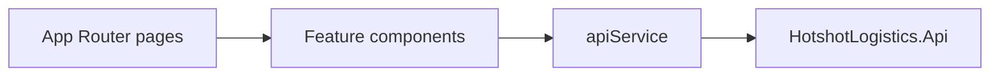

# Admin dashboard architecture

## Overview

The admin dashboard is a Next.js App Router UI for dispatchers: jobs, drivers, tracking, billing, and login. It is a presentation client of the API. It does not own SQL access or domain invariants.

## Architecture

TanStack Query caches server state. MSAL handles Azure AD sign-in. SignalR connects to the API `/realtime` hub for live updates.

### Dashboard overview

Between the existing metrics and Recent Jobs, the overview displays Pending,
Assigned, EnRoute and Received counts from the
[job status counts endpoint](../api/architecture.md#job-status-counts).
`useJobStatusCounts` validates all four values as non-negative integers with
zod; it does not fabricate fallback counts. Loading shows an ellipsis and marks
the section busy; a request or validation error shows dashes and an unavailable
alert. This state is independent of the existing overview loading skeleton.

`JobStatusCards` and `JobStatusCard` are presentational; `jobStatusCardConfig`
defines the ordered labels, icons and badge colors. The grid stacks on small
screens, uses two columns at `sm`, and five tracks at `lg` for four cards.
The badges use Hourglass `#3B82F6`, ClipboardList `#0EA5E9`, Truck `#0284C7`,
and Inbox `#0369A1`, respectively; icons are decorative.
The hook exports `jobStatusCountsQueryKey` as a future SignalR invalidation
seam; no status-count broadcast or invalidation handler is added by this feature.
The existing frontend job status enum remains out of sync with the backend;
see the [dashboard status todo](../todo/admin-dashboard-job-status-unresolved.md).

## Components and interfaces

| Area | Path |
| --- | --- |
| Shell | `src/app/layout.tsx` |
| Jobs | `src/app/jobs/page.tsx`, `JobsManagement` |
| Drivers | `src/app/drivers/page.tsx` |
| Tracking | `src/app/tracking/page.tsx` |
| Billing | `src/app/billing/page.tsx` |
| Login | `src/app/(auth)/login/page.tsx` |
| Auth | `src/components/auth/` |
| HTTP | `src/services/api.ts` |
| Request interception | `proxy.ts` (dashboard root) — production HTTPS redirect and security headers |

## Data models

Shared TypeScript types live in `src/types`. They mirror API DTOs; the API remains the source of truth.

## Error handling

Query and mutation errors surface in the feature components. Auth failures redirect through the MSAL / protected-route wrappers.

## Testing strategy

Playwright specs under `tests/` cover auth, dashboard overview, jobs, drivers, tracking, and billing. Run `npm test` from the dashboard source root.
