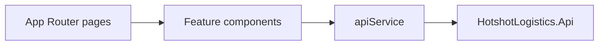

# Admin dashboard architecture

## Overview

The admin dashboard is a Next.js App Router UI for dispatchers: jobs, drivers, tracking, billing, and login. It is a presentation client of the API. It does not own SQL access or domain invariants.

## Architecture

TanStack Query caches server state. MSAL handles Azure AD sign-in. SignalR connects to the API `/realtime` hub for live updates.

## Components and interfaces

| Area | Path |
| --- | --- |
| Shell | `src/app/layout.tsx` |
| Jobs | `src/app/jobs/page.tsx`, `JobsManagement` |
| Drivers | `src/app/drivers/page.tsx` |
| Overview | `src/components/dashboard/` (`DashboardOverview`, `StatCard`, `RecentJobs`) |
| Tracking | `src/app/tracking/page.tsx`, `TrackingDashboard` |
| Billing | `src/app/billing/page.tsx` |
| Login | `src/app/(auth)/login/page.tsx` |
| Auth | `src/components/auth/` |
| HTTP | `src/services/api.ts` |
| Request interception | `proxy.ts` (dashboard root) — production HTTPS redirect and security headers |

## Data models

Shared TypeScript types live in `src/types`. They mirror API DTOs; the API remains the source of truth.

## Error handling

`apiService` validates the shape of the jobs, drivers and overdue-invoices responses; a response that fails is an error. Each view shows distinct loading, error, empty and data states, and each overview statistic and the Recent Jobs list wait only for their own request. Query and mutation errors surface in the feature components. Auth failures redirect through the MSAL / protected-route wrappers.

## Testing strategy

Playwright specs under `tests/` cover auth, dashboard overview, jobs, drivers, tracking, and billing. Run `npm test` from the dashboard source root. Tests mock the API per test; live updates are tested by mocking the SignalR negotiate request and WebSocket (`tests/utils/signalr-mock.ts`), so the app runs its real client. One test, live overview statistics, stays `fixme` until the SignalR contract is decided (see [Resolve unresolved DashboardOverview issues](../todo/admin-dashboard-job-status-unresolved.md)).
