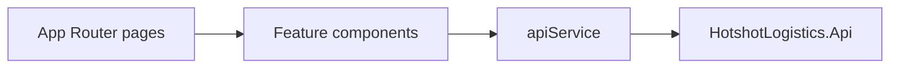

# Admin dashboard architecture

## Overview

The admin dashboard is a Next.js App Router UI for dispatchers: jobs, drivers, tracking, billing, and login. It is a presentation client of the API. It does not own SQL access or domain invariants.

## Architecture

TanStack Query caches server state. MSAL handles Azure AD sign-in. SignalR connects to the API `/realtime` hub for live updates: `useRealtimeSubscription` (`src/lib`) opens the connection while a view is mounted and registers its handlers, and the event names live in `src/services/signalr-events.ts`. The hub refuses anonymous clients, so the client sends the same token as the API calls (`accessTokenFactory`). The server sends `JobStatusUpdated` to the `admins` group, which the hub adds managers and admins to when they connect; the overview refetches its job queries on it, and says so when the connection cannot be opened.

## Components and interfaces

| Area | Path |
| --- | --- |
| Shell | `src/app/layout.tsx` |
| Jobs | `src/app/jobs/page.tsx`, `JobsManagement` |
| Drivers | `src/app/drivers/page.tsx` |
| Overview | `src/components/dashboard/` (`DashboardOverview`, `StatCard`, `RecentJobs`) |
| Tracking | `src/app/tracking/page.tsx`, `TrackingDashboard` |
| Billing | `src/app/billing/page.tsx` |
| Login | `src/app/(auth)/login/page.tsx` |
| Auth | `src/components/auth/` |
| HTTP | `src/services/api.ts` |
| Live updates | `src/services/signalr.ts`, `src/services/signalr-events.ts`, `src/lib/useRealtimeSubscription.ts` |
| Request interception | `proxy.ts` (dashboard root) — production HTTPS redirect and security headers |

## Data models

Shared TypeScript types live in `src/types`. They mirror API DTOs; the API remains the source of truth. `JobStatus` is the server's `Pending`, `Assigned`, `EnRoute` and `Received`; the API sends it as a number and `apiService` converts it. The other enums are not converted yet ([wire types todo](../todo/admin-dashboard-api-wire-types.md)).

## Error handling

`apiService` validates the shape of the jobs, drivers and overdue-invoices responses (a job with a status the server does not define fails it); a response that fails is an error. Each view shows distinct loading, error, empty and data states, and each overview statistic and the Recent Jobs list wait only for their own request (Active Jobs is a server-side count, `GET /api/job?isActive=true&pageSize=1`, separate from the first page of jobs). Query and mutation errors surface in the feature components. Auth failures redirect through the MSAL / protected-route wrappers.

## Testing strategy

Playwright specs under `tests/` cover auth, dashboard overview, jobs, drivers, tracking, and billing. Run `npm test` from the dashboard source root. Tests mock the API per test; live updates are tested by mocking the SignalR negotiate request and WebSocket (`tests/utils/signalr-mock.ts`), so the app runs its real client. A test pushes `JobStatusUpdated` and checks the overview refetches, and another checks the connection carries the token. Delivery from the server is covered by the API tests. The tracking view's `LocationUpdate` and `Notification` events do not yet match the hub ([tracking live events](../todo/tracking-live-events-contract.md)).
