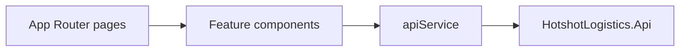

# Admin dashboard architecture

## Overview

The admin dashboard is a Next.js App Router UI for dispatchers: jobs, drivers, tracking, billing, and login. It is a presentation client of the API. It does not own SQL access or domain invariants.

## Architecture



TanStack Query caches server state. MSAL handles Azure AD sign-in. SignalR connects to the API `/realtime` hub for live updates.

## Components and interfaces

| Area | Path |
| --- | --- |
| Shell | `src/app/layout.tsx` |
| Jobs | `src/app/jobs/page.tsx`, `JobsManagement` |
| Drivers | `src/app/drivers/page.tsx` |
| Tracking | `src/app/tracking/page.tsx` |
| Billing | `src/app/billing/page.tsx` |
| Login | `src/app/(auth)/login/page.tsx` |
| Auth | `src/components/auth/` |
| HTTP | `src/services/api.ts` |
| Request interception | `proxy.ts` (dashboard root) — production HTTPS redirect and security headers |

### Job status cards

`DashboardOverview` requests the unfiltered job status summary over REST and places
Pending, Assigned, EnRoute and Received cards between the main metrics and Recent
Jobs. These are aggregate counts, unlike the existing first-page-based metrics.
`useJobStatusSummary` owns the query and exports `JOB_STATUS_SUMMARY_QUERY_KEY`
(`['job-status-summary']`); a future SignalR handler can invalidate it, but no
summary push is implemented. `jobStatusCardDefinitions` maps the response to items,
and `JobStatusCards` renders only its supplied props.

The responsive grid uses one column, two at `sm`, and five tracks at `lg` (the
fifth is empty). The badge theme tokens in `globals.css` are `--color-job-pending`
(`#3B82F6`), `--color-job-assigned` (`#0EA5E9`), `--color-job-enroute`
(`#0284C7`), and `--color-job-received` (`#0369A1`).

## Data models

Shared TypeScript types live in `src/types`. They mirror API DTOs; the API remains the source of truth.

## Error handling

Query and mutation errors surface in the feature components. Auth failures redirect through the MSAL / protected-route wrappers.

The status summary joins the overview loading gate. Its client validates all four
fields as non-negative integers; a request failure or invalid body shows
`Job status counts are unavailable.` as an alert instead of cards or fabricated zeros.

## Testing strategy

Playwright specs under `tests/` cover auth, dashboard overview, jobs, drivers, tracking, and billing. Run `npm test` from the dashboard source root.

The job status spec mocks API responses by default. Its `@live` test is an opt-in
exception to the [test standard](../standards/test/README.md)'s mocked-API rule: it
compares displayed counts with the local API, using only the development test database.
Start `7-Deployment/dev-env/dev-env-up.sh` from the repository root, then start the
API in Development on `https://localhost:5001` using the existing test-database user
secret. With port 3000 available, run from the dashboard source root:

```bash
LIVE_API=1 PLAYWRIGHT_PORT=3000 npx playwright test tests/job-status-cards.spec.ts --project=chromium --grep @live
```

Stop the API afterwards. Do not use production data or commit credentials.
