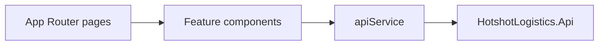

# Admin dashboard architecture

## Overview

The admin dashboard is a Next.js App Router UI for dispatchers: jobs, drivers, tracking, billing, and login. It is a presentation client of the API. It does not own SQL access or domain invariants.

## Architecture

TanStack Query caches server state. MSAL handles Azure AD sign-in. SignalR connects to the API `/realtime` hub for live updates.

## Components and interfaces

| Area | Path |
| --- | --- |
| Shell | `src/app/layout.tsx` |
| Overview | `DashboardOverview` → `JobStatusSummarySection` → `JobStatusCards` |
| Jobs | `src/app/jobs/page.tsx`, `JobsManagement` |
| Drivers | `src/app/drivers/page.tsx` |
| Tracking | `src/app/tracking/page.tsx` |
| Billing | `src/app/billing/page.tsx` |
| Login | `src/app/(auth)/login/page.tsx` |
| Auth | `src/components/auth/` |
| HTTP | `src/services/api.ts` |
| Request interception | `proxy.ts` (dashboard root) — production HTTPS redirect and security headers |

The overview places four status cards after its metric cubes and before Recent Jobs.
The container uses `useJobStatusSummary` in `src/hooks/useJobStatusSummary.ts`;
`buildJobStatusCardItems` maps the response to presentational `JobStatusCardItem`
values (`key`, `label`, `count`, `color`, `icon`). In order, Pending, Assigned,
EnRoute and Received use Hourglass, ClipboardList, Truck and Inbox icons. The
responsive grid has one, two, then five columns; the four cards share the metric
cards' shell and inherit Inter. Badge theme tokens in `globals.css` are
`--color-job-status-pending` (#3B82F6), `--color-job-status-assigned` (#0EA5E9),
`--color-job-status-enroute` (#0284C7) and `--color-job-status-received` (#0369A1).

The query key is `['jobs', 'status-summary']`; invalidating the `['jobs']`
prefix also invalidates it. A future SignalR handler can invalidate the exported
`jobStatusSummaryQueryKey` or set the matching summary data; no status-summary
push is implemented.

## Data models

Shared TypeScript types live in `src/types`. They mirror API DTOs; the API remains the source of truth.
`JobStatusSummary` mirrors `JobStatusSummaryDto`: `pending`, `assigned`,
`enRoute`, and `received` are counts.

## Error handling

Query and mutation errors surface in the feature components. Auth failures redirect through the MSAL / protected-route wrappers.
The status section loads independently with four busy placeholders. HTTP errors or
payloads missing any non-negative integer count show an alert instead of invented
zeroes; valid zero counts are displayed. The overview no longer substitutes
test-mode data for failed queries.

## Testing strategy

Playwright specs under `tests/` cover auth, dashboard overview, jobs, drivers, tracking, and billing. Run `npm test` from the dashboard source root.
`tests/job-status-cards.spec.ts` mocks the API contract and covers counts, states,
visual consistency and responsive layout; it does not prove a live database flow.
