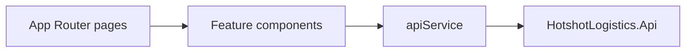

# Admin dashboard architecture

## Overview

The admin dashboard is a Next.js App Router UI for dispatchers: jobs, drivers, tracking, billing, and login. It is a presentation client of the API. It does not own SQL access or domain invariants.

## Architecture

TanStack Query caches server state. MSAL handles Azure AD sign-in. SignalR connects to the API `/realtime` hub for live updates.

## Components and interfaces

| Area | Path |
| --- | --- |
| Shell | `src/app/layout.tsx` |
| Dashboard status summary | `src/components/dashboard/DashboardOverview.tsx`, `useJobStatusSummary.ts`, `JobStatusCards.tsx` |
| Jobs | `src/app/jobs/page.tsx`, `JobsManagement` |
| Drivers | `src/app/drivers/page.tsx` |
| Tracking | `src/app/tracking/page.tsx` |
| Billing | `src/app/billing/page.tsx` |
| Login | `src/app/(auth)/login/page.tsx` |
| Auth | `src/components/auth/` |
| HTTP | `src/services/api.ts` |
| Request interception | `proxy.ts` (dashboard root) — production HTTPS redirect and security headers |

`DashboardOverview` places the status cards between the metric cubes and Recent Jobs.
`useJobStatusSummary` calls `apiService.getJobStatusSummary()` with query key
`['job-status-summary']` and maps the response to a fixed presentation order.
`JobStatusCards` only renders its supplied view models; it does not fetch data. This
separation leaves the summary query as the integration point for a future SignalR
update; no status-summary push is implemented. The existing SignalR event mismatch and
other dashboard status drift remain tracked in
[admin-dashboard-job-status-unresolved](../todo/admin-dashboard-job-status-unresolved.md).

| API status | Label | Badge colour | Icon |
| --- | --- | --- | --- |
| `Pending` | Pending | `#3B82F6` | `Hourglass` |
| `Assigned` | Assigned | `#0EA5E9` | `ClipboardList` |
| `EnRoute` | En Route | `#0284C7` | `Truck` |
| `Received` | Received | `#0369A1` | `Inbox` |

The grid has one column by default, two at `sm`, and four at `lg`. Cards inherit
the dashboard's Inter font and use white surfaces, rounded corners and shadows.

## Data models

Shared TypeScript types live in `src/types`. They mirror API DTOs; the API remains the source of truth.
`JobStatusCount` is `{ status: string; count: number }`, matching the API summary
DTO. The dashboard-local `JobStatusCard` view model has `label`, `count`, `color`
and `icon` fields. The hook omits a status missing from the response rather than
inventing a count; the API contract supplies all four known statuses.

## Error handling

Query and mutation errors surface in the feature components. Auth failures redirect through the MSAL / protected-route wrappers.
While the summary loads, the cards container is marked busy and shows no numbers.
On error it shows “Unable to load job status counts” without fallback counts. Zero
counts on successful responses come from the server.

## Testing strategy

Playwright specs under `tests/` cover auth, dashboard overview, jobs, drivers, tracking, and billing. Run `npm test` from the dashboard source root.
The dashboard overview spec mocks the summary endpoint to check counts, placement,
styling, responsive layout and errors independently of the live API.
