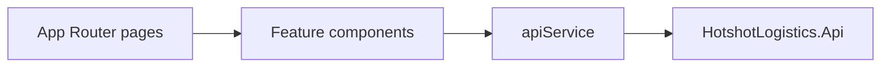

# Admin dashboard architecture

## Overview

The admin dashboard is a Next.js App Router UI for dispatchers: jobs, drivers, tracking, billing, and login. It is a presentation client of the API. It does not own SQL access or domain invariants.

## Architecture

TanStack Query caches server state. MSAL handles Azure AD sign-in. SignalR connects to the API `/realtime` hub for live updates.

## Components and interfaces

| Area | Path |
| --- | --- |
| Shell | `src/app/layout.tsx` |
| Jobs | `src/app/jobs/page.tsx`, `JobsManagement` |
| Drivers | `src/app/drivers/page.tsx` |
| Tracking | `src/app/tracking/page.tsx` |
| Billing | `src/app/billing/page.tsx` |
| Login | `src/app/(auth)/login/page.tsx` |
| Auth | `src/components/auth/` |
| HTTP | `src/services/api.ts` |
| Request interception | `proxy.ts` (dashboard root) — production HTTPS redirect and security headers |

The overview places `JobStatusCards` between its metric cards and Recent Jobs.
`useJobStatusSummary` fetches the summary through `apiService`; `JobStatusCard`
renders each label, count and decorative white icon in a rounded badge. The grid
uses one column by default, two at `sm`, and four at `lg`, with `gap-4`.

| Status | Icon | `globals.css` theme token | Colour |
| --- | --- | --- | --- |
| Pending | Hourglass | `--color-job-status-pending` | `#3b82f6` |
| Assigned | ClipboardList | `--color-job-status-assigned` | `#0ea5e9` |
| EnRoute | Truck | `--color-job-status-enroute` | `#0284c7` |
| Received | Inbox | `--color-job-status-received` | `#0369a1` |

## Data models

Shared TypeScript types live in `src/types`. They mirror API DTOs; the API remains the source of truth.
`JobStatusSummary` mirrors the four integer fields of the API's
`JobStatusSummaryDto`. Its TanStack Query key is `['jobs', 'status-summary']`;
it can be invalidated by a future SignalR handler, but the cards do not currently
subscribe to live status updates.

## Error handling

Query and mutation errors surface in the feature components. Auth failures redirect through the MSAL / protected-route wrappers.
The status cards show loading skeletons while loading and an inline `role="alert"`
on failure; they do not substitute fallback counts.

## Testing strategy

Playwright specs under `tests/` cover auth, dashboard overview, jobs, drivers, tracking, and billing. Run `npm test` from the dashboard source root.
