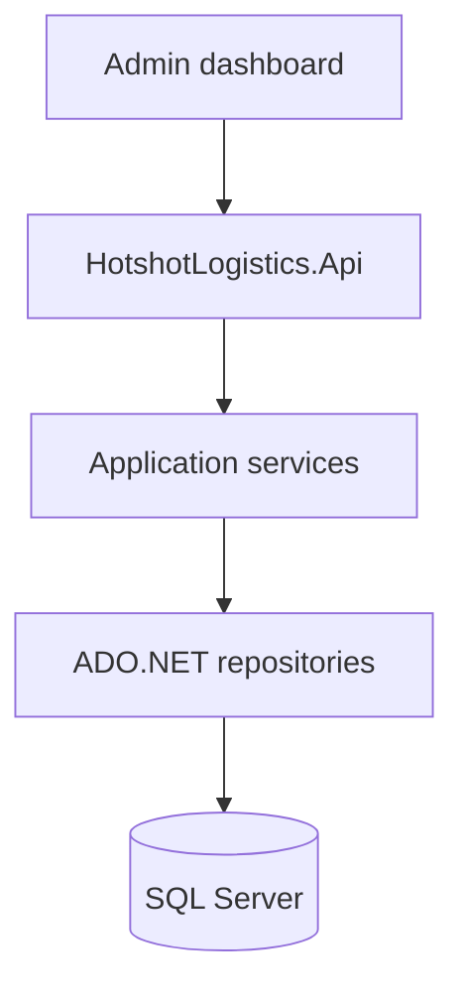

# API architecture

## Overview

`HotshotLogistics.Api` is an ASP.NET Core Web API. Its hosting model is unresolved — see the canonical drift register (DR2) in [deployment architecture](../devops/deployment-architecture.md); the actual deployment path is an Azure App Service plan / Function App provisioned by Terraform, deployed by [`.github/workflows/release.yml`](../../.github/workflows/release.yml) (`deploy-api` job). It is the HTTP and SignalR edge for jobs, drivers, customers, billing, tracking, and assignments. It depends on Application, Domain, and Persistence; it does not own business invariants.

## Architecture

`Program` wires user secrets, optional Azure App Configuration, repository and application DI, authentication, CORS, controllers, and `RealtimeHub` at `/realtime`.

## Components and interfaces

| Surface | Role |
| --- | --- |
| `JobController` and sibling controllers under `Controllers/` | HTTP API, route prefix `api/[controller]` |
| `TestAuthHandler` | Development and test authentication |
| JWT Bearer + Microsoft Identity Web | Non-development Azure AD B2C |
| `ExceptionHandlingMiddleware` | Structured error responses (ProblemDetails-style payloads) |
| Application `RealtimeHub` | Real-time updates mapped from the API host |

Authorization policies include `Admin`, `Manager`, `Driver`, `Customer`, and combined roles.

### Job status summary

`GET /api/job/status-summary` requires the `ManagerOrAdmin` policy. Its optional
`customerId` query parameter restricts the count to that customer; whitespace is
trimmed, and an absent or blank value counts all jobs. The dashboard requests the
unfiltered summary. `JobController` calls `JobService.GetJobStatusSummaryAsync`,
which passes the filter to `JobRepository.GetJobStatusSummaryAsync`. The repository
uses a parameterized SQL `GROUP BY Status`, not a page of jobs.

## Data models

Request and response DTOs live in Domain. Persistence uses native ADO.NET. See the
[data access layer coding standard](../standards/data-access-layer/README.md).

The Domain `JobStatusSummaryDto` serializes as
`{"pending":0,"assigned":0,"enRoute":0,"received":0}`: all four fields are
non-negative integer counts, with zero for a status without matches. Stored values
outside the four `JobStatus` members are excluded from these counts.

## Error handling

Controllers and `ExceptionHandlingMiddleware` map validation and domain exceptions to HTTP status codes. Do not return secrets or stack traces to clients in production.

## Testing strategy

API tests live under `5-Test/` (`HotshotLogistics.Api.Tests`, integration tests). The `Program` type is public (`Program.Api.cs`) so the test host can use the real composition root.
