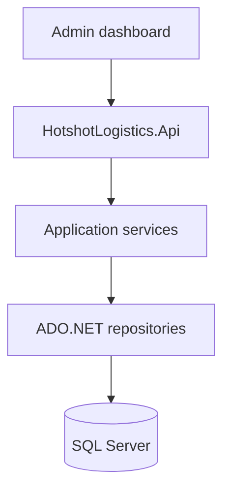

# API architecture

## Overview

`HotshotLogistics.Api` is an ASP.NET Core Web API. Its hosting model is unresolved — see the canonical drift register (DR2) in [deployment architecture](../devops/deployment-architecture.md); the actual deployment path is an Azure App Service plan / Function App provisioned by Terraform, deployed by [`.github/workflows/release.yml`](../../.github/workflows/release.yml) (`deploy-api` job). It is the HTTP and SignalR edge for jobs, drivers, customers, billing, tracking, and assignments. It depends on Application, Domain, and Persistence; it does not own business invariants.

## Architecture

`Program` wires user secrets, optional Azure App Configuration, repository and application DI, authentication, CORS, controllers, and `RealtimeHub` at `/realtime`.

## Components and interfaces

| Surface | Role |
| --- | --- |
| `JobController` and sibling controllers under `Controllers/` | HTTP API, route prefix `api/[controller]` |
| `TestAuthHandler` | Development and test authentication |
| JWT Bearer + Microsoft Identity Web | Non-development Azure AD B2C |
| `ExceptionHandlingMiddleware` | Structured error responses (ProblemDetails-style payloads) |
| Application `RealtimeHub` | Real-time updates mapped from the API host |

Authorization policies include `Admin`, `Manager`, `Driver`, `Customer`, and combined roles.

`GET /api/job/status-summary` requires the `ManagerOrAdmin` policy. An optional
`customerId` restricts the counts; when supplied it must be a single non-blank
value of at most 50 characters without control characters, otherwise the API
returns a validation error. A successful response is
`{"pending":0,"assigned":0,"enRoute":0,"received":0}` with integer counts.
Each count covers all matching jobs in that status, without a date window; absent
statuses are zero and unrecognized stored status values are ignored.

`JobController.GetJobStatusSummary` delegates to `IJobService`, then
`IJobRepository`, which groups `Jobs` by status in SQL using the parameterized
customer filter. The query follows the existing repository's `SqlConnection`
pattern and propagates cancellation. Unexpected failures propagate to host error handling.

## Data models

Existing request and response DTOs live in Domain. The shared sealed response
record `HotshotLogistics.Contracts.Models.JobStatusSummaryDto` lives in Contracts
and carries `Pending`, `Assigned`, `EnRoute`, and `Received`. Persistence uses native ADO.NET. See the
[data access layer coding standard](../standards/data-access-layer/README.md).

## Error handling

Controllers and `ExceptionHandlingMiddleware` map validation and domain exceptions to HTTP status codes. Do not return secrets or stack traces to clients in production.

## Testing strategy

API tests live under `5-Test/` (`HotshotLogistics.Api.Tests`, integration tests). The `Program` type is public (`Program.Api.cs`) so the test host can use the real composition root.
