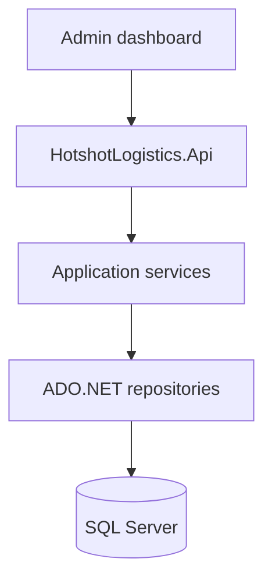

# API architecture

## Overview

`HotshotLogistics.Api` is an ASP.NET Core Web API. Its hosting model is unresolved — see the canonical drift register (DR2) in [deployment architecture](../devops/deployment-architecture.md); the actual deployment path is an Azure App Service plan / Function App provisioned by Terraform, deployed by [`.github/workflows/release.yml`](../../.github/workflows/release.yml) (`deploy-api` job). It is the HTTP and SignalR edge for jobs, drivers, customers, billing, tracking, and assignments. It depends on Application, Domain, and Persistence; it does not own business invariants.

## Architecture

`Program` wires user secrets, optional Azure App Configuration, repository and application DI, authentication, CORS, controllers, and `RealtimeHub` at `/realtime`.

## Components and interfaces

| Surface | Role |
| --- | --- |
| `JobController` and sibling controllers under `Controllers/` | HTTP API, route prefix `api/[controller]` |
| `TestAuthHandler` | Development and test authentication |
| JWT Bearer + Microsoft Identity Web | Non-development Azure AD B2C |
| `DomainExceptionHandler`, `CorrelationIdMiddleware`, `ApiControllerBase` | One RFC 9457 `ProblemDetails` error contract with trace and correlation ids |
| `HealthCheckExtensions`, `DatabaseHealthCheck` | `/health`, `/health/live`, `/health/ready` probes; the database is the only readiness dependency |
| Application `RealtimeHub` | Real-time updates mapped from the API host |

Authorization policies include `Admin`, `Manager`, `Driver`, `Customer`, and combined roles.

## Data models

Request and response DTOs live in Domain. Persistence uses native ADO.NET. See the
[data access layer coding standard](../standards/data-access-layer/data-access-layer.standards.md).

## Error handling

Every error answers `application/problem+json` with `traceId` and `correlationId`
(`X-Correlation-ID` is accepted or created and echoed). `DomainExceptionHandler` maps `ValidationException` to 400
(`ValidationProblemDetails`), `BusinessRuleException` to 422, `PaymentProcessingException` to 402 and
`ExternalServiceException` to 502; any other exception is a 500 with no message or stack trace.
`UseStatusCodePages` fills the body of bodiless 401/403/404/405 responses. Controllers keep per-action catches of
named exceptions and return `ApiControllerBase` helpers; they do not catch `Exception`.

## Health

`/health/live` runs no checks and answers 200 while the process serves requests. `/health/ready` runs the checks tagged
`ready` (the database: connect plus `SELECT 1` within `Health:Database:TimeoutSeconds`, default 3) and answers 503
when one fails. `/health` runs every check. All three are anonymous and write only check names and statuses.

## Testing strategy

API tests live under `5-Test/` (`HotshotLogistics.Api.Tests`, integration tests). The `Program` type is public (`Program.Api.cs`) so the test host can use the real composition root.
