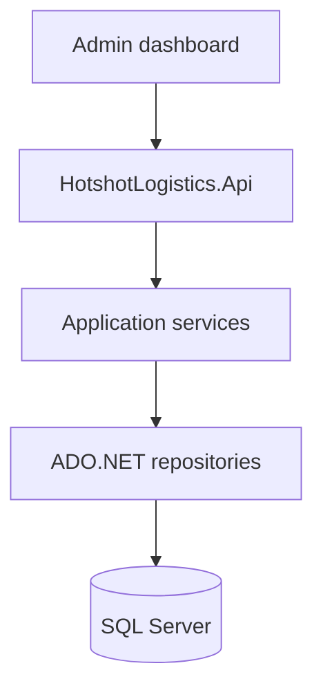

# API architecture

## Overview

`HotshotLogistics.Api` is an ASP.NET Core Web API. Its hosting model is unresolved — see the canonical drift register (DR2) in [deployment architecture](../devops/deployment-architecture.md); the actual deployment path is an Azure App Service plan / Function App provisioned by Terraform, deployed by [`.github/workflows/release.yml`](../../.github/workflows/release.yml) (`deploy-api` job). It is the HTTP and SignalR edge for jobs, drivers, customers, billing, tracking, and assignments. It depends on Application, Domain, and Persistence; it does not own business invariants.

## Architecture

`Program` wires user secrets, optional Azure App Configuration, repository and application DI, authentication, CORS, controllers, and `RealtimeHub` at `/realtime`.

## Components and interfaces

| Surface | Role |
| --- | --- |
| `JobController` and sibling controllers under `Controllers/` | HTTP API, route prefix `api/[controller]` |
| `TestAuthHandler` | Development and test authentication |
| JWT Bearer + Microsoft Identity Web | Non-development Azure AD B2C |
| `DomainExceptionHandler`, `CorrelationIdMiddleware`, `ApiControllerBase` | One RFC 9457 `ProblemDetails` error contract with trace and correlation ids |
| `HealthCheckExtensions`, `DatabaseHealthCheck` | `/health`, `/health/live`, `/health/ready` probes; the database is the only readiness dependency |
| `RateLimitingExtensions` | Global and `public` per-address limits; 429 `ProblemDetails` with `Retry-After`; health exempt |
| `TelemetryExtensions` | OpenTelemetry traces and metrics; Application Insights export only when a connection string is set |
| Application `RealtimeHub` | Real-time updates mapped from the API host; see [Realtime hub](#realtime-hub) |

Authorization policies include `Admin`, `Manager`, `Driver`, `Customer`, and combined roles.

## Data models

Controller request and response types are `sealed record` types with `init` properties under `Models/` (namespace
`HotshotLogistics.Api.Models`); shared DTOs live in Domain. Persistence uses native ADO.NET. See the
[data access layer coding standard](../standards/data-access-layer/README.md).

## Error handling

Every error answers `application/problem+json` with `traceId` and `correlationId`
(`X-Correlation-ID` is accepted or created and echoed). `DomainExceptionHandler` maps `ValidationException` to 400
(`ValidationProblemDetails`), `BusinessRuleException` to 422, `PaymentProcessingException` to 402 and
`ExternalServiceException` to 502; any other exception is a 500 with no message or stack trace.
`UseStatusCodePages` fills the body of bodiless 401/403/404/405 responses. Controllers keep per-action catches of
named exceptions and return `ApiControllerBase` helpers; they do not catch `Exception`.

## Authorization

Every controller is `[Authorize]`; actions add a policy. `TrackingController`: `start`, `stop/{jobId}`, `location` and
`check-deviation` need `ManagerOrDriver`; `location/{jobId}` and `history/{jobId}` need `ManagerOrAdmin`. The only
anonymous actions are `GET api/Tracking/public/{jobId}` (returns `PublicTrackingInfo`: job id, position, last update,
status, estimated arrival, no driver data) and the two payment webhooks. A webhook is accepted only if the provider's
signature verifies, before any processing: Stripe's `Stripe-Signature` (HMAC-SHA256 over `timestamp.payload` with
`Stripe:WebhookSecret`) and PayPal's `PAYPAL-TRANSMISSION-SIG` family of headers (RSA-SHA256 with PayPal's certificate,
webhook id `PayPal:WebhookId`), each with a five-minute timestamp tolerance. A failed check answers 401 and nothing is
processed. The secrets come from configuration only.

## Health

`/health/live` runs no checks and answers 200 while the process serves requests. `/health/ready` runs the checks tagged
`ready` (the database: connect through `ISqlConnectionFactory` plus `SELECT 1` within `Health:Database:TimeoutSeconds`, default 3) and answers 503
when one fails. `/health` runs every check. All three are anonymous and write only check names and statuses.

## Rate limiting

`UseRateLimiter()` runs after CORS and before authentication. The global limit is a fixed window per client address;
`/health*` is exempt. The `public` policy is stricter and is applied to public tracking and the payment webhooks only. Limits bind from the `RateLimiting` section and are validated at startup; a rejection is a 429
`ProblemDetails` with `Retry-After`.

## Resilience

Outbound HTTP is registered on `IHttpClientFactory` with `AddOutboundResilience()` (`HotshotLogistics.Data.Http`): the
standard pipeline from `Microsoft.Extensions.Http.Resilience` (total timeout, bounded exponential retry on transient
failures, per-attempt timeout, circuit breaker), configured under `Resilience:Outbound`. Payment retries in
`BillingService` handle only transport failures and the processor's transient error codes (`Payments:Retry`); a decline
is never retried and the payment id travels as the idempotency key.

## Telemetry

OpenTelemetry traces and metrics cover ASP.NET Core, outbound `HttpClient` and the .NET runtime. The Application
Insights exporter is registered only when `Telemetry:ApplicationInsights:ConnectionString` or
`APPLICATIONINSIGHTS_CONNECTION_STRING` is set; otherwise nothing is exported. The correlation id is tagged on the
request activity.

## Testing strategy

API tests live under `5-Test/` (`HotshotLogistics.Api.Tests`, integration tests). The `Program` type is public (`Program.Api.cs`) so the test host can use the real composition root.

## Realtime hub

`RealtimeHub` at `/realtime` is `[Authorize]`: an anonymous negotiate or WebSocket request answers 401. A browser
WebSocket cannot set the `Authorization` header, so on this path the JWT bearer handler (and, in Development, the
`Test` scheme with the token `test-token`) also reads the token from the `access_token` query value.

On connect the hub adds a caller that satisfies `ManagerOrAdmin` to the `admins` group (`RealtimeGroups.Admins`); other
authenticated callers stay connected without it. A reconnect is a new connection and is added again.

`JobService` calls `IRealtimeService.BroadcastJobStatusUpdate` once for each of: job created (`Pending`), update that
changes the status, driver assigned (`Assigned`), and every status update (start, deliver, receive). `RealtimeService`
sends `JobStatusUpdated(jobId, status)` to `admins` and to `job-{jobId}`. The change is already saved when it is sent, so
a send failure is logged as a warning and does not fail the request. `ISignalRClientWrapper` finds the typed client method
by name through reflection, so `RealtimeBroadcastWireTests` runs the real hub context to prove the name and arguments
reach the group.
