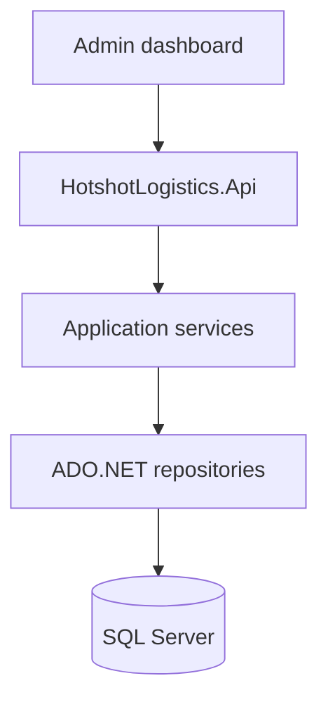

# API architecture

## Overview

`HotshotLogistics.Api` is an ASP.NET Core Web API. Its hosting model is unresolved — see the canonical drift register (DR2) in [deployment architecture](../devops/deployment-architecture.md); the actual deployment path is an Azure App Service plan / Function App provisioned by Terraform, deployed by [`.github/workflows/release.yml`](../../.github/workflows/release.yml) (`deploy-api` job). It is the HTTP and SignalR edge for jobs, drivers, customers, billing, tracking, and assignments. It depends on Application, Domain, and Persistence; it does not own business invariants.

## Architecture

`Program` wires user secrets, optional Azure App Configuration, repository and application DI, authentication, CORS, controllers, and `RealtimeHub` at `/realtime`.

## Components and interfaces

| Surface | Role |
| --- | --- |
| `JobController` and sibling controllers under `Controllers/` | HTTP API, route prefix `api/[controller]` |
| `TestAuthHandler` | Development and test authentication |
| JWT Bearer + Microsoft Identity Web | Non-development Azure AD B2C |
| `ExceptionHandlingMiddleware` | Structured error responses (ProblemDetails-style payloads) |
| Application `RealtimeHub` | Real-time updates mapped from the API host |

Authorization policies include `Admin`, `Manager`, `Driver`, `Customer`, and combined roles.

`GET /api/job/status-summary` requires `ManagerOrAdmin`. Its optional `customerId`
is trimmed; absent or whitespace values select all customers. The controller calls
`IJobService.GetJobStatusSummaryAsync`, which calls
`IJobRepository.GetJobStatusCountsAsync`. The repository performs a parameterized
`GROUP BY Status` query and skips undefined enum values. Missing statuses become
zero. The integer database statuses are Pending=0, Assigned=1, EnRoute=2 and
Received=3. Exceptions propagate to middleware. The current repository opens its
own SQL connection; the planned factory is tracked in
[Introduce a SQL connection factory](../todo/sql-connection-factory.md).

The endpoint returns `{"pending":0,"assigned":0,"enRoute":0,"received":0}`
with counts in place of the example zeroes. It is REST only; a future SignalR
message could use the same shape and invalidate the dashboard summary query.

## Data models

Existing request and response DTOs live in Domain; the shared
`JobStatusSummaryDto` lives in `HotshotLogistics.Contracts.Models` in the
Contracts project. Persistence uses native ADO.NET. See the
[data access layer coding standard](../standards/data-access-layer/README.md).

## Error handling

Controllers and `ExceptionHandlingMiddleware` map validation and domain exceptions to HTTP status codes. Do not return secrets or stack traces to clients in production.

## Testing strategy

API tests live under `5-Test/` (`HotshotLogistics.Api.Tests`, integration tests). The `Program` type is public (`Program.Api.cs`) so the test host can use the real composition root.
Status-summary repository and HTTP tests isolate their rows by unique customer ID
and clean them up; unfiltered assertions use lower bounds rather than absolute
shared-database totals. These tests cover database-to-JSON, while mocked
dashboard tests cover the JSON-to-display contract.
