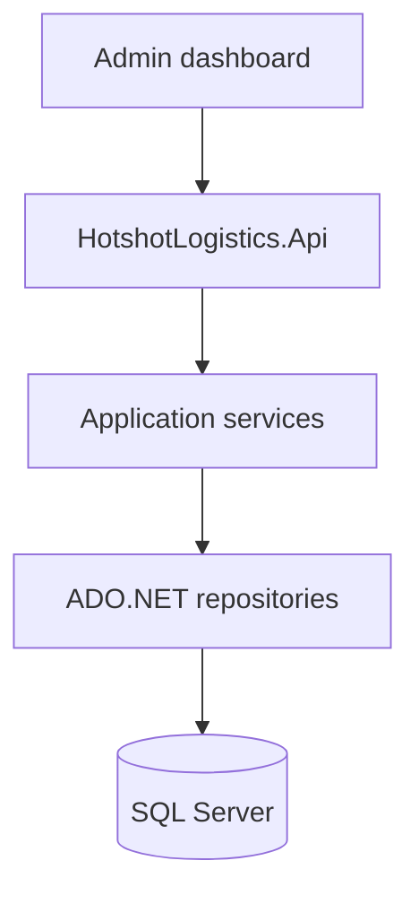

# API architecture

## Overview

`HotshotLogistics.Api` is an ASP.NET Core Web API. Its hosting model is unresolved — see the canonical drift register (DR2) in [deployment architecture](../devops/deployment-architecture.md); the actual deployment path is an Azure App Service plan / Function App provisioned by Terraform, deployed by [`.github/workflows/release.yml`](../../.github/workflows/release.yml) (`deploy-api` job). It is the HTTP and SignalR edge for jobs, drivers, customers, billing, tracking, and assignments. It depends on Application, Domain, and Persistence; it does not own business invariants.

## Architecture



`Program` wires user secrets, optional Azure App Configuration, repository and application DI, authentication, CORS, controllers, and `RealtimeHub` at `/realtime`.

## Components and interfaces

| Surface | Role |
| --- | --- |
| `JobController` and sibling controllers under `Controllers/` | HTTP API, route prefix `api/[controller]` |
| `TestAuthHandler` | Development and test authentication |
| JWT Bearer + Microsoft Identity Web | Non-development Azure AD B2C |
| `ExceptionHandlingMiddleware` | Structured error responses (ProblemDetails-style payloads) |
| Application `RealtimeHub` | Real-time updates mapped from the API host |

Authorization policies include `Admin`, `Manager`, `Driver`, `Customer`, and combined roles.

### Job status summary

`GET /api/job/status-summary` requires the `ManagerOrAdmin` policy. The controller
calls `IJobService.GetJobStatusSummaryAsync`, which calls
`IJobRepository.GetJobStatusCountsAsync`. The repository aggregates the whole
`Jobs` table with `GROUP BY Status`, seeds missing enum values with zero, and ignores
undefined stored status values. The service projects the counts in enum order; no
client-side page counting is involved.

The response is a JSON array with string status names and integer counts:

```json
[
  { "status": "Pending", "count": 0 },
  { "status": "Assigned", "count": 0 },
  { "status": "EnRoute", "count": 0 },
  { "status": "Received", "count": 0 }
]
```

The example shows an empty table; actual counts come from the database. The
repository currently opens its `SqlConnection` directly; migration to the target
factory is tracked in [sql-connection-factory](../todo/sql-connection-factory.md).

## Data models

The shared response `JobStatusCountDto` is a sealed record in
`HotshotLogistics.Contracts.Models` in the Contracts project. Existing DTOs also
remain in Domain; migration to the target shared DTO location is tracked in
[contracts-model-placement](../todo/contracts-model-placement.md).
Persistence uses native ADO.NET. See the
[data access layer coding standard](../standards/data-access-layer/README.md).

## Error handling

Controllers and `ExceptionHandlingMiddleware` map validation and domain exceptions to HTTP status codes. Do not return secrets or stack traces to clients in production.

## Testing strategy

API tests live under `5-Test/` (`HotshotLogistics.Api.Tests`, integration tests). The `Program` type is public (`Program.Api.cs`) so the test host can use the real composition root.
Status-summary database tests use their own rows, clean them up and assert count
deltas so existing data need not be empty. Service, controller and HTTP integration
tests cover the DTO projection and the database-to-JSON path.
