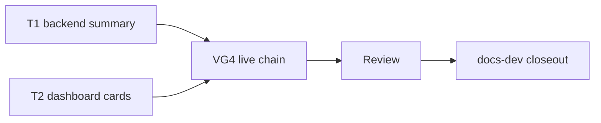

# Job status cards on the dashboard overview

**Status: Archived, 2026-11-16.**

## Problem and goal

The dashboard overview (`DashboardOverview.tsx`) shows four main metric cards and a Recent Activity
section, but no per-status job counts. Its existing figures are computed client-side from the first
page of `GET /api/job`, so they cannot report true totals.

Goal: four job status cards (Pending, Assigned, EnRoute, Received) placed between the main metric
cards and Recent Activity, whose counts are aggregated in SQL by the job repository, returned by the
job service through a REST endpoint, and rendered by a reusable `JobStatusCards` component. No
production mock data; the data path is shaped so a later SignalR push can refresh it.

## Scale

`documentation-impact: extends-component` for `admin-dashboard` (new component, hook, theme tokens,
opt-in live test) and `Api` (new endpoint, DTO, repository and service members). No new component,
project, folder, dependency, infrastructure or deployment asset.

## Decisions

| ID | Question | Answer / decision | Mitigating and supporting information | Status / approval provenance |
|---|---|---|---|---|
| D1 | Does the requested stack (Next.js 16 App Router, React, Tailwind) conflict with the repository? | No conflict, no change: the dashboard already is Next.js `16.4.6` App Router (`src/app`), React `19.3.1`, Tailwind `^4.3.5` (`package.json`). No dependency is added. | Icons come from the declared `lucide-react` (`1.70.0` in `package-lock.json`); response validation uses the declared `zod` (`^4.6.7`). | ANSWERED — autonomous: covered by `1-Presentation/admin-dashboard/package.json` |
| D2 | REST or SignalR for the summary? | REST: `GET /api/job/status-summary`. SignalR is not introduced. | Request says SignalR only if necessary; it is not. Future live refresh invalidates the exported React Query key `JOB_STATUS_SUMMARY_QUERY_KEY` from a SignalR handler; that follow-up is tracked in [admin-dashboard-job-status-unresolved](../todo/admin-dashboard-job-status-unresolved.md). | ANSWERED — autonomous: request constraint |
| D3 | Where does the endpoint live? | New action `GetJobStatusSummary` on `JobController` (`[HttpGet("status-summary")]`, policy `AuthorizationPolicies.ManagerOrAdmin`), calling `IJobService`, not the repository. | Same policy as `GetJobs`, whose data it summarises. The literal segment outranks `[HttpGet("{id}")]` in ASP.NET Core routing. A separate dashboard controller was rejected: one action does not justify a new controller. | ANSWERED — autonomous: low-confidence, no authoritative source (cheap to move) |
| D4 | Wire shape of the summary? | Object with four fixed non-negative integer fields: `{"pending":n,"assigned":n,"enRoute":n,"received":n}` (camelCase, the API's default JSON naming). | Fixed fields guarantee every status is present, zero-filled, so a missing status cannot be read as "no data". An array of `{status,count}` was rejected for that reason. Public contract, expensive to change: named here so both tasks build to it in parallel. | ANSWERED — autonomous: low-confidence, no authoritative source |
| D5 | Where does the C# DTO go? | `sealed record JobStatusSummaryDto` in `3-Domain/HotshotLogistics.Domain/DTOs/JobStatusSummaryDto.cs` (namespace `HotshotLogistics.Domain.DTOs`), beside `JobFilterDto` and `PagedResult`. | The C# standard's target `HotshotLogistics.Contracts.Models` does not exist yet ([contracts-model-placement todo](../todo/contracts-model-placement.md), which already covers Domain DTOs); a new project needs its own approval. Sealed record follows the standard. | ANSWERED — autonomous: standard target absent, existing location used |
| D6 | How does the repository aggregate? | `IJobRepository.GetJobStatusSummaryAsync(JobFilterDto? filter, CancellationToken)`: one parameterized `SELECT Status, COUNT(*) AS JobCount FROM Jobs{where} GROUP BY Status`, reusing `BuildWhereClause` and `AddParametersToCommand`; listed columns, no `SELECT *`. Status values outside `JobStatus` are not counted in any card. | Counts in SQL, never from a page of rows (fixes the first-page defect for these figures). `Jobs.Status` is `INT NOT NULL` with index `IX_Jobs_Status` (`20250101000200_CreateJobsTable`). | ANSWERED — autonomous: DAL standard |
| D7 | The DAL standard forbids `new SqlConnection` at a call site; its target `ISqlConnectionFactory` does not exist. | Sanctioned exception: the new method opens its connection the same way as its neighbours in `JobRepository` (`new SqlConnection(ConnectionString)` with `await using`). | Tracked by the [sql-connection-factory todo](../todo/sql-connection-factory.md); introducing the factory here would be a cross-cutting change needing its own plan. | ANSWERED — autonomous: standard target absent |
| D8 | Why an optional `customerId` filter? | Service `GetJobStatusSummaryAsync(string? customerId, CancellationToken)` and endpoint query `customerId`; blank or whitespace means absent (all jobs). | Lets tests scope counts to their own rows (the test standard forbids absolute table counts) and mirrors `GetJobs`' existing `customerId` filter. The dashboard calls it unfiltered. | ANSWERED — autonomous: test standard |
| D9 | How are the exact hex colours applied? | New Tailwind theme tokens in `globals.css` `@theme`: `--color-job-pending: #3B82F6`, `--color-job-assigned: #0EA5E9`, `--color-job-enroute: #0284C7`, `--color-job-received: #0369A1`, used as `bg-job-pending` etc. | React standard: reusable colours are theme tokens, no inline styles. Tailwind 4.x default palette is OKLCH, so `bg-blue-500` is not exactly `#3B82F6`. | ANSWERED — autonomous: React standard + Tailwind ^4.3.5 |
| D10 | Grid classes, given the request names `grid grid-cols-5 gap-4` and also "responsive"? | `grid grid-cols-1 sm:grid-cols-2 lg:grid-cols-5 gap-4`: the requested five-column track and `gap-4` at `lg`, stacking below it. | A bare `grid-cols-5` is not responsive at 375 px. Four cards in five tracks leaves the fifth empty (risk R1). | ANSWERED — autonomous: request text |
| D11 | Card look? | Each card: `bg-white p-6 rounded-lg shadow` (same as the existing stats cards); header row with a `w-8 h-8 rounded-md` icon badge in the status token colour left of the label (`text-sm font-semibold`); count centred below (`text-2xl font-bold text-center`). Labels are `Pending`, `Assigned`, `EnRoute`, `Received`, as the request writes them. | Inter is already the body font (`layout.tsx` applies `inter.className` to `<body>`; the class outranks the `body` rule in `globals.css`), so no font change. | ANSWERED — autonomous: request text + existing markup |
| D12 | Component structure? | `JobStatusCards` is presentational: props `items: JobStatusCardItem[]` (`key`, `label`, `count`, `badgeClassName`, `icon`). `useJobStatusSummary` hook fetches; `jobStatusCardDefinitions.ts` maps a summary to the four ordered items. `DashboardOverview` wires them. | React standard: fetching and rendering are separate; one component per file. Files stay in `src/components/dashboard/` (no new folder). | ANSWERED — autonomous: React standard |
| D13 | Loading, error and integrity on the client? | The summary query joins the page's existing loading gate. `apiService.getJobStatusSummary` validates the body with a zod schema (four non-negative integers); a failed request or invalid body renders `role="alert"` text `Job status counts are unavailable.` instead of cards. No test-mode fallback data. | Showing zeros on failure would misstate the data. The existing test-mode fallback in `DashboardOverview` is not extended. | ANSWERED — autonomous: request constraint (no production mock data) |
| D14 | How is "database values reach display" proved, when the test standard says Playwright never hits a real API? | Three executed links: (1) repository tests on the real test database; (2) HTTP integration tests that insert rows and read the endpoint; (3) mocked Playwright tests for display, layout and request. Plus one opt-in live Playwright test (`@live`, skipped unless `LIVE_API=1`) run in verification gate VG4 against the local API on the dev test database. | The default suite and every gate stay mocked, so the standard holds for them; the live test is a documented, opt-in exception the request asks for. It uses only `hotshot_logistics_test`, never production data or committed secrets. | ANSWERED — autonomous: low-confidence, no authoritative source; conflict with the test standard recorded |
| D15 | Does anything need owner approval under the root `AGENTS.md` rules? | No: no infrastructure, deployment asset, dependency, new project or folder, or cross-cutting concern. The architecture choices (D2–D6, D14) are recorded here under the run's autonomous approval. | Governed docs changes are left to `docs-dev` closeout. | ANSWERED — autonomous: `AGENTS.md` non-negotiable rules |
| D16 | Development mode and autonomy | `development-mode: test-first`, `autonomy: autonomous`. | From the conductor packet. | ANSWERED — conductor packet |
| AP1 | Approve and execute | Approved for execution as planned. | Recorded by the finalize step, which changed no task, file scope, test row or command. | ANSWERED: autonomous: recommendation accepted, AUTONOMOUS_APPROVAL: approve-and-execute, 2026-11-16 |

## Design harvest

| Target component | Target doc type | Section | Content to harvest |
|---|---|---|---|
| Api | architecture | Components and interfaces | `GET /api/job/status-summary[?customerId=]`, policy ManagerOrAdmin, served by `JobService.GetJobStatusSummaryAsync` → `JobRepository.GetJobStatusSummaryAsync` (SQL `GROUP BY Status`). |
| Api | architecture | Data models | `JobStatusSummaryDto` wire shape (D4); statuses outside `JobStatus` are not counted. |
| admin-dashboard | architecture | Components and interfaces | `JobStatusCards` (presentational), `useJobStatusSummary` with `JOB_STATUS_SUMMARY_QUERY_KEY` as the future SignalR refresh point, `jobStatusCardDefinitions`, theme tokens `--color-job-*`. |
| admin-dashboard | architecture | Error handling | Summary failure or invalid body shows the alert, never zeros (D13). |
| admin-dashboard | architecture | Testing strategy | Opt-in `@live` test and how to run it (VG4); default suite stays mocked. |

## Investigation findings

Discovery: codegraph 2, docs 4 (standards: react, test, data-access-layer, csharp), direct reads 17. Reads
were at revision `ff86948` on `copilot/feat/job-status-dashboard` (worktree index, `projectPath`).
Direct reads, each for what the index did not cover: plan index, root `AGENTS.md`, `.kyber-weave/kyber-weave.yml`
gates, three todos, catalog (docs files the plan process names); `DashboardOverview.tsx`, `api.ts`,
`dashboard-overview.spec.ts`, `package.json` (codegraph returned only `api.ts` symbol names, not the
component tree or spec); `JobRepositoryTests` and `JobControllerIntegrationTests` heads (test pattern
detail); grep/ls of `layout.tsx`, `globals.css`, lock file, auth handler, CORS and test helpers.

- `JobStatus` (`0-Base/HotshotLogistics.Core/Enums/JobStatus.cs`) is `Pending, Assigned, EnRoute, Received` (0–3), stored as `INT`.
- The frontend `JobStatus` enum in `src/types/index.ts` is stale (`InProgress`, `Completed`, `Cancelled`); this plan does not use it. Tracked by [admin-dashboard-job-status-unresolved](../todo/admin-dashboard-job-status-unresolved.md).
- `DashboardOverview.tsx` already holds test-mode fallback data and debug `console.log` calls; new code adds neither.
- `JobController.GetJobs` lets exceptions propagate (exception middleware handles them); the new action does the same.
- Playwright `webServer` sets `NEXT_PUBLIC_API_BASE_URL=https://localhost:5001/api` (the API's launch URL); API Development CORS allows `http://localhost:3000`; in `next dev` the client sends `Authorization: Test test-token`, which the API's Development `TestAuthHandler` accepts. The API and the test projects share user secret `a562df9b-…`, whose `ConnectionStrings:DefaultConnection` points at `hotshot_logistics_test`.
- Existing spec `dashboard-overview.spec.ts` locates `text=Pending` with `.first()` for the Recent Jobs badge; the new `Pending` card label precedes it, so that locator must be narrowed to the Recent Jobs section. Its `**/api/job**` mock in the Key Metrics test also matches `/api/job/status-summary` and returns a paged job body, which the zod check rejects (alert shown; that test asserts nothing about it).
- `task-e2e.sh` maps `src/components/dashboard/JobStatusCards.tsx` to `tests/job-status-cards.spec.ts` and the `dashboard` area to `tests/dashboard-overview.spec.ts`.
- Divergences from documented rules in touched files, left as they are and already tracked: `JobRepository` uses `SELECT *` and `Console.WriteLine` in other methods (DAL standard), `new SqlConnection` (D7), `JobController` returns domain entities (C# standard; [api-platform-hardening todo](../todo/api-platform-hardening.md)).

## Test contract (development-mode: test-first)

| Task | Test project or file | Runner command | Observable behavior | RED evidence required | GREEN acceptance |
|---|---|---|---|---|---|
| T1 | `5-Test/tests/HotshotLogistics.Tests/Jobs/JobRepositoryTests.cs` — extend `HotshotLogistics.Tests.Jobs.JobRepositoryTests` | `bash 5-Test/run-task-tests.sh 'FullyQualifiedName~HotshotLogistics.Tests.Jobs.JobRepositoryTests\|FullyQualifiedName~HotshotLogistics.IntegrationTests.JobControllerIntegrationTests' .agent_scratchpad/T1/artifacts` | `GetJobStatusSummaryAsync_WithCustomerFilter_ReturnsCountPerStatus`: rows created for a unique customer (2 Pending, 1 Assigned, 3 EnRoute, 1 Received) give exactly 2/1/3/1. `GetJobStatusSummaryAsync_WithNoMatchingJobs_ReturnsZeroForEveryStatus`: unused customer id gives 0/0/0/0. `GetJobStatusSummaryAsync_WithStatusFilter_CountsOnlyThatStatus`: customer + `Status = EnRoute` gives 0/0/3/0. `GetJobStatusSummaryAsync_WithoutFilter_IncludesCreatedJobs`: unfiltered counts are each ≥ the created rows of that status (no absolute counts). Left out: a stored status outside 0–3 (needs a raw invalid row the cleanup and seed rules do not cover; behaviour is specified in D6). | Compile error CS1061 for `GetJobStatusSummaryAsync` on `JobRepository`/`IJobRepository`, or CS0246 for `JobStatusSummaryDto`. | All four pass against `hotshot_logistics_test` (not skipped); existing tests unchanged in assertions. |
| T1 | `5-Test/tests/HotshotLogistics.IntegrationTests/JobControllerIntegrationTests.cs` — extend `HotshotLogistics.IntegrationTests.JobControllerIntegrationTests` | same command | `GetJobStatusSummary_WithCustomerId_ReturnsCountsOfCreatedJobs`: rows inserted for a unique customer (tracked in `Cleanup`) → 200 and body `{pending,assigned,enRoute,received}` equals what was inserted. `GetJobStatusSummary_WithUnknownCustomerId_ReturnsZeros`. `GetJobStatusSummary_WithBlankCustomerId_ReturnsUnfilteredCounts`: `?customerId=%20%20` gives each count ≥ the inserted rows (treated as absent, not as a customer named blank). `GetJobStatusSummary_WithoutCustomerId_Returns200WithAllFourFields`. `GetJobStatusSummary_AsDriver_ReturnsForbidden` (`X-Test-Role: Driver` → 403). `GetJobStatusSummary_AsManager_ReturnsOk` (`X-Test-Role: Manager` → 200). | 404 from `/api/Job/status-summary` (route absent; `{id}` route answers) or compile error for `JobStatusSummaryDto`. | All six pass; JSON field names are exactly `pending`, `assigned`, `enRoute`, `received`. |
| T2 | `1-Presentation/admin-dashboard/tests/job-status-cards.spec.ts` (new) | `bash 1-Presentation/admin-dashboard/scripts/task-e2e.sh 1-Presentation/admin-dashboard/tests/job-status-cards.spec.ts 1-Presentation/admin-dashboard/tests/dashboard-overview.spec.ts` | With `**/api/job/status-summary` mocked to `{pending:7,assigned:3,enRoute:5,received:12}`: `should display a card per status with the counts from the API` (labels Pending, Assigned, EnRoute, Received in that order; counts 7/3/5/12 in `job-status-count-<key>`). `should request the status summary once` (exactly one GET to `/api/job/status-summary`). `should show zero counts as 0` (all-zero body renders four `0`). `should show an alert when the summary request fails` (500 → alert `Job status counts are unavailable.`, no cards). `should show an alert when the summary body is invalid` (negative or missing field → same alert). `should place the cards between the main metrics and Recent Jobs` (bounding-box y order). `should colour each badge with its status colour` (computed background `rgb(59, 130, 246)`, `rgb(14, 165, 233)`, `rgb(2, 132, 199)`, `rgb(3, 105, 161)`; badge x < label x). `should match the existing card styling` (`bg-white`, `p-6`, `rounded-lg`, `shadow`; label `font-semibold`; count `font-bold` and `text-center`). Responsive: 375 px one column (same x), 768 px two per row, 1280 px four in one row with `lg:grid-cols-5` and `gap-4` on the grid. `@live` `should show the live API counts` — skipped unless `LIVE_API=1`; no route mock for the summary; asserts each card equals the body of a direct `GET https://localhost:5001/api/job/status-summary` (`Authorization: Test`). | `tsc` TS2307/TS2339 for the missing `JobStatusCards`/`getJobStatusSummary`, or locator timeouts for `job-status-card`. | All mocked tests pass in chromium; `@live` reported skipped; `dashboard-overview.spec.ts` keeps its assertions (locator narrowed and summary route added only). |

## Tasks

### T1: Job status summary from repository to REST endpoint

- **Objective:** Count jobs per status in SQL and return the counts from `GET /api/job/status-summary` through the job service.
- **Capabilities:** C# ASP.NET Core controller and service, parameterized ADO.NET repository, xUnit tests against SQL Server.
- **Session:** `backend`
- **Depends on:** none
- **Files:**
  - `3-Domain/HotshotLogistics.Domain/DTOs/JobStatusSummaryDto.cs`: new `public sealed record JobStatusSummaryDto` with `int Pending`, `int Assigned`, `int EnRoute`, `int Received` (XML docs; namespace `HotshotLogistics.Domain.DTOs`).
  - `3-Domain/HotshotLogistics.Contracts/Repositories/IJobRepository.cs`: `IJobRepository`, add `Task<JobStatusSummaryDto> GetJobStatusSummaryAsync(JobFilterDto? filter = null, CancellationToken cancellationToken = default)`.
  - `4-Persistence/HotshotLogistics.Data/Repositories/JobRepository.cs`: `JobRepository.GetJobStatusSummaryAsync`, one `SELECT Status, COUNT(*) AS JobCount FROM {GetTableName()}{whereClause} GROUP BY Status` using `BuildWhereClause` and `AddParametersToCommand`, `await using` connection/command/reader, cancellation passed through; values outside `JobStatus` skipped (D6, D7). No `Console.WriteLine`.
  - `3-Domain/HotshotLogistics.Contracts/Services/IJobService.cs`: `IJobService`, add `Task<JobStatusSummaryDto> GetJobStatusSummaryAsync(string? customerId = null, CancellationToken cancellationToken = default)`.
  - `2-Application/HotshotLogistics.Application/Services/JobService.cs`: `JobService.GetJobStatusSummaryAsync`, blank/whitespace `customerId` → no filter, else `new JobFilterDto { CustomerId = customerId.Trim() }`; calls `_jobRepository`.
  - `1-Presentation/HotshotLogistics.Api/Controllers/JobController.cs`: `JobController.GetJobStatusSummary([FromQuery] string? customerId, CancellationToken)`, `[HttpGet("status-summary")]`, `[Authorize(Policy = AuthorizationPolicies.ManagerOrAdmin)]`, `[ProducesResponseType(typeof(JobStatusSummaryDto), 200)]`, returns `Ok(dto)` from `_jobService`; XML docs; no try/catch (as `GetJobs`).
  - `5-Test/tests/HotshotLogistics.Tests/Jobs/JobRepositoryTests.cs`: `HotshotLogistics.Tests.Jobs.JobRepositoryTests`, the four `[DatabaseFact]` tests in the Test contract, scoped by the class's `_customerId`, rows tracked in `_cleanup`.
  - `5-Test/tests/HotshotLogistics.IntegrationTests/JobControllerIntegrationTests.cs`: `HotshotLogistics.IntegrationTests.JobControllerIntegrationTests`, the six tests in the Test contract; rows inserted with a unique `test-{Guid:N}` customer id (through the class's existing direct-insert path or an `IJobRepository` resolved from `Factory.Services`) and registered with `Cleanup.TrackJob` before insert.
- **Commands:**
  - `kyber-weave review gates . --agent <your agent> --task T1 --red`
  - `kyber-weave review gates . --agent <your agent> --task T1`
- **Acceptance:**
  - All ten new tests pass against `hotshot_logistics_test`, none skipped.
  - `GET /api/job/status-summary` returns `{"pending":n,"assigned":n,"enRoute":n,"received":n}`; Driver gets 403.
  - The new SQL lists its columns and uses only parameters for values.
  - Existing tests keep their assertions.

### T2: JobStatusCards on the dashboard overview

- **Objective:** Render four reusable job status cards from the summary endpoint between the main metrics and Recent Activity, with mocked and opt-in live Playwright coverage.
- **Capabilities:** React and TypeScript UI with Tailwind 4 and TanStack Query, Playwright tests.
- **Session:** `dashboard`
- **Depends on:** none (builds to the wire contract D4; VG4 needs T1 merged)
- **Files:**
  - `1-Presentation/admin-dashboard/src/app/globals.css`: new `@theme` block with `--color-job-pending: #3B82F6`, `--color-job-assigned: #0EA5E9`, `--color-job-enroute: #0284C7`, `--color-job-received: #0369A1` (D9).
  - `1-Presentation/admin-dashboard/src/types/index.ts`: new `export interface JobStatusSummary { pending: number; assigned: number; enRoute: number; received: number }`.
  - `1-Presentation/admin-dashboard/src/services/api.ts`: `ApiService.getJobStatusSummary(): Promise<JobStatusSummary>` requesting `/job/status-summary`, validating with a zod schema of four non-negative integers and throwing on mismatch (D13).
  - `1-Presentation/admin-dashboard/src/components/dashboard/useJobStatusSummary.ts`: `export const JOB_STATUS_SUMMARY_QUERY_KEY = ['job-status-summary'] as const`; `useJobStatusSummary()` wraps `useQuery` with that key, `apiService.getJobStatusSummary`, `retry: false`.
  - `1-Presentation/admin-dashboard/src/components/dashboard/jobStatusCardDefinitions.ts`: `JobStatusCardItem` type (`key`, `label`, `count`, `badgeClassName`, `icon: LucideIcon`) and `toJobStatusCardItems(summary)` returning Pending/`bg-job-pending`/`Hourglass`, Assigned/`bg-job-assigned`/`ClipboardList`, EnRoute/`bg-job-enroute`/`Truck`, Received/`bg-job-received`/`Inbox` in that order (class names as full literals so Tailwind sees them).
  - `1-Presentation/admin-dashboard/src/components/dashboard/JobStatusCards.tsx`: `JobStatusCards({ items })`, grid `data-testid="job-status-cards"` with `grid grid-cols-1 sm:grid-cols-2 lg:grid-cols-5 gap-4`; each card `data-testid="job-status-card"` `data-status={key}` per D11, icon `aria-hidden`, count `data-testid={`job-status-count-${key}`}`; keys from `item.key`.
  - `1-Presentation/admin-dashboard/src/components/dashboard/DashboardOverview.tsx`: `DashboardOverview`, call `useJobStatusSummary`, include its loading in the existing gate, render `JobStatusCards` (or the `role="alert"` message on error) between the `stats-container` grid and the Recent Activity block; no fallback data.
  - `1-Presentation/admin-dashboard/tests/job-status-cards.spec.ts`: new spec with the tests in the Test contract; setup copied from `dashboard-overview.spec.ts` `beforeEach` (bypass flag, MSAL mocks, jobs/drivers/invoices routes); `@live` test guarded by `test.skip(process.env.LIVE_API !== '1', …)` and `test.use({ ignoreHTTPSErrors: true })`.
  - `1-Presentation/admin-dashboard/tests/dashboard-overview.spec.ts`: add a `**/api/job/status-summary` route in `beforeEach`; narrow the `text=Pending` / `text=InProgress` badge locators in `should display job status badges with correct styling` to the Recent Jobs section. No assertion changes.
- **Commands:**
  - `kyber-weave review gates . --agent <your agent> --task T2 --red`
  - `kyber-weave review gates . --agent <your agent> --task T2`
- **Acceptance:**
  - Lint, typecheck, build and the two specs pass in chromium; `@live` is skipped.
  - No colour hex, inline style, test-mode fallback or `console.log` added in `src/`.
  - `JobStatusCards` renders only from props; it imports no API or query code.

## Dependency graph

T1 and T2 run in parallel; they share only the D4 wire contract.

## Risks

| ID | Risk | Mitigation |
|---|---|---|
| R1 | `lg:grid-cols-5` with four cards leaves an empty fifth track at desktop. | Kept as the request states (D10); changing to `lg:grid-cols-4` is one class if the owner prefers. |
| R2 | Label `EnRoute` reads as an identifier. | Kept as written (D11); one string in `jobStatusCardDefinitions.ts`. |
| R3 | Unfiltered counts in shared `hotshot_logistics_test` move under parallel runs. | Tests assert exact values only for their unique customer; unfiltered cases assert ≥. |
| R4 | VG4 needs the API on `https://localhost:5001` with a dev certificate and port 3000 free. | `ignoreHTTPSErrors` in the live test; `PLAYWRIGHT_PORT=3000` matches Development CORS. |
| R5 | `lucide-react` 1.70.0 could lack an icon name. | `tsc` in the T2 gate fails on a missing export; pick the nearest lucide name and report it. |

## Out-of-scope boundaries

- SignalR push of summary updates, the `JobStatusUpdate`/`JobStatusUpdated` name mismatch, Active Jobs computed from the first page, and the stale frontend `JobStatus` enum: [admin-dashboard-job-status-unresolved](../todo/admin-dashboard-job-status-unresolved.md).
- Existing `SELECT *`, `Console.WriteLine` and `new SqlConnection` in `JobRepository`: [sql-connection-factory](../todo/sql-connection-factory.md), [generic-repository-migration](../todo/generic-repository-migration.md).
- Moving DTOs to `HotshotLogistics.Contracts.Models`: [contracts-model-placement](../todo/contracts-model-placement.md).
- Frontend unit-test runner: [frontend-unit-test-tooling](../todo/frontend-unit-test-tooling.md).
- Removing `DashboardOverview`'s existing test-mode fallback data and debug logging (pre-existing; reported as an open item, not changed).

## Verification gates

- **VG1 (T1):** T1 task gate passing run, DB tests not skipped.
- **VG2 (T2):** T2 task gate passing run (lint, typecheck, build, chromium specs).
- **VG3:** request walk-through: each instruction maps to D1–D14 or an acceptance line above.
- **VG4 (after T1 and T2, conductor-run, live chain on the local test database):**
  1. `7-Deployment/dev-env/dev-env-up.sh`
  2. In the background: `ASPNETCORE_ENVIRONMENT=Development dotnet run --project 1-Presentation/HotshotLogistics.Api --urls https://localhost:5001` (connection string from the shared user secret; never printed or written to the tree).
  3. `cd 1-Presentation/admin-dashboard && LIVE_API=1 PLAYWRIGHT_PORT=3000 npx playwright test tests/job-status-cards.spec.ts --project=chromium --grep @live`
  4. Evidence: the `@live` test passed (not skipped); stop the API process afterwards.

## Review

End-of-run review by `code-reviewer` over the whole change, under the `code-review` skill; it derives its own gate commands.

## docs-dev closeout

`docs-dev` harvests the Design harvest rows into `6-Docs/api/architecture.md` and
`6-Docs/admin-dashboard/architecture.md`, then the plan is archived through the closeout tool.

## Completion summary

Documentation-impact review covered the T1 backend and T2 dashboard implementation,
their tests, and the two canonical architecture documents. The endpoint and client
flow are reflected in those documents; no new governed document is needed.
T1 task-gate evidence passes; its test log reports 13 integration and 34
unit/repository tests passed, none skipped. On clean revision `b8678f6`, the T2
focused rerun (`.agent_scratchpad/t2/closeout-focused.txt`) passed 27, skipped 7,
and failed 0; `@live` was skipped in that mocked run. The T2 gate rerun
(`.agent_scratchpad/t2/closeout-gate.txt`) passed lint, typecheck, build and E2E.
The earlier two alert-locator failures were from the pre-fix run.

VG4 was independently verified: 6 API integration, 4 repository, 11 mocked
browser and 1 live browser tests passed. Isolated test SQL counts and filtered API
counts matched at 1/2/3/4; global SQL and API counts agreed, and live cards matched
the API. No live environment was started by docs-dev.

## Closeout mapping

All migrated decisions below: no ADR — ADR waiver: these extend existing component
patterns or describe implementation details rather than a new architectural boundary.

| ID | Destination | documentation-impact | impact-components | last-reviewed | status |
|---|---|---|---|---|---|
| D1 | [Dashboard architecture](../../admin-dashboard/architecture.md#overview) | extends-component | admin-dashboard | 2026-11-16 | archived |
| D2, D9, D10, D11, D12 | [Job status cards](../../admin-dashboard/architecture.md#job-status-cards) | extends-component | admin-dashboard | 2026-11-16 | archived |
| D3, D6, D7, D8 | [Job status summary](../../api/architecture.md#job-status-summary) | extends-component | Api | 2026-11-16 | archived |
| D4, D5 | [API data models](../../api/architecture.md#data-models) | extends-component | Api | 2026-11-16 | archived |
| D13 | [Dashboard error handling](../../admin-dashboard/architecture.md#error-handling) | extends-component | admin-dashboard | 2026-11-16 | archived |
| D14 | [Dashboard testing strategy](../../admin-dashboard/architecture.md#testing-strategy) | extends-component | admin-dashboard | 2026-11-16 | archived |
| D15, D16, AP1 | Documentation waiver — transient approval and execution process, no surviving behavioral invariant | none | admin-dashboard, Api | 2026-11-16 | archived |
| Api | [API architecture](../../api/architecture.md#job-status-summary) | extends-component | Api | 2026-11-16 | archived |
| admin-dashboard | [Dashboard architecture](../../admin-dashboard/architecture.md#job-status-cards) | extends-component | admin-dashboard | 2026-11-16 | archived |
| Api components and interfaces | [Job status summary](../../api/architecture.md#job-status-summary) | extends-component | Api | 2026-11-16 | archived |
| Api data models | [API data models](../../api/architecture.md#data-models) | extends-component | Api | 2026-11-16 | archived |
| admin-dashboard components and interfaces | [Job status cards](../../admin-dashboard/architecture.md#job-status-cards) | extends-component | admin-dashboard | 2026-11-16 | archived |
| admin-dashboard error handling | [Dashboard error handling](../../admin-dashboard/architecture.md#error-handling) | extends-component | admin-dashboard | 2026-11-16 | archived |
| admin-dashboard testing strategy | [Dashboard testing strategy](../../admin-dashboard/architecture.md#testing-strategy) | extends-component | admin-dashboard | 2026-11-16 | archived |
