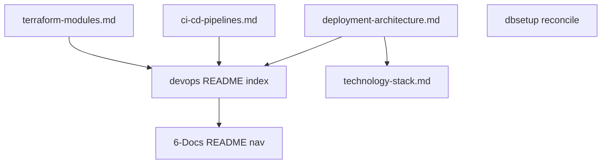

# Deployment and CLI architecture documentation

Status: Archived
Date: 2026-10-19
Goal: Author canonical documentation under `6-Docs/devops/` that describes the repository's actual deployment architecture (GitHub Actions workflows, Terraform IaC, docker-compose) and the DbSetup CLI; reconcile the existing `6-Docs/dbsetup/` docs; and explicitly record known drift — without changing any source, workflow, or Terraform.

## Problem

The repository's deployment and CLI machinery exists and runs, but no canonical documentation describes it. The GitHub Actions workflows, the `7-Deployment/` Terraform tree, the docker-compose file, and the DbSetup CLI are only partially or incorrectly documented. The documentation standard already reserves a `6-Docs/devops/` purpose folder ("Deployment and build procedures") that does not exist yet. Several existing documents disagree with the code they describe, and that drift must be recorded rather than silently smoothed over.

## Scope

### In scope

- Create the `6-Docs/devops/` purpose folder and its documents (index + three reference documents).
- Reconcile and cross-link the existing `6-Docs/dbsetup/` CLI documents.
- Update `6-Docs/README.md` navigation and reconcile `6-Docs/technology-stack.md` hosting claims (documentation-only).
- Record all known drift explicitly in a canonical drift register.

### Out of scope

- Any change to source code, GitHub workflows, Terraform, or docker-compose. Decision D4 makes this a documentation-only delivery.
- Resolving the hosting-model ambiguity (App Service vs Function App vs Container Apps) in code or infrastructure.
- Adding a `Deployment` catalog component (decided unnecessary; see D6).
- Fixing the two pre-existing `kyber-weave docs validate` errors (`6-Docs/admin-dashboard/AZURE_AD_SETUP.md` missing frontmatter — KW-DOC-SPEC-001; `6-Docs/todo/README.md` stale link — KW-DOC-LIFECYCLE-002). These are unrelated to deployment and are recorded in the drift register / risks as out-of-scope baseline.
- Any `6-Docs/catalog.md` change. No new catalog component is introduced; `DbSetup` already exists and its documentation path is unchanged.

## Decisions

| ID | Question | Answer / decision | Mitigating and supporting information | Status / approval provenance |
|---|---|---|---|---|
| D1 | Artifact type: plan or spec | Plan | Deployment workflows, Terraform IaC, and the DbSetup CLI already exist; this is bounded authoring of canonical documentation, not requirement definition | Approved by user 2026-10-19 |
| D2 | Folder location | `6-Docs/devops/` purpose folder | `documentation-standard.md` reserves `devops/` for "Deployment and build procedures"; it does not exist yet; creating it is in scope | Approved by user 2026-10-19 |
| D3 | CLI scope | DbSetup CLI only | `HotshotLogistics.DbSetup` (`7-Deployment/DbSetup`); reconcile the existing `6-Docs/dbsetup/` docs and cross-link from the new deployment docs. No broader deployment CLI exists; the workflows invoke FluentMigrator directly and do not invoke DbSetup | Approved by user 2026-10-19 |
| D4 | Reconciliation stance | Document actual current state; explicitly flag drift | All known drift is recorded in the drift register; documents state reality, not intended design. No source, workflow, or Terraform changes in this delivery | Approved by user 2026-10-19 |
| D5 | Development mode | `test-first` (default; user did not opt out) | Kyber-Weave `docs validate` + `docs drift` are the verification surface (see Test contract) | Planner default 2026-10-19 |
| D6 | devops doc-type and catalog component | Use `doc-type: reference` for the three substantive documents and `doc-type: index` for the folder README; no new catalog component. The plan artifact itself carries `component: DbSetup` | Deployment is not a runnable catalog component. The ontology requires `component` (a catalog row) only for `architecture`/`runbook`/`onboarding`/`plan`/`spec`/`todo`/`requirements`; `reference` and `index` carry no `component`/`source-root`/`code-refs`. Terraform HCL, YAML, and docker-compose have no CodeGraph symbols, so the `architecture` doc-type and its `source-root`+`code-refs` pairing invariant do not apply. `owner` stays `unassigned` (matches catalog). The plan's own `doc-type: plan` requires a `component`, so it names `DbSetup` — the only cataloged component whose canonical docs this delivery modifies — while the deployment documents remain component-less `reference` docs | Decided by planner 2026-10-19 (consistent with user D2) |
| D7 | `technology-stack.md` reconciliation | In scope, documentation-only | Correct the "Azure Container Apps" hosting assertion to match the actual deployment path, and point at the drift register. Do not resolve the underlying hosting ambiguity (out of scope) | Decided by planner 2026-10-19 |
| D8 | Plan index row | Add a `Draft` row to `6-Docs/plans/README.md` | Plan remains Draft until the conductor's approve-and-execute gate | Planner 2026-10-19 |
| D9 | Approve-and-execute gate | Approved — execute the plan | Repository owner answered the presented approve-and-execute gate: "use plan 6-Docs/plans/devops-deployment-architecture-documentation.md , it is approved, execute the plan." Plan moves from Draft to Ready and the index row is synchronized | Approved by repository owner 2026-10-19 |

## Investigation findings

- **Workflows (4, not 5; no `.github/actions/`, no reusable/composite workflows):** `dotnet-buid-test.yml` (build, dotnet-format lint with `-warnaserror:IDE0005`, tests under `5-Test/`, CodeQL, TruffleHog `--results=verified`, dependabot outdated-package check); `terraform-plan.yml` (OIDC login, inline-generated `hotshot.tfvars`, `terraform plan`, embedded apply gated to `refs/heads/main`); `terraform-apply.yml` (`terraform apply -auto-approve`, `workflow_dispatch` environment choice dev/staging/prod); `API-deploy.yml` (`azure/webapps-deploy@v4`, startup `dotnet HotshotLogistics.Api.dll`, Key Vault `sql-connection-string`, `dotnet fm migrate`). Plus `.github/dependabot.yml` (nuget + github-actions).
- **`7-Deployment/` tree:** `Azure-deploy/` (`launchpad` state solution + `HotshotLogistics` solution: resource group, App Service plan B1 Linux, storage account, Function App, App Configuration, SQL Server + serverless database, Key Vault with `sql-connection-string` and `sql-admin-password`); `DbSetup/` (the CLI); `docker-compose.yml` (local SQL Server 2022); READMEs.
- **DbSetup CLI:** `System.CommandLine` .NET 8 console tool. `SqlServerProvisioner` (with rollback) provisions database/login/user; `MigrationInvoker` is implemented but never invoked by `Program.cs` (`// TODO`). Environment overrides: `HOTSHOT_DB_SERVER`, `HOTSHOT_DB_NAME`, `HOTSHOT_DB_APP_USER`, `HOTSHOT_DB_PASSWORD`, `CI_SA_CONNECTION_STRING`; `--non-interactive` for CI. Provisioning tool, not a runtime service.
- **Existing docs:** `6-Docs/dbsetup/{architecture,onboarding}.md` (catalog component `DbSetup`); `technology-stack.md` and `api/architecture.md` assert Azure Container Apps; `documentation-standard.md` declares the `devops/` purpose folder; `documentation-ontology.md` defines frontmatter rules; `github-actions` coding standard is `status: draft`.
- **Drift:** six items (see drift register below). `codegraph explore` confirmed `SqlServerProvisioner` and `MigrationInvoker` resolve (docs drift is currently clean: 0 findings).

## Proposed document set (under `6-Docs/devops/`)

| File | Doc type | id | Purpose |
|---|---|---|---|
| `6-Docs/devops/README.md` | `index` | `devops/index` | Index of deployment/build documentation; links the three references, `6-Docs/dbsetup/`, and the drift register |
| `6-Docs/devops/deployment-architecture.md` | `reference` | `devops/deployment-architecture` | Overall deployment architecture: environments, hosting model + explicit drift, resource topology, workflow chain, docker-compose, DbSetup role, and the canonical drift register |
| `6-Docs/devops/ci-cd-pipelines.md` | `reference` | `devops/ci-cd-pipelines` | The four workflows + dependabot: triggers, job graph, steps, secrets/env/permissions, target platform, `workflow_run` chain, standard-conformance drift |
| `6-Docs/devops/terraform-modules.md` | `reference` | `devops/terraform-modules` | The `launchpad` and `HotshotLogistics` Terraform solutions: remote state, providers, modules, variables (sensitive flagged), outputs, dev tfvars, environment separation |

Each new document carries conformant frontmatter (see D6): required keys `id`, `title`, `owner: unassigned`, `last-reviewed: 2026-10-19`, `doc-type`, `status: current`. `reference` and `index` need no `component`, `source-root`, or `code-refs`. No secret or credential value appears in any body (placeholders only).

**Existing-document updates:** `6-Docs/dbsetup/architecture.md` (reconcile the `MigrationInvoker` claim; keep existing `code-refs` `SqlServerProvisioner` + `MigrationInvoker` resolving), `6-Docs/dbsetup/onboarding.md` (note CI does not invoke DbSetup; cross-link), `6-Docs/README.md` (add `devops/` row), `6-Docs/technology-stack.md` (correct hosting assertion). `6-Docs/catalog.md` is unchanged.

## Test contract (test-first)

Documentation has no unit tests. The verification surface is the repository's Kyber-Weave documentation gate. Each task's contract is a no-test task whose replacement verification is the read-only gate named below.

Runner commands (CLI present at `~/.local/bin/kyber-weave`):
- `kyber-weave docs validate .` — schema (`KW-DOC-SPEC-*`, `KW-DOC-LIFECYCLE-*`)
- `kyber-weave docs drift .` — `code-refs`/`api-endpoints` resolution (`KW-DOC-DRIFT-*`)

Baseline (before this delivery): `docs drift` = 0 findings; `docs validate` = 2 pre-existing errors (out of scope, see drift register P1/P2).

| Task | Test surface / file | Runner command | Observable behavior | RED evidence required | GREEN acceptance |
|---|---|---|---|---|---|
| T1 | `6-Docs/devops/deployment-architecture.md` | `kyber-weave docs validate .` + `docs drift .` | Conformant `reference` frontmatter; body describes actual deployment + drift register; no secrets; links resolve | New file with missing/malformed frontmatter yields `KW-DOC-SPEC-001` before frontmatter is finalized | Zero new `KW-DOC-SPEC-*`/`KW-DOC-DRIFT-*`/`KW-DOC-LIFECYCLE-*` findings for this file; only the 2 baseline errors remain |
| T2 | `6-Docs/devops/ci-cd-pipelines.md` | same | Conformant `reference` frontmatter; accurate per-workflow inventory | Same RED pattern as T1 | Zero new findings for this file |
| T3 | `6-Docs/devops/terraform-modules.md` | same | Conformant `reference` frontmatter; accurate module/variable/output inventory; sensitive variables flagged not valued | Same RED pattern as T1 | Zero new findings for this file |
| T4 | `6-Docs/dbsetup/architecture.md`, `6-Docs/dbsetup/onboarding.md` | same | MigrationInvoker drift stated; existing `code-refs` still resolve; cross-links added | `code-refs` drift would surface if a symbol were renamed; the false composition claim is the pre-existing defect being corrected | Zero new `KW-DOC-SPEC-*`/`KW-DOC-DRIFT-*` findings; `SqlServerProvisioner`/`MigrationInvoker` still resolve |
| T5 | `6-Docs/devops/README.md` | same | Conformant `index` frontmatter; links all four devops docs + dbsetup | Same RED pattern as T1 | Zero new findings; all internal links resolve |
| T6 | `6-Docs/technology-stack.md` | same | Hosting assertion corrected; pointer to drift register; no secret added | Existing false "Container Apps" claim is the pre-existing defect | Zero new findings; no "Azure Container Apps" left as settled fact |
| T7 | `6-Docs/README.md` | same | `devops/` row added to the directory table | Link would dangle if `devops/README.md` is absent | Zero new findings; `devops/` navigable from the documentation index |

## Tasks

All tasks are authored by `docs-dev` (using the `kyber-weave-docs` skill for frontmatter conformance). File scopes are disjoint so tasks run in parallel unless a dependency is declared.

- **T1 — Deployment architecture + drift register.** Files: `6-Docs/devops/deployment-architecture.md` (new). Objective: author the deployment architecture reference and the canonical six-item drift register (below). Acceptance: `reference` frontmatter per D6; drift register lists DR1–DR6 verbatim; no secrets. Dependencies: none. Skills: docs-dev.
- **T2 — CI/CD pipelines reference.** Files: `6-Docs/devops/ci-cd-pipelines.md` (new). Objective: document the four workflows + dependabot (triggers, jobs, steps, secrets/env/permissions, platform, `workflow_run` chain, standard-conformance drift DR6). Acceptance: `reference` frontmatter; no secrets. Dependencies: none. Skills: docs-dev.
- **T3 — Terraform modules reference.** Files: `6-Docs/devops/terraform-modules.md` (new). Objective: document `launchpad` + `HotshotLogistics` solutions (remote state, providers, modules, variables incl. sensitive, outputs, dev tfvars, environment separation, drift DR3/DR5). Acceptance: `reference` frontmatter; sensitive variables flagged, never valued. Dependencies: none. Skills: docs-dev.
- **T4 — DbSetup CLI reconciliation.** Files: `6-Docs/dbsetup/architecture.md`, `6-Docs/dbsetup/onboarding.md`. Objective: correct the `Program`-composes-`MigrationInvoker` claim (DR1); note CI does not invoke DbSetup; cross-link to `devops/`. Acceptance: existing `code-refs` unchanged and resolving; no frontmatter regression. Dependencies: none. Skills: docs-dev.
- **T5 — DevOps index.** Files: `6-Docs/devops/README.md` (new). Objective: index linking `deployment-architecture`, `ci-cd-pipelines`, `terraform-modules`, `6-Docs/dbsetup/`, and the drift register. Acceptance: `index` frontmatter; links resolve. Dependencies: T1, T2, T3. Skills: docs-dev.
- **T6 — Technology stack reconciliation.** Files: `6-Docs/technology-stack.md`. Objective: replace the "Azure Container Apps" hosting assertion with the actual deployment path (DR2) and point at the drift register; do not resolve the hosting ambiguity. Acceptance: no "Container Apps" left as settled fact; no secrets. Dependencies: T1. Skills: docs-dev.
- **T7 — Documentation index navigation.** Files: `6-Docs/README.md`. Objective: add a `devops/` row to the directory table. Acceptance: `devops/` navigable. Dependencies: T5. Skills: docs-dev.

## Dependency graph

T1, T2, T3, T4 run in parallel. T5 waits on the three reference documents; T6 waits on the drift register (T1); T7 waits on the devops index (T5).

## Drift register

These are recorded verbatim in `6-Docs/devops/deployment-architecture.md` (T1) and referenced by other documents. No item is fixed in this delivery.

- **DR1 — DbSetup composition claim.** `6-Docs/dbsetup/architecture.md` states `Program` composes `MigrationInvoker`; `Program.cs` carries `// TODO: Implement ... MigrationInvoker` and never calls `MigrationInvoker.RunMigrationsAsync`. `MigrationInvoker` is implemented but dead code.
- **DR2 — Hosting model conflict.** `6-Docs/technology-stack.md` and `6-Docs/api/architecture.md` say Azure Container Apps; Terraform `main.tf` provisions a Function App (`kind = functionapp`, AVM `web-site`); `API-deploy.yml` uses `azure/webapps-deploy@v4` (App Service) with startup `dotnet HotshotLogistics.Api.dll`. The hosting model is unresolved at the code/infra level.
- **DR3 — Divergent region/resource-group.** `terraform-plan.yml` hardcodes "East US 2" / `rg-hotshot-logistics-dev-eastus2`; `terraform-apply.yml` hardcodes "East US" / `rg-hotshot-logistics-dev-eastus`.
- **DR4 — Plan/apply overlap.** `terraform-plan.yml` embeds a `terraform apply -auto-approve` step gated to `refs/heads/main`, overlapping `terraform-apply.yml`.
- **DR5 — Missing staging/prod environments.** `staging` and `prod` appear in `workflow_dispatch` inputs and the Terraform `environment` variable, but `7-Deployment/Azure-deploy/environments/` contains only `dev/hotshot.tfvars`.
- **DR6 — Action pinning vs standard.** Third-party actions use mutable tags (`azure/login@v2`, `hashicorp/setup-terraform@v3`, `azure/webapps-deploy@v4`, `trufflesecurity/trufflehog@main`); the `github-actions` coding standard requires SHA-pinning and least-privilege `permissions:` (that standard is itself `status: draft`).

Pre-existing documentation defects, out of scope for this delivery (recorded for the conductor's awareness, not fixed here):

- **P1 —** `6-Docs/admin-dashboard/AZURE_AD_SETUP.md` has no YAML frontmatter (`KW-DOC-SPEC-001`).
- **P2 —** `6-Docs/todo/README.md` links `../todos/admin-dashboard-job-status-unresolved.md` while the file is `6-Docs/todo/admin-dashboard-job-status-unresolved.md` (`KW-DOC-LIFECYCLE-002`).

## Risks

- The whole-corpus `kyber-weave docs validate .` gate remains red (2 baseline errors P1/P2) after this delivery. The Test contract therefore scopes GREEN acceptance to "no new findings" rather than "0 total findings".
- The drift register records contradictions between code and docs that this delivery does not resolve; consumers must not read those passages as settled design.
- Adding a `code-refs` value by hand (not from CodeGraph) would create drift; docs-dev must only preserve existing `code-refs`, never hand-write new ones.

## Verification gates

- `kyber-weave docs validate .` — zero new `KW-DOC-SPEC-*`/`KW-DOC-LIFECYCLE-*` findings for files this delivery authors or edits.
- `kyber-weave docs drift .` — 0 findings (unchanged).
- Link integrity and secret scan: every internal link resolves; no credential value appears in any authored or edited file.

## Review and closeout

- Each task is reviewed by its own `task-reviewer` against the Test contract row above.
- `docs-dev` closeout: after all tasks merge, verify the drift register is the single source of truth, the `6-Docs/README.md` and `6-Docs/devops/README.md` navigational paths resolve, and the plan body/`Status` field and the plan index row agree (`Draft`). Update `last-reviewed` on changed documents to the delivery date.
