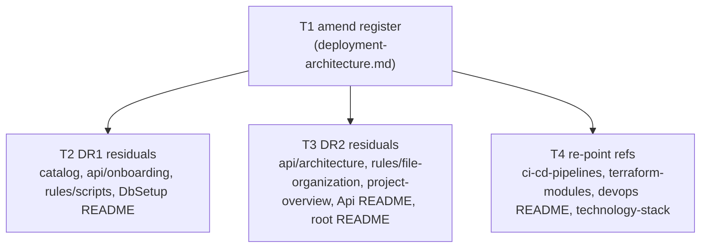

# Deployment drift register and residual-claim remediation

Status: Archived
Date: 2026-10-20
Goal: Amend the canonical drift register — correct the now-stale DR1/DR2 file lists and add DR7–DR15 for the drift facts discovered during execution — and correct every residual false claim ("DbSetup applies migrations", "Azure Container Apps") that survives outside the documents the prior delivery already fixed. Documentation-only; no source, workflow, Terraform, or docker-compose change.

## Problem

The delivery of [Deployment and CLI architecture documentation](devops-deployment-architecture-documentation.md) (Status: Ready, D9 approve-and-execute 2026-10-19) corrected three documents (`6-Docs/dbsetup/architecture.md`, `6-Docs/dbsetup/onboarding.md`, `6-Docs/technology-stack.md`) and authored the `6-Docs/devops/` references, but three classes of residual defect survived its scope boundaries:

1. **The register is now stale about where the drift lives.** DR1 names `6-Docs/dbsetup/architecture.md` as the assertor of the composition claim — a file the delivery corrected — while the claim actually survives in `6-Docs/catalog.md`, `6-Docs/api/onboarding.md`, `7-Deployment/DbSetup/README.md`, `6-Docs/rules/scripts.md`, and `6-Docs/project-overview.md` (five files, none of which DR1 names). DR2 names `6-Docs/technology-stack.md` and `6-Docs/api/architecture.md` as the "Azure Container Apps" assertors — one of which (`technology-stack.md`) the delivery already corrected — while the claim actually survives in `6-Docs/api/architecture.md`, `6-Docs/project-overview.md`, `6-Docs/rules/file-organization.md`, `1-Presentation/HotshotLogistics.Api/README.md`, and the root `README.md` (five files, of which DR2 names only one).
2. **Nine drift facts discovered during execution have no register entry.** The reference documents recorded their evidence in body prose (and, in `ci-cd-pipelines.md`, explicitly deferred the id-minting to the register: "no id is minted here; adding one belongs to the register"), but the register — declared the single source of truth for drift definition and severity — still holds only DR1–DR6.
3. **Residual false claims remain in living documents.** The "DbSetup applies migrations" and "API is hosted on Azure Container Apps" claims contradict the code the register already records, and they sit in documents that are current guidance.

This plan corrects the false claims and amends the register. It does not resolve the hosting-model ambiguity (App Service vs Function App vs Container Apps), and it does not change any workflow, Terraform file, source file, or docker-compose — those are named as a separate, out-of-scope remediation where a correction would require one.

## Decisions

| ID | Question | Answer / decision | Mitigating and supporting information | Status / approval provenance |
|---|---|---|---|---|
| D1 | Artifact type | Plan | Bounded documentation correction with settled architecture; decomposes directly into a small set of file-level edits and one register amendment. A spec is unnecessary. | Decided by architect 2026-10-20 |
| D2 | Mechanism: reopen the completed plan vs. a successor plan | Successor plan (this document) | The prior plan is Ready and its approve-and-execute gate is already recorded (D9). The `## Decisions` section of a plan is permanent state and its T1 acceptance ("register lists DR1–DR6 verbatim") is a historical record; mutating it would falsify an approved, executed contract. `documentation-standard.md` (plan lifecycle) and [`plan-authoring`] confine active editing to Draft/Ready/In progress/Blocked artifacts and treat delivered plans as records of intent. Amendment is new work and belongs behind its own approve-and-execute gate. | Decided by architect 2026-10-20 |
| D3 | Register amendment shape | Correct DR1 and DR2 in place so they name the current residual locations, add DR7–DR15, and retain the verbatim DR1–DR6 originals in a dated "Register versioning" subsection for audit | The register is a `doc-type: reference` with `status: current` — live guidance, not an immutable ADR. A drift register that names files that no longer assert the claim is actively misleading. Retaining the verbatim originals preserves the audit trail the delivered "Register reconciliation note" chose, without forfeiting accuracy. | Decided by architect 2026-10-20 |
| D4 | Home of the F4 drift facts | The register (canonical definition + severity); evidence remains in `ci-cd-pipelines.md`, `terraform-modules.md`, and the `deployment-architecture.md` body | Preserves the declared invariant — the register owns definition/severity, the reference documents own evidence — which `6-Docs/devops/README.md` and `6-Docs/technology-stack.md` both point at, and which the reference documents already defer to ("adding one belongs to the register"). | Decided by architect 2026-10-20 |
| D5 | Treatment of the secrets-in-tfvars fact | Record as DR14 (and the Key Vault echo as DR15) in the register; name the workflow fix as a separate out-of-scope remediation | The generated `hotshot.tfvars` is written by a CI job at runtime, is covered by the repository `*.tfvars` gitignore, and is never committed — so it is **not** a violation of the root `AGENTS.md` absolute secrets ban (which governs the repository working tree). It **is** a divergence from the `github-actions` coding standard ("passed by `env:`", never written to a file). Recording the fact is documentation; fixing it touches workflows, so the fix is excluded by D4's documentation-only boundary. | Decided by architect 2026-10-20 |
| D6 | Scope of `7-Deployment/DbSetup/README.md` (and, by the same rule, the root `README.md` and `1-Presentation/HotshotLogistics.Api/README.md`) | In scope, as documentation-only corrections | These are governed documentation surfaces: `documentation-standard.md` "Canonical-source rules" and "Component README"/"Root README" required content cover source-root and root READMEs, and "Documentation MUST match the tree." They are not code; correcting a false claim in a README is not a code change. They sit outside `6-Docs/` so they are outside the `kyber-weave` gate's scope, and their acceptance is manual review rather than gate output. | Decided by architect 2026-10-20 |
| D7 | F2 catalog review-date correction | Routine record correction; in scope; no separate approval | `catalog.md`'s own "How the columns are read" states only Component and Owner are parsed and the other columns "may be reworded freely"; `documentation-standard.md:110-111` makes the catalog the authoritative review-date record and mandates updating it when material changes occur. The DbSetup rows changed on 2026-10-19, so the catalog's `2026-08-17` is a stale housekeeping value, not a schema/vocabulary change. | Decided by architect 2026-10-20 |
| D8 | Hosting-model ambiguity | Do not resolve; correct the false "Container Apps" claim to "unresolved + actual deployment path", pointing at DR2 | Preserves the prior plan's D4/D7 and DR2. Corrected text must not assert App Service or Function App as the settled winner; it states the observed code/infra facts and leaves the model unresolved. | Decided by architect 2026-10-20 |
| D9 | Development mode | `test-first` (repository default; no user opt-out) | Verification surface is the Kyber-Weave documentation gate, with GREEN scoped to "no new findings" because whole-corpus `validate` remains red on two pre-existing out-of-scope baseline defects (P1/P2). | Planner default 2026-10-20 |
| D10 | Approve-and-execute gate | Approved — execute the plan | Repository owner answered the presented approve-and-execute gate: "approve". Plan moves from Draft to Ready and the index row is synchronized. `development-mode: test-first` and the Test contract are unchanged; no mode change, so no re-approval of the contract is required. | Approved by repository owner 2026-10-20 |

## Investigation findings

Every finding below was verified against source (workflows, Terraform, and the current text of each document) rather than taken on faith. CodeGraph (`codegraph explore`) confirmed the DR1 code basis: `MigrationInvoker.RunMigrationsAsync` is implemented but has no caller, and `Program.cs` carries the `// TODO` naming `MigrationInvoker`.

- **F1 (reproduced, and incomplete).** The "DbSetup applies migrations" claim appears exactly at `6-Docs/catalog.md:30`, `6-Docs/api/onboarding.md:48`, and `7-Deployment/DbSetup/README.md:3`, as stated. Two further locations were found that F1 did not list: `6-Docs/rules/scripts.md:38` ("it applies FluentMigrator migrations…") and `6-Docs/project-overview.md:18` ("…and applies FluentMigrator migrations"). Total residual DR1 locations: five.
- **F2 (reproduced).** `catalog.md` DbSetup row reads `Last reviewed 2026-08-17`; both `6-Docs/dbsetup/architecture.md` and `onboarding.md` read `last-reviewed: 2026-10-19`. `documentation-standard.md:110-111` is the authoritative-review-date rule (verified).
- **F3 (reproduced).** The "Azure Container Apps" claim survives in `6-Docs/api/architecture.md:20`, `6-Docs/project-overview.md:17`, and `6-Docs/rules/file-organization.md:27`. DR2 names only `6-Docs/technology-stack.md` (now corrected) and `6-Docs/api/architecture.md`. Two further locations were found that F3 did not list: `1-Presentation/HotshotLogistics.Api/README.md:3` and the root `README.md:11`. Total residual DR2 locations: five.
- **F4 (all eight reproduced against source).** (1) Key Vault name divergence — `API-deploy.yml:75` uses `<environment>-hotshot-logistics-kv`, `main.tf:126` provisions `<environment>-hotshot-log-kv-01`. (2) `tfstate` container not created — `launchpad/main.tf` declares only the resource group and storage account, no `azurerm_storage_container`. (3) `compute_model = "Serverless"` is commented out (`main.tf:109`), the database is `GP_S_Gen5_1` (`variables.tf:70`, `hotshot.tfvars:25`); the claim that the `modules/database` submodule declares no `compute_model` input is **registry-sourced** (the module lives in the Terraform Registry, not the repo) and is corroborated by `terraform-modules.md` "Declared-behaviour note 3", not independently verified here. (4) `administrator_login_password` is `sensitive` and defaultless (`variables.tf:55-59`); no workflow exports `TF_VAR_administrator_login_password`. (5) `sql_server` receives `var.administrator_login_password` (`main.tf:93`) while Key Vault `sql-admin-password` and `sql-connection-string` embed `random_password.sql_password.result` (`main.tf:145-146`) — two different values; the connection-string template also hardcodes `User Id=sqladmin`. (6) `min_capacity`/`max_capacity`/`auto_pause_delay_in_minutes`/`azure_ad_client_id`/`azure_ad_client_secret` are declared/supplied but referenced by nothing; launchpad `location`/`environment` are hardcoded away (`launchpad/main.tf:15-21`). (7) `dotnet-buid-test.yml:16` pushes on `develop`; the deploy workflows filter `workflow_run` on `development` (`API-deploy.yml:9`, `terraform-plan.yml:9`, `terraform-apply.yml:8`). (8) `terraform-plan.yml:63,66,67` and `terraform-apply.yml:67,70,71` interpolate three secret-store values into a generated `hotshot.tfvars`.
- **F4 precision correction.** The finding calls item (8) "three secret values". Only one of the three is a credential (the Azure AD **client secret**, `AZURE_AD_CLIENT_SECRET`); the other two are identifiers — the Azure **subscription id** (`DAVIDS_AZURE_SUB`) and the Azure AD **client id** (`AZURE_AD_CLIENT_ID`). They are stored as GitHub secrets and marked `sensitive` in Terraform, but only the client secret is a secret in the credential sense. DR14 records all three names because all three are written by the same file-write pattern, while stating that distinction.
- **Ninth drift fact (not in F4).** `ci-cd-pipelines.md` also documents a second secret-handling divergence with no register id: `API-deploy.yml` writes the Key Vault `sql-connection-string` value to `$GITHUB_OUTPUT` (`:76`) and interpolates it into the migration step's script (`:84`), where the runner prints it, with no `::add-mask::` call. It is minted as DR15 here.
- **Non-reproducing findings:** none. All stated locations and facts reproduced. F4(8)'s "three secret values" framing and F4(3)'s registry-sourced module-input clause are precision caveats, not non-reproductions.

## Register amendments (the exact text T1 writes)

The live register is amended to DR1–DR15. The verbatim DR1–DR6 text from the prior delivery is retained unchanged in a new "Register versioning" subsection dated 2026-10-19, immediately after the live list, so the audit trail survives the in-place correction.

**Corrected DR1 — DbSetup composition claim (residual locations).** `Program.cs` carries `// TODO: Implement ... MigrationInvoker` and never calls `MigrationInvoker.RunMigrationsAsync`; `MigrationInvoker` is implemented but dead code. The claim that DbSetup "applies migrations" survives in `6-Docs/catalog.md`, `6-Docs/api/onboarding.md`, `7-Deployment/DbSetup/README.md`, `6-Docs/rules/scripts.md`, and `6-Docs/project-overview.md`.

**Corrected DR2 — Hosting model conflict (residual locations).** Terraform `main.tf` provisions a Function App (`kind = "functionapp"`, AVM `web-site`); `API-deploy.yml` uses `azure/webapps-deploy@v4` (App Service) with startup `dotnet HotshotLogistics.Api.dll`. The hosting model is unresolved at the code/infra level. The claim that the API is "hosted on Azure Container Apps" survives in `6-Docs/api/architecture.md`, `6-Docs/project-overview.md`, `6-Docs/rules/file-organization.md`, `1-Presentation/HotshotLogistics.Api/README.md`, and the root `README.md`.

**New DR7 — Key Vault name divergence.** `API-deploy.yml` reads the `sql-connection-string` secret from a vault named `<environment>-hotshot-logistics-kv`; Terraform `main.tf` provisions the Key Vault as `<environment>-hotshot-log-kv-01`. The two names are reconciled only by convention and do not match.

**New DR8 — `tfstate` container not provisioned.** The `azurerm` backend in both solutions names blob container `tfstate`; the launchpad solution creates only the resource group and the storage account, so the container must be created out of band before `terraform init` can succeed.

**New DR9 — Serverless knobs on a provisioned tier.** `compute_model = "Serverless"` is commented out and the `modules/database` submodule of `avm-res-sql-server` 0.1.5 declares no `compute_model` input; the database is created `GP_S_Gen5_1`, while `min_capacity` and `auto_pause_delay_in_minutes` are set as literals that do not take effect on that tier.

**New DR10 — SQL administrator password never supplied.** `administrator_login_password` is `sensitive` with no default; the committed `dev/hotshot.tfvars` omits it and points at `TF_VAR_administrator_login_password`, but no workflow exports that variable, so an unattended `terraform plan`/`apply` has no value for it.

**New DR11 — SQL admin password and Key Vault password diverge.** The `sql_server` module receives `var.administrator_login_password`, while the Key Vault `sql-admin-password` secret and the embedded `sql-connection-string` use `random_password.sql_password.result` — two different values — and the connection-string template hardcodes the login name rather than `var.administrator_login`.

**New DR12 — Inert Terraform variables.** `min_capacity`, `max_capacity`, `auto_pause_delay_in_minutes`, `azure_ad_client_id`, and `azure_ad_client_secret` are declared (the last two supplied by the workflows) but referenced by nothing; the launchpad solution's `location` and `environment` variables are hardcoded away in `main.tf`.

**New DR13 — Branch-name mismatch in the workflow chain.** `dotnet-buid-test.yml` pushes on `main` and `develop`, while the deploy workflows filter `workflow_run` on `development` and `main`; `develop` is not `development`, so a push to `develop` does not trigger the deploy chain.

**New DR14 — Secret values written to a generated tfvars file.** `terraform-plan.yml` and `terraform-apply.yml` interpolate `DAVIDS_AZURE_SUB`, `AZURE_AD_CLIENT_ID`, and `AZURE_AD_CLIENT_SECRET` into a generated `hotshot.tfvars`, diverging from the `github-actions` coding standard's "passed by `env:`" rule (the same values are already passed as `TF_VAR_*` environment variables). The file is created only on the CI runner and is covered by the repository's `*.tfvars` gitignore, so it is **not** a violation of the root `AGENTS.md` absolute secrets ban, which governs the repository working tree; it is a standard-conformance drift whose fix is a workflow change outside this plan.

**New DR15 — Key Vault secret value written to a step output and echoed into the job log.** `API-deploy.yml` writes the value of the Key Vault secret `sql-connection-string` to `$GITHUB_OUTPUT` and interpolates it into the migration step's script, where the runner prints it, with no `::add-mask::` call to redact it.

## Corrected-text guidance for the residual claims

Each correction removes the false claim, states the verified fact, and does not introduce a secret value.

- **DR1 wording (do not say "applies migrations" of DbSetup):** DbSetup provisions the SQL Server database, login, and application user. It does not apply FluentMigrator migrations — `MigrationInvoker` is implemented but never invoked by `Program`. The deploy pipeline applies schema with `dotnet fm migrate` (see `API-deploy.yml`).
  - `6-Docs/catalog.md` DbSetup Overview cell → "Console tool that provisions the SQL Server database, login, and application user."; set its `Last reviewed` cell to `2026-10-19` (F2).
  - `6-Docs/api/onboarding.md:48` → "…Schema changes go through FluentMigrator in Persistence; the deploy pipeline applies them with `dotnet fm migrate`. DbSetup provisions the database and login only."
  - `7-Deployment/DbSetup/README.md:3` → "Cross-platform .NET 8 console tool that creates the SQL Server database and application login. It does not apply FluentMigrator migrations."
  - `6-Docs/rules/scripts.md:38` → correct the "it applies FluentMigrator migrations" clause to state the CLI does not run migrations (`MigrationInvoker` is dead code); keep the secret-handling guidance intact.
  - `6-Docs/project-overview.md:18` → "Console tool that provisions SQL Server databases and application accounts."
- **DR2 wording (remove "Container Apps" as settled fact; do not assert a single winner):** state the hosting model is unresolved and name the actual deployment path (an App Service plan and a Function App provisioned by Terraform, deployed by `API-deploy.yml` with `azure/webapps-deploy@v4` and startup `dotnet HotshotLogistics.Api.dll`), pointing at DR2.
  - `6-Docs/api/architecture.md:20` → replace "hosted on Azure Container Apps" with "…Web API. Its hosting model is unresolved — see the canonical drift register (DR2) in [deployment architecture](../devops/deployment-architecture.md); the actual deployment path is an Azure App Service plan / Function App provisioned by Terraform, deployed by `API-deploy.yml`."
  - `6-Docs/project-overview.md:17` → "ASP.NET Core Web API (hosting model unresolved — see DR2), SQL Server via native ADO.NET, Clean Architecture."
  - `6-Docs/rules/file-organization.md:27` → drop the "(ASP.NET Core Web API on Azure Container Apps)" parenthetical; keep "API controllers and endpoints".
  - `1-Presentation/HotshotLogistics.Api/README.md:3` → "ASP.NET Core Web API for Hotshot Logistics. Hosting model unresolved — see `6-Docs/devops/deployment-architecture.md` (DR2)."
  - root `README.md:11` → "ASP.NET Core Web API (.NET 8)…" with the hosting clause reworded to "hosting model unresolved (App Service / Function App — see DR2)" or equivalent; do not re-assert Container Apps and do not assert a single winner.

## Test contract (test-first)

Documentation has no unit tests. The verification surface is the repository's Kyber-Weave gate. Each task is a no-test task whose replacement verification is the read-only gate below; files outside `6-Docs/` are not in the gate's scope and are verified by manual review.

Runner commands (CLI: `~/.local/bin/kyber-weave`):
- `kyber-weave docs validate .`
- `kyber-weave docs drift .`

Baseline (verified before authoring): `docs drift` = 0 findings; `docs validate` = 2 pre-existing errors (P1 `6-Docs/admin-dashboard/AZURE_AD_SETUP.md`, P2 `6-Docs/todo/README.md`), both out of scope. GREEN = no new findings beyond that 2-error baseline.

| Task | Files | Verification | Observable behavior | GREEN acceptance |
|---|---|---|---|---|
| T1 | `6-Docs/devops/deployment-architecture.md` | `docs validate .` + `docs drift .` | Register holds DR1–DR15 (corrected DR1/DR2 + new DR7–DR15, text above) plus a "Register versioning" subsection retaining DR1–DR6 verbatim dated 2026-10-19 | Zero new `KW-DOC-SPEC-*`/`KW-DOC-DRIFT-*` findings; register still the single source of truth; no secret value; no false claim left in the amended entries |
| T2 | `6-Docs/catalog.md`, `6-Docs/api/onboarding.md`, `6-Docs/rules/scripts.md`, `7-Deployment/DbSetup/README.md` | gate for the two `6-Docs/` files; manual review for the README | DR1 claim removed; catalog DbSetup `Last reviewed` = `2026-10-19`; `last-reviewed` bumped on materially changed files | Zero new findings on in-scope files; no "applies migrations" wording remains for DbSetup; no secret value |
| T3 | `6-Docs/api/architecture.md`, `6-Docs/rules/file-organization.md`, `6-Docs/project-overview.md`, `1-Presentation/HotshotLogistics.Api/README.md`, root `README.md` | gate for the three `6-Docs/` files; manual review for the two READMEs | "Azure Container Apps" removed as settled fact; hosting stated as unresolved + actual path; project-overview DbSetup bullet also corrected | Zero new findings on in-scope files; no "Container Apps" left as settled fact; no winner asserted; no secret value |
| T4 | `6-Docs/devops/ci-cd-pipelines.md`, `6-Docs/devops/terraform-modules.md`, `6-Docs/devops/README.md`, `6-Docs/technology-stack.md` | `docs validate .` + `docs drift .` | The two "no DR id" subsections in `ci-cd-pipelines.md` now cite DR14/DR15; `terraform-modules.md` "Declared-behaviour notes" cite DR9–DR12; the `DR1–DR6` / `DR… to DR6` range phrasings in `devops/README.md` and `technology-stack.md` are reworded count-agnostic ("the canonical drift register") | Zero new findings; every drift fact is back-referenced to a register entry; register remains single source of truth |

## Tasks

All tasks authored by `docs-dev` (frontmatter conformance where a `last-reviewed` bump or new frontmatter is touched uses the `kyber-weave-docs` skill). File scopes are disjoint except where the dependency declares it.

- **T1 — Amend the canonical drift register.** Files: `6-Docs/devops/deployment-architecture.md`. Objective: correct DR1 and DR2 to name the current residual locations; add DR7–DR15 exactly as specified under "Register amendments"; add a "Register versioning" subsection retaining the verbatim DR1–DR6 dated 2026-10-19; update the "Register reconciliation note" to point at the amended entries. Acceptance: register lists DR1–DR15; no secret value; register remains the single source of truth. Dependencies: none. Skills: docs-dev.
- **T2 — Correct DbSetup residual claims (DR1) + catalog date (F2).** Files: `6-Docs/catalog.md`, `6-Docs/api/onboarding.md`, `6-Docs/rules/scripts.md`, `7-Deployment/DbSetup/README.md`. Objective: remove the "DbSetup applies migrations" claim and set the catalog DbSetup `Last reviewed` to `2026-10-19`, per the guidance above. Acceptance: no "applies migrations" wording remains for DbSetup; no secret value; `last-reviewed` bumped on changed files. Dependencies: T1 (so corrected files cite the amended DR1). Skills: docs-dev.
- **T3 — Correct hosting residual claims (DR2).** Files: `6-Docs/api/architecture.md`, `6-Docs/rules/file-organization.md`, `6-Docs/project-overview.md` (both the hosting bullet and the DbSetup bullet), `1-Presentation/HotshotLogistics.Api/README.md`, root `README.md`. Objective: remove "Azure Container Apps" as settled fact; state unresolved + actual path; do not pick a winner. Acceptance: no "Container Apps" left as settled fact in these five files; no secret value. Dependencies: T1 (so corrected files cite the amended DR2). Skills: docs-dev.
- **T4 — Re-point the reference documents at the amended register.** Files: `6-Docs/devops/ci-cd-pipelines.md`, `6-Docs/devops/terraform-modules.md`, `6-Docs/devops/README.md`, `6-Docs/technology-stack.md`. Objective: replace the "no DR id" deferrals with DR14/DR15 (ci-cd) and DR9–DR12 (terraform-modules); reword `DR1–DR6` / `DR… to DR6` ranges to count-agnostic wording so future entries do not force another sweep. Acceptance: every drift fact the reference docs record is back-referenced to a register entry; register remains the single source of truth. Dependencies: T1. Skills: docs-dev.

## Dependency graph

T1 runs first; T2, T3, and T4 run in parallel once T1 lands, on disjoint file scopes.

## Risks

- The whole-corpus `kyber-weave docs validate .` gate stays red on the two baseline defects (P1/P2). GREEN acceptance is scoped to "no new findings" for the files this plan authors.
- Correcting hosting text risks reintroducing a settled claim. The D8 guidance (unresolved + actual path, no winner) is the guard, and T3's acceptance rejects any settled single-model assertion.
- "No secret value" is the gate every task shares; the plan references secret and credential **names only** and must never reproduce a value.

## Out of scope (separate, clearly-named remediations)

These facts are recorded as drift (DR10/DR11/DR14/DR15, plus the workflow-side DR7/DR13), but fixing them requires changes outside a documentation-only delivery and is not scheduled here:

1. **CI/CD secret-handling remediation** — a github-actions/Terraform scope: stop writing `DAVIDS_AZURE_SUB`/`AZURE_AD_CLIENT_ID`/`AZURE_AD_CLIENT_SECRET` into the generated `hotshot.tfvars` and rely on the already-exported `TF_VAR_*` environment variables (fixes DR14); route the `sql-connection-string` value through `env:` + `::add-mask::` instead of interpolating it into the `run:` script (fixes DR15).
2. **Terraform SQL administrator password remediation** — a Terraform scope: supply `administrator_login_password` (DR10) and align it with `random_password.sql_password` so the server admin password and the Key Vault `sql-admin-password`/`sql-connection-string` are one value (DR11).

These are named so a future plan can pick them up; they are not smuggled into any task above, and each stays documentation-only in this delivery.

## Verification gates

- `kyber-weave docs validate .` — zero new `KW-DOC-SPEC-*`/`KW-DOC-LIFECYCLE-*` findings for files this plan authors or edits.
- `kyber-weave docs drift .` — 0 findings (unchanged).
- Link integrity and secret scan: every internal link resolves; no credential value appears in any authored or edited file.

## Review and closeout

- Each task is reviewed by its own `task-reviewer` against the Test contract row above.
- `docs-dev` closeout: after all tasks merge, verify the register is the single source of truth with DR1–DR15, no residual "Container Apps" / "applies migrations" claim survives in any of the ten claim occurrences across the nine files named in the Investigation findings, `6-Docs/devops/README.md` and `6-Docs/technology-stack.md` still point at the register, the plan body/`Status` and the plan index row agree, and `last-reviewed` is bumped on every materially changed document.