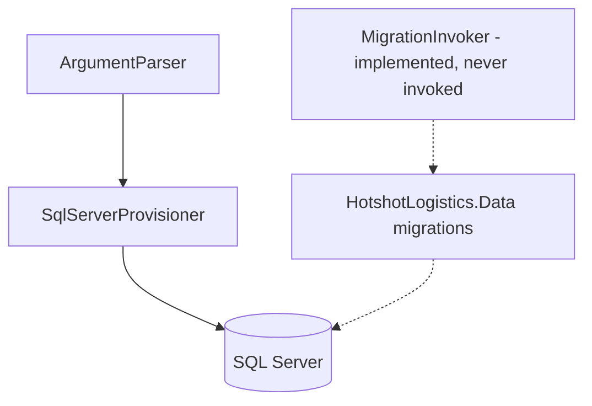

# DbSetup architecture

## Overview

DbSetup is a .NET 8 console tool built on `System.CommandLine`. It creates the SQL Server database, login, and application user. It is not a runtime service.

The tool does **not** apply FluentMigrator migrations today. `MigrationInvoker` is implemented, but `Program.cs` carries a `// TODO` for it and never calls `MigrationInvoker.RunMigrationsAsync`, so the migration path is dead code.

For how this tool relates to the deployed platform, see [deployment architecture](../devops/deployment-architecture.md) and the [DevOps documentation index](../devops/README.md).

## Architecture

Solid edges are the path the CLI actually executes. Dashed edges are the implemented migration path, which the CLI never reaches.

`Program` composes `ArgumentParser`, `EnvironmentManager`, `PasswordManager`, and `SqlServerProvisioner`.

**DR1 — `MigrationInvoker` is not invoked.** `Program.cs` carries a `// TODO: Implement the rest of the components` marker that names `MigrationInvoker`, and never calls `MigrationInvoker.RunMigrationsAsync`. The class itself is complete — it runs FluentMigrator in-process against `HotshotLogistics.Data` when that assembly loads, and otherwise builds and invokes `4-Persistence/MigrationRunner` as a subprocess — but nothing reaches it. Migrations are therefore not applied by the CLI today, and `MigrationInvoker` is dead code.

DR1 is recorded in the canonical drift register in [deployment architecture](../devops/deployment-architecture.md). That register is the single source of truth; it is referenced here, not duplicated.

## Components and interfaces

| Type | Role | Wired by `Program` |
| --- | --- | --- |
| `ArgumentParser` | CLI flags and environment overrides | Yes |
| `EnvironmentManager` | Administrator check; persists the generated connection string to the OS environment with consent | Yes |
| `PasswordManager` | Generated passwords; never logged in full | Yes |
| `SqlServerProvisioner` | CREATE DATABASE / LOGIN / USER, grants, rollback | Yes |
| `MigrationInvoker` | FluentMigrator in-process or MigrationRunner subprocess | No — dead code (DR1) |
| `PermissionManager` | Additional permission grants beyond the base DML set | No |
| `PreflightChecker` | Connectivity and privilege preflight checks | No |
| `InteractivePrompter` | Console prompts and destructive-action confirmation | No |
| `SecureLogger` | Structured logging with secret masking | No — `Program` logs through `Microsoft.Extensions.Logging` directly |
| Tests | `7-Deployment/DbSetup/HotshotLogistics.DbSetup.Tests` | — |

## Data models

No application entities. The tool talks to SQL Server catalog views (`sys.databases`, `sys.server_principals`, `sys.database_principals`) and the target database.

## Error handling

Provisioning catches failures, logs them, rolls back the artifacts created in that run in reverse creation order, and exits non-zero. There is no migration step in the current run, so no migration failure path is exercised.

## Testing strategy

Unit tests sit beside the tool project. Integration coverage that needs a real SQL Server is opt-in: those tests return early when no privileged connection string is configured through user secrets or `TEST_SA_CONNECTION_STRING`. Do not embed credentials in test projects.

CI compiles the test project but does not run it — the build-and-test workflow runs `dotnet test` only over `5-Test/`.
