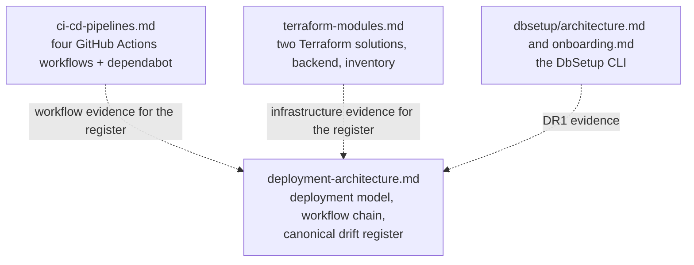

# Deployment and build documentation

How the Hotshot Logistics platform is built and deployed: the Terraform
infrastructure under `7-Deployment/`, the GitHub Actions pipelines that apply
it, and the DbSetup provisioning CLI. The three documents in this folder
describe the deployment stack as this repository implements it today — read
from the source files, not from the intent behind them.

| Document | Covers |
|---|---|
| [Deployment architecture](deployment-architecture.md) | The deployment model, the environments, the resource topology, and the workflow chain. It also hosts the canonical drift register. |
| [CI/CD pipelines](ci-cd-pipelines.md) | The four GitHub Actions workflows and the dependabot configuration — triggers, jobs, steps, and the secret and environment variable names each one references. |
| [Terraform modules and infrastructure](terraform-modules.md) | The two Terraform solutions, the remote-state backend, the providers, and the module, variable, and output inventory. |

The DbSetup CLI is a provisioning tool rather than a runtime service, and it is
documented in its own folder, `6-Docs/dbsetup/`:

| Document | Covers |
|---|---|
| [DbSetup architecture](../dbsetup/architecture.md) | The CLI's composition, its components and interfaces, and the DR1 drift item. |
| [DbSetup onboarding](../dbsetup/onboarding.md) | Dependencies, setup, the debug path, the command line options, and the CI and deployment boundary. |

## How the documents relate

`deployment-architecture.md` is the narrative: it describes the stack as a whole
and links the other documents for the detail each of them owns.
`ci-cd-pipelines.md` and `terraform-modules.md` are inventories — each states
the source files it read, describes them as written today, and links back to
the architecture document for the workflow chain and the drift register. The
DbSetup documents cover the CLI itself and refer to the deployment documents
for how it relates to the deployed platform.

## Drift register

The [canonical drift register](deployment-architecture.md#canonical-drift-register)
is the single source of truth for deployment drift in this delivery. It owns the
definition and the severity of every entry it holds.

Other documents reference drift items by their DR id and record the evidence
from their own area rather than restating the items. The CI/CD pipelines
document holds the workflow-side evidence for the entries the workflows exhibit,
the Terraform document holds the Terraform-side evidence, and the DbSetup
architecture document holds the DR1 evidence.

## Related documentation

- [Documentation index](../README.md)
- [CI/CD coding standard](../standards/github-actions/README.md)
- [Security guidelines](../security.md)
- [Documentation standard](../documentation-standard.md) and
  [documentation ontology](../documentation-ontology.md)
- [Component and owner catalog](../catalog.md)
