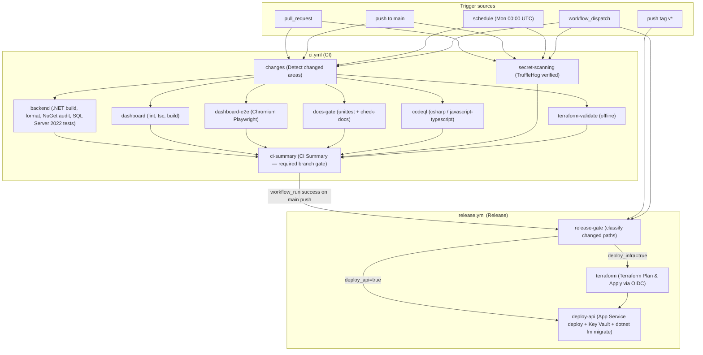

# CI/CD pipelines

An inventory of the GitHub Actions workflows and helper tooling in this repository: what each
workflow triggers on, the jobs and steps it runs, the secrets and environment variables it
declares, and what it validates or deploys.

The workflow files are the source of truth. This document describes them as written today and
cross-references the [Canonical drift register](deployment-architecture.md#canonical-drift-register)
in [deployment architecture](deployment-architecture.md) for deployment drift status.

## Scope of the inventory

| Item | Present |
|---|---|
| Workflow files under `.github/workflows/` | 2 (`ci.yml`, `release.yml`) |
| Shared CI helper module & tests | Yes — [`7-Deployment/ci/ci_helpers.py`](../../7-Deployment/ci/ci_helpers.py) & [`test_ci_helpers.py`](../../7-Deployment/ci/test_ci_helpers.py) |
| Dependabot configuration | 1 — [`.github/dependabot.yml`](../../.github/dependabot.yml) |
| `.github/actions/` directory | No |
| Reusable workflows (`workflow_call`) | No |

## Pipeline inventory at a glance

| File | Workflow `name:` | Triggers | Target / Effect |
|---|---|---|---|
| [`.github/workflows/ci.yml`](../../.github/workflows/ci.yml) | `CI` | `pull_request`, `push` (`main`), `schedule` (`0 0 * * 1`), `workflow_dispatch` | Validation only (solution build/tests, dashboard lint/build/e2e, docs gate, CodeQL, TruffleHog, offline `terraform validate`) |
| [`.github/workflows/release.yml`](../../.github/workflows/release.yml) | `Release` | `workflow_run` (`CI` completed on `main` push), `push` tags (`v*`), `workflow_dispatch` (`dev` \| `staging` \| `prod`, `skip_terraform`) | Azure infrastructure (`terraform` plan + apply) and API deploy + FluentMigrator migrations (`deploy-api`) |

## The workflow chain

## `ci.yml` — CI

**Triggers:** `pull_request`, `push` to `main`, weekly `schedule` (`"0 0 * * 1"`), and
`workflow_dispatch`.

**Permissions & concurrency:** workflow-level `contents: read`; `codeql` elevates
`security-events: write` and `actions: read` at the job level. Concurrency group
`ci-${{ github.workflow }}-${{ github.ref }}` sets `cancel-in-progress: true` only on
`pull_request`.

**Environment defaults:** `DOTNET_VERSION: "10.0.x"`, `NODE_VERSION: "22"`, `DOTNET_NOLOGO: "true"`,
`DOTNET_CLI_TELEMETRY_OPTOUT: "1"`.

| Job | Runs when | What it does |
|---|---|---|
| `changes` | Always | Diffs `BASE_SHA..HEAD` on `pull_request` (falling back to running all jobs if fetch/diff fails, or on non-PR triggers, or if `ci.yml`, `.github/codeql/`, or `7-Deployment/ci/` changed) and emits `backend`, `dashboard`, `docs`, `terraform`, and `codeql` matrix outputs. |
| `backend` | `changes.outputs.backend == 'true'` | Installs .NET `10.0.x`, caches `~/.nuget/packages`, restores `HotshotLogistics.sln`, verifies `dotnet format whitespace` and `dotnet format style --severity warn`, checks `dotnet list HotshotLogistics.sln package --vulnerable --include-transitive --format json` via `ci_helpers.py check-nuget-json`, builds Release (`-nr:false -p:UseSharedCompilation=false`), starts an ephemeral `mcr.microsoft.com/mssql/server:2022-latest` Docker container with a masked per-run `openssl rand` SA password, provisions `hotshot_logistics_test` via `HotshotLogistics.DbSetup` (`--non-interactive`), runs `MigrationRunner`, exports `ConnectionStrings__DefaultConnection`, runs all 4 test projects (`HotshotLogistics.Tests`, `HotshotLogistics.IntegrationTests`, `HotshotLogistics.Api.Tests`, `HotshotLogistics.DbSetup.Tests`), and removes the container under `if: always()`. |
| `dashboard` | `changes.outputs.dashboard == 'true'` | Installs Node `22` with npm cache, runs `npm ci --no-audit --no-fund`, ESLint (`npm run lint`), TypeScript typecheck (`tsc --noEmit`), and `npm run build` in `1-Presentation/admin-dashboard`. |
| `dashboard-e2e` | `changes.outputs.dashboard == 'true'` | Installs Node `22`, restores cached Playwright Chromium browsers (`~/.cache/ms-playwright`), installs OS dependencies on cache miss, and runs `npx --no-install playwright test --project=chromium` (uploading `playwright-report/` on failure). |
| `docs-gate` | `changes.outputs.docs == 'true'` | Runs `python3 -m unittest discover -s 7-Deployment/ci -v` and `python3 7-Deployment/ci/ci_helpers.py check-docs --root .` over `AGENTS.md` and non-archive `6-Docs/**/*.md` (checking balanced-parenthesis local links and exact `6-Docs/todo/README.md` indexing). |
| `codeql` | `changes.outputs.codeql != '[]'` | Runs `github/codeql-action/{init,autobuild,analyze}` across `csharp` and/or `javascript-typescript`. Job permissions: `actions: read`, `contents: read`, `security-events: write`. |
| `secret-scanning` | Always | Checks out with `fetch-depth: 0`, fetches `refs/pull/<n>/head` if `HEAD_SHA` is missing on a pull request, and runs `trufflesecurity/trufflehog` (`--results=verified`). |
| `terraform-validate` | `changes.outputs.terraform == 'true'` | Runs `terraform init -backend=false -input=false` and `terraform validate` in `7-Deployment/Azure-deploy/solution/HotshotLogistics` with no Azure credentials. |
| `ci-summary` | `always()` | Summarizes all upstream job results into `$GITHUB_STEP_SUMMARY` and fails if any dependency reported `failure` or `cancelled`. This is the single required status check enforced on `main`. |

## `release.yml` — Release

**Triggers:**
- `workflow_run` on `"CI"` `completed` for `main`, guarded inside `release-gate` to
  `conclusion == 'success' && event == 'push' && head_branch == 'main'`
- `push` on version tags (`"v*"`)
- `workflow_dispatch` with inputs `environment` (`dev` | `staging` | `prod`, default `dev`) and
  `skip_terraform` (boolean, default `false`)

**Permissions & concurrency:** `id-token: write`, `contents: read`. Concurrency group
`release-${{ github.event.inputs.environment || 'dev' }}` sets `cancel-in-progress: false` so an
active release or Terraform apply is never canceled mid-run. Note that no job declares GitHub
`environment:` because Entra OIDC federated credentials target `ref:refs/heads/main`.

| Job | Runs when | What it does |
|---|---|---|
| `release-gate` | Valid release trigger | Checks out the tested commit (`github.event.workflow_run.head_sha \|\| github.sha`, `fetch-depth: 2`) and invokes `ci_helpers.py classify-release` so docs-only or dashboard-only pushes on `main` emit `deploy_infra=false, deploy_api=false` (tags and `workflow_dispatch` deploy per inputs, and unavailable diffs fail safe to deploying both). |
| `terraform` | `release-gate.outputs.deploy_infra == 'true'` | Runs in `7-Deployment/Azure-deploy/solution/HotshotLogistics`: verifies `SQL_ADMIN_PASSWORD`, `AZURE_AD_CLIENT_ID`, and `AZURE_AD_CLIENT_SECRET` are non-empty, authenticates with Azure OIDC (`azure/login`), runs `terraform init -input=false`, `terraform plan -input=false -out=tfplan -no-color`, and `terraform apply -input=false -auto-approve tfplan` in the same job (never uploading `tfplan`), and deletes `tfplan` under `if: always()`. |
| `deploy-api` | `always()` when `deploy_api == 'true'` and (`deploy_infra != 'true'` or `terraform.result == 'success'`) | Checks out the tested commit, builds and publishes `1-Presentation/HotshotLogistics.Api`, authenticates via Azure OIDC, deploys to `${environment}-hotshot-logistics-function` (`azure/webapps-deploy`, startup `dotnet HotshotLogistics.Api.dll`), reads `sql-connection-string` from Key Vault `${TARGET_ENV}-hotshot-log-kv-01`, masks it with `::add-mask::`, passes it via `env: CONNECTION_STRING`, builds `4-Persistence/HotshotLogistics.Data`, locates the built `HotshotLogistics.Data.dll` dynamically under `bin/Release`, and runs `dotnet fm migrate`. |

## `.github/dependabot.yml`

Configures weekly Monday 09:00 updates for two ecosystems (`nuget` at `/`, limit 10 PRs; and
`github-actions` at `/`, limit 5 PRs), ignoring major version bumps on `actions/setup-dotnet`.

## Secrets and environment variables

| Name | Kind | Where used | Notes |
|---|---|---|---|
| `AZURE_CLIENT_ID` | Repository secret | `release.yml` (`terraform`, `deploy-api`) | Entra app registration client id for OIDC |
| `AZURE_TENANT_ID` | Repository secret | `release.yml` (`terraform`, `deploy-api`) | Entra tenant id |
| `DAVIDS_AZURE_SUB` | Repository secret | `release.yml` (`terraform`, `deploy-api`) | Subscription id (`TF_VAR_subscription_id`, `ARM_SUBSCRIPTION_ID`) |
| `AZURE_AD_CLIENT_ID` | Repository secret (required by Terraform) | `release.yml` (`terraform`) | Pre-checked; mapped to `TF_VAR_azure_ad_client_id` |
| `AZURE_AD_CLIENT_SECRET` | Repository secret (required by Terraform) | `release.yml` (`terraform`) | Pre-checked; mapped to `TF_VAR_azure_ad_client_secret` |
| `SQL_ADMIN_PASSWORD` | Repository secret (required by Terraform) | `release.yml` (`terraform`) | Pre-checked; mapped to `TF_VAR_administrator_login_password` |
| `sql-connection-string` | Azure Key Vault secret (`<env>-hotshot-log-kv-01`) | `release.yml` (`deploy-api`) | Masked via `::add-mask::`, passed via `env: CONNECTION_STRING` |
| Ephemeral `SA_PASSWORD` / `APP_PASSWORD` | Per-run `openssl rand` values | `ci.yml` (`backend`) | Masked via `::add-mask::`; never committed or echoed |

## Standard-conformance and drift alignment

Against the [GitHub Actions coding standard](../standards/github-actions/README.md):

- **Third-party action pinning (DR6 resolved):** Every external `uses:` reference across
  `ci.yml` and `release.yml` is pinned to a full 40-character commit SHA with a version comment
  (`actions/checkout`, `actions/setup-dotnet`, `actions/setup-node`, `actions/cache`,
  `actions/upload-artifact`, `github/codeql-action/*`, `trufflesecurity/trufflehog`,
  `hashicorp/setup-terraform`, `azure/login`, `azure/webapps-deploy`).
- **Least-privilege permissions (DR6 resolved):** `ci.yml` defaults to `contents: read` and
  grants `security-events: write` only to `codeql`; `release.yml` declares `id-token: write` and
  `contents: read` only, with `release-gate` narrowed to `contents: read`.
- **Secret handling (DR14, DR15, and artifact safety resolved):** No `hotshot.tfvars` file is
  written with secrets (`TF_VAR_*` env vars only), `CONNECTION_STRING` is masked and passed by
  `env:`, ephemeral CI SQL passwords are generated at runtime and masked, and `tfplan` is consumed
  in-job and removed rather than uploaded as a workflow artifact.
- **Trigger separation & concurrency:** Pull requests run only `ci.yml` with
  `cancel-in-progress: true` (`pull_request` only); `release.yml` runs downstream on `main` pushes
  passing `CI`, `v*` tags, or manual dispatches with `cancel-in-progress: false`.
- **Remaining register items:** DR1, DR2, DR3 (`environments/dev/hotshot.tfvars` vs `release.yml`
  region/RG), DR5, DR8, DR9, DR11, and DR12 remain open in the
  [Canonical drift register](deployment-architecture.md#canonical-drift-register).
- **Determinism note (no register entry):** Hosted jobs still use `ubuntu-latest` and SDK band
  `10.0.x` (while `global.json` pins `10.0.403` for local consistency).
