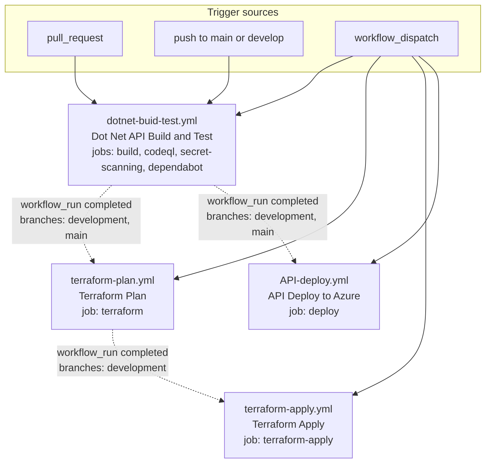

# CI/CD pipelines

An inventory of the GitHub Actions workflows in this repository: what each one triggers
on, the jobs and steps it runs, the secrets and environment variables it declares, and
what it deploys or mutates.

The workflow files are the source of truth. This document describes them as they are
written today. Where the written behaviour diverges from the repository's
[GitHub Actions coding standard](../standards/github-actions/README.md), the divergence is
recorded in [Standard-conformance drift](#standard-conformance-drift) and cross-referenced
to the canonical drift register in [the deployment architecture document](deployment-architecture.md);
a divergence the register does not cover is marked as such where it is recorded.

## Scope of the inventory

| Item | Present |
|---|---|
| Workflow files under `.github/workflows/` | 4 |
| Dependabot configuration | 1 — `.github/dependabot.yml` |
| `.github/actions/` directory | No |
| Reusable workflows (`workflow_call`) | No |
| Composite actions | No |
| Job-level calls to a local reusable workflow | No |

Every `uses:` in the corpus is a step-level reference to a published action. There is no
shared local action or workflow to reuse, which is itself a drift against the standard's
"shared sequences become reusable workflows or composite actions" rule. No entry in the
canonical drift register covers this fact; minting an id for it belongs to the register, not
to this document.

## Pipeline inventory at a glance

| File | Workflow `name:` | Triggers | Target |
|---|---|---|---|
| `dotnet-buid-test.yml` | `Dot Net API Build and Test` | `pull_request`, `push` (main, develop), `workflow_dispatch` | None — verification only |
| `terraform-plan.yml` | `Terraform Plan` | `workflow_run` (Dot Net API Build and Test), `workflow_dispatch` | Azure, via Terraform |
| `terraform-apply.yml` | `Terraform Apply` | `workflow_run` (Terraform Plan), `workflow_dispatch` | Azure, via Terraform |
| `API-deploy.yml` | `API Deploy to Azure` | `workflow_run` (Dot Net API Build and Test), `workflow_dispatch` | Azure App Service |

## The workflow chain



Two properties of the chain are worth stating before the per-workflow detail, because
they change what actually runs:

- **The `workflow_run` branch filters and the CI push filters name different branches.**
  `dotnet-buid-test.yml` pushes on `main` and `develop`; both downstream workflows filter
  `workflow_run` on `development` and `main`. `develop` is not `development`, and the
  repository's default branch is `development`. This is **DR13** in the
  [canonical drift register](deployment-architecture.md#canonical-drift-register), which owns
  its definition and severity.
- **All three `workflow_run` consumers run with the base repository's secrets.** The
  [coding standard](../standards/github-actions/README.md) flags `workflow_run` as a
  trigger that must not check out and execute fork code; `terraform-plan.yml`,
  `terraform-apply.yml`, and `API-deploy.yml` all run `actions/checkout@v5` under a
  `workflow_run` event. `terraform-apply.yml` is one step removed from the fork pull
  request rather than directly downstream of it: it is triggered by `workflow_run` of
  "Terraform Plan", which is itself triggered by `workflow_run` of the CI workflow. No
  entry in the canonical drift register covers this fact; minting an id for it belongs to
  the register, not to this document.

## `dotnet-buid-test.yml` — Dot Net API Build and Test

The only workflow that builds and tests the .NET solution. Every other workflow in the
repository keys off its completion. The file name is spelled `dotnet-buid-test.yml` in the
tree; the workflow's `name:` is `Dot Net API Build and Test`, and the two downstream
`workflow_run` triggers reference the `name:`, not the file name.

### Triggers

- `pull_request`, filtered by `paths`: `**/*.cs`, `**/*.csproj`, `**/Directory.Build.props`,
  `**/Directory.Build.targets`, `**/.editorconfig`, `stylecop.json`, `.github/workflows/**`.
- `push` to `main` or `develop`, with the same `paths` filter.
- `workflow_dispatch` with **no inputs**.

### Declared permissions, concurrency, and secrets

- `permissions:` — `actions: read`, `contents: read`, `security-events: write`.
- `concurrency:` — group `${{ github.workflow }}-${{ github.ref }}`,
  `cancel-in-progress: true`.
- **No secrets and no environment variables are declared.** The workflow references no
  `secrets.*` expression and sets no `env:` block.

### Job graph

Four jobs, all on `ubuntu-latest`, none declaring `needs:` — they run in parallel.

| Job | `if:` | Extra `permissions:` |
|---|---|---|
| `build` | none | inherits the workflow block |
| `codeql` | none | repeats `actions: read`, `contents: read`, `security-events: write` |
| `secret-scanning` | none | inherits the workflow block |
| `dependabot` | `github.actor == 'dependabot[bot]'` | inherits the workflow block |

### `build` job

1. `actions/checkout@v5`.
2. `actions/setup-dotnet@v4` with `dotnet-version: '9.0.x'`.
3. **Restore** — a shell loop over every `*.csproj` found by `find .`, running
   `dotnet restore "$proj"` for each.
4. **Install formatter** — `dotnet tool update -g dotnet-format`.
5. **Lint** — a shell loop over every `*.csproj`, running three verifications per project:
   `dotnet format analyzers "$proj" --severity warn --verify-no-changes --no-restore --verbosity diagnostic`,
   then the same for `style`, then for `whitespace` (without `--severity warn`).
   The lint step itself carries no `-warnaserror` switch; it fails on any reported change.
6. **Build** — a shell loop over every `*.csproj`, running
   `dotnet build "$proj" --configuration Release --no-restore -warnaserror:IDE0005`.
   `-warnaserror:IDE0005` is on this step, not on the lint step. `Directory.Build.props`
   already sets `EnforceCodeStyleInBuild` and promotes `IDE0005` to an error, and
   `.editorconfig` sets `dotnet_diagnostic.IDE0005.severity = warning`.
7. **Test** — a shell loop over every `*.csproj` found by `find ./5-Test`, running
   `dotnet test "$proj" --no-build --configuration Release`. Three test projects are
   matched: `5-Test/HotshotLogistics.Api.Tests`, `5-Test/tests/HotshotLogistics.Tests`, and
   `5-Test/tests/HotshotLogistics.IntegrationTests`.

### `codeql` job

1. **Checkout repository** — `actions/checkout@v5`.
2. **Initialize CodeQL** — `github/codeql-action/init@v3` with `languages: csharp`.
3. **Autobuild** — `github/codeql-action/autobuild@v3`.
4. **Perform CodeQL Analysis** — `github/codeql-action/analyze@v3`.

### `secret-scanning` job

1. **Checkout repository** — `actions/checkout@v5` with `fetch-depth: 0`, so the scan has
   the full history.
2. **Run TruffleHog (Pull Request)** — `if: github.event_name == 'pull_request'`;
   `trufflesecurity/trufflehog@main` with `path: ./`, `base:` the pull request's base
   SHA, `head:` the pull request's head SHA, and `extra_args: --results=verified`.
3. **Run TruffleHog (Push/Workflow Dispatch)** — `if: github.event_name != 'pull_request'`;
   `trufflesecurity/trufflehog@main` with `path: ./` and the same
   `extra_args: --results=verified`.

The `--results=verified` argument is what scopes the action's built-in `--fail` to live
secrets, so unverified findings do not fail the job. The workflow's own comment records
that repeating `--fail` or `--no-update` in `extra_args` aborts the scan before any
secret is detected.

### `dependabot` job

Runs only when `github.actor == 'dependabot[bot]'`.

1. **Checkout repository** — `actions/checkout@v5`.
2. **Setup .NET** — `actions/setup-dotnet@v4` with `dotnet-version: '9.0.x'`.
3. **Check for outdated packages** — a shell loop over every `*.csproj` running
   `dotnet list "$proj" package --outdated || true`. The `|| true` makes the step
   non-failing, so this job reports outdated packages without gating anything.

### What it deploys or mutates

Nothing. The workflow only reads the repository and writes check results (CodeQL security
events) and job logs.

## `terraform-plan.yml` — Terraform Plan

Plans the Azure infrastructure in `7-Deployment/Azure-deploy/solution/HotshotLogistics`, and
— under one condition — also applies it.

### Triggers

- `workflow_run` on `workflows: ["Dot Net API Build and Test"]`, `types: [completed]`,
  `branches: [development, main]`.
- `workflow_dispatch` with **no inputs**.

### Declared permissions, concurrency, and secrets

- `permissions:` — `id-token: write`, `contents: read`. The `id-token` grant is what lets
  the Azure login exchange the OIDC token for a subscription credential.
- `concurrency:` — group `${{ github.workflow }}-${{ github.ref }}`,
  `cancel-in-progress: true`.
- No `secrets:` block and no `environments:` block; every secret is referenced inline.
- **Secret names referenced:** `AZURE_CLIENT_ID`, `AZURE_TENANT_ID`, `DAVIDS_AZURE_SUB`,
  `AZURE_AD_CLIENT_ID`, `AZURE_AD_CLIENT_SECRET`.
- **Environment variable names set in `env:` blocks:** `ARM_CLIENT_ID`,
  `ARM_SUBSCRIPTION_ID`, `ARM_TENANT_ID`, `ARM_USE_OIDC`, `TF_VAR_subscription_id`,
  `TF_VAR_azure_ad_client_id`, `TF_VAR_azure_ad_client_secret`.

### Job graph

A single job, `terraform`, on `ubuntu-latest`, with
`defaults.run.working-directory: 7-Deployment/Azure-deploy/solution/HotshotLogistics`.

The job's guard is:

```
(github.event.workflow_run.conclusion == 'success' && github.event_name == 'workflow_run' && github.event.workflow_run.event == 'pull_request') || github.event_name == 'workflow_dispatch'
```

The `workflow_run.event == 'pull_request'` clause means a **push** to `main` or
`development` does not run the plan job through the chain; only a pull request, or a
manual dispatch, does.

### Steps

1. **Checkout** — `actions/checkout@v5`.
2. **Setup Terraform** — `hashicorp/setup-terraform@v3`.
3. **Setup Azure CLI** — `azure/login@v2` with `client-id:`, `tenant-id:`, and
   `subscription-id:` bound to `secrets.AZURE_CLIENT_ID`, `secrets.AZURE_TENANT_ID`, and
   `secrets.DAVIDS_AZURE_SUB`, and `enable-AzPSSession: true`.
4. **Terraform Init** — `terraform init`, with `ARM_CLIENT_ID`, `ARM_SUBSCRIPTION_ID`,
   `ARM_TENANT_ID`, and `ARM_USE_OIDC: true` in `env:`. The OIDC flag is what makes the
   `azurerm` provider authenticate with the federated token rather than a stored
   credential.
5. **Create tfvars with secrets** — a heredoc that writes `hotshot.tfvars` into the
   working directory, interpolating `secrets.DAVIDS_AZURE_SUB`,
   `secrets.AZURE_AD_CLIENT_ID`, and `secrets.AZURE_AD_CLIENT_SECRET`. The file it writes
   sets `location = "East US 2"`, `resource_group_name = "rg-hotshot-logistics-dev-eastus2"`,
   `environment = "dev"`, and a `tags` map with `Environment`, `Project`, `ManagedBy`, and
   `Owner`.
6. **Terraform Plan** — `terraform plan -var-file="hotshot.tfvars"`, with the three
   `TF_VAR_*` variables and the four `ARM_*` variables in `env:`.
7. **Terraform Apply** — `if: github.ref == 'refs/heads/main'`, running
   `terraform apply -var-file="hotshot.tfvars" -auto-approve` with the same `env:` block.
   Because the job's own guard excludes `workflow_run` events whose source was not a pull
   request, and because a `workflow_run` event carries the default branch's ref, this
   embedded apply is reachable only by dispatching the workflow manually from the `main`
   branch.

### What it deploys or mutates

On the plan path, nothing — `terraform plan` only reads state and writes a plan. On the
embedded apply path it creates or updates the Azure resources declared in
`7-Deployment/Azure-deploy/solution/HotshotLogistics/main.tf`: a resource group, a Linux
App Service plan, a storage account, a function app named
`${environment}-hotshot-logistics-function`, an App Configuration store, a SQL Server, a
SQL database, and a Key Vault.

The generated `hotshot.tfvars` does not set `administrator_login_password`, which
`variables.tf` declares with no default, so the plan and apply steps have no value to
supply for it. Recorded as **DR10** in the
[canonical drift register](deployment-architecture.md#canonical-drift-register).

## `terraform-apply.yml` — Terraform Apply

Applies the same Terraform root as the plan workflow, with different values.

### Triggers

- `workflow_run` on `workflows: ["Terraform Plan"]`, `types: [completed]`,
  `branches: [development]`.
- `workflow_dispatch` with one input:

  | Input | Type | Required | Default | Choices |
  |---|---|---|---|---|
  | `environment` | `choice` | yes | `dev` | `dev`, `staging`, `prod` |

### Declared permissions and secrets

- `permissions:` — `id-token: write`, `contents: read`.
- No `secrets:` block, no `environments:` block, and no `concurrency:` block.
- **Secret names referenced:** `AZURE_CLIENT_ID`, `AZURE_TENANT_ID`, `DAVIDS_AZURE_SUB`,
  `AZURE_AD_CLIENT_ID`, `AZURE_AD_CLIENT_SECRET`.
- **Environment variable names set in `env:` blocks:** `ARM_CLIENT_ID`,
  `ARM_SUBSCRIPTION_ID`, `ARM_TENANT_ID`, `ARM_USE_OIDC`, `TF_VAR_subscription_id`,
  `TF_VAR_azure_ad_client_id`, `TF_VAR_azure_ad_client_secret`.

### Job graph

A single job, `terraform-apply`, on `ubuntu-latest`, with
`defaults.run.working-directory: 7-Deployment/Azure-deploy/solution/HotshotLogistics`.

Its guard is `github.event.workflow_run.conclusion == 'success' || github.event_name == 'workflow_dispatch'`.
The guard reads the conclusion of the whole Terraform Plan workflow; it does not test the
outcome of that workflow's `terraform` job, nor the event that triggered it.

### Steps

1. **Checkout** — `actions/checkout@v5`.
2. **Setup Terraform** — `hashicorp/setup-terraform@v3`.
3. **Setup Azure CLI** — `azure/login@v2` with the same three secret-backed inputs and
   `enable-AzPSSession: true`.
4. **Terraform Init** — `terraform init` with the four `ARM_*` variables in `env:` and
   `ARM_USE_OIDC: true`.
5. **Create tfvars with secrets** — the same heredoc as the plan workflow, except the
   values written are `location = "East US"` and
   `resource_group_name = "rg-hotshot-logistics-dev-eastus"`, with `environment = "dev"`.
6. **Terraform Apply** — `terraform apply -var-file="hotshot.tfvars" -auto-approve`, with
   the three `TF_VAR_*` variables and the four `ARM_*` variables in `env:`.

The `environment` dispatch input is **not consumed by this workflow**. The generated
`hotshot.tfvars` hard-codes `environment = "dev"`, `location = "East US"`, and
`rg-hotshot-logistics-dev-eastus`, so choosing `staging` or `prod` at dispatch time does
not change what is applied.

### What it deploys or mutates

The same Azure resource set as the plan workflow's apply path, in the `East US` region
rather than `East US 2`.

## `API-deploy.yml` — API Deploy to Azure

Builds the ASP.NET Core API and deploys it to an Azure App Service, then applies database
migrations.

### Triggers

- `workflow_run` on `workflows: ["Dot Net API Build and Test"]`, `types: [completed]`,
  `branches: [development, main]`.
- `workflow_dispatch` with one input:

  | Input | Type | Required | Default | Choices |
  |---|---|---|---|---|
  | `environment` | `choice` | yes | `dev` | `dev`, `staging`, `prod` |

### Declared permissions and secrets

- `permissions:` — `id-token: write`, `contents: read`.
- Workflow-level `env:` — `DOTNET_VERSION: '9.0.x'`.
- No `secrets:` block, no `environments:` block, and no `concurrency:` block.
- **Secret names referenced:** `AZURE_CLIENT_ID`, `AZURE_TENANT_ID`, `DAVIDS_AZURE_SUB`.
- **Environment variable names set in `env:` blocks:** `ARM_CLIENT_ID`,
  `ARM_SUBSCRIPTION_ID`, `ARM_TENANT_ID`, `ARM_USE_OIDC`, and the shell-local
  `CONNECTION_STRING` exported inside the migration step.
- **Azure Key Vault secret name read at runtime:** `sql-connection-string`. The name is
  used, and the value is not recorded in this document. The workflow never `echo`s the
  value on its own, but the value does reach the job log: it is written to
  `$GITHUB_OUTPUT` at `API-deploy.yml:76` and interpolated into the migration step's
  `run:` script at `API-deploy.yml:84`, which the runner prints before executing the
  step. See [Key Vault secret value written to a step output and echoed into the job
  log](#dr15--key-vault-secret-value-written-to-a-step-output-and-echoed-into-the-job-log).

### Job graph

A single job, `deploy`, on `ubuntu-latest`, with
`defaults.run.working-directory: 1-Presentation/HotshotLogistics.Api`.

Its guard is `(github.event.workflow_run.conclusion == 'success' && github.event_name == 'workflow_run') || github.event_name == 'workflow_dispatch'`.
Unlike the plan workflow's guard, it does not test which event triggered the build
workflow, so any successful build run on `development` or `main` leads to a deploy.

### Steps

1. **Checkout repository** — `actions/checkout@v5`.
2. **Setup .NET** — `actions/setup-dotnet@v4` with `dotnet-version: ${{ env.DOTNET_VERSION }}`.
3. **Setup Azure CLI** — `azure/login@v2` with `client-id:`, `tenant-id:`, and
   `subscription-id:` bound to `secrets.AZURE_CLIENT_ID`, `secrets.AZURE_TENANT_ID`, and
   `secrets.DAVIDS_AZURE_SUB`, and `enable-AzPSSession: true`.
4. **Restore dependencies** — `dotnet restore`.
5. **Build application** — `dotnet build --configuration Release --no-restore`.
6. **Publish application** — `dotnet publish --configuration Release --output ./publish --no-build`.
7. **Deploy to Azure App Service** — `azure/webapps-deploy@v4` with
   `app-name: ${{ github.event.inputs.environment || 'dev' }}-hotshot-logistics-function`,
   `package: ./publish`, and `startup-command: 'dotnet HotshotLogistics.Api.dll'`.
8. **Get Key Vault connection string** — step id `get-connection-string`. Runs
   `az keyvault secret show --vault-name "<environment>-hotshot-logistics-kv" --name "sql-connection-string" --query value -o tsv`
   and appends the result to `$GITHUB_OUTPUT` under the output name `connection_string`.
9. **Run database migrations** — installs `FluentMigrator.DotNet.Cli` version `3.4.0`
   globally, exports `CONNECTION_STRING` from the previous step's output, builds
   `4-Persistence/HotshotLogistics.Data/HotshotLogistics.Data.csproj` in `Release`, then
   runs
   `dotnet fm migrate -a 4-Persistence/HotshotLogistics.Data/bin/Release/net8.0/HotshotLogistics.Data.dll -c "<connection string>" -p sqlserver`.
   The step's `env:` block carries the four `ARM_*` OIDC variables.
10. **Verify deployment** — echoes the environment, the App Service name, and a completion
    message. No secret is echoed in this step. The job log does carry the Key Vault
    connection string, but it arrives through the migration step's `run:` script, not
    through this one.

Two naming details are worth recording, because both are inputs to a live Azure call:

- The vault the workflow reads is `<environment>-hotshot-logistics-kv`, while
  `main.tf` creates the Key Vault as `${var.environment}-hotshot-log-kv-01`. This is
  **DR7** in the
  [canonical drift register](deployment-architecture.md#canonical-drift-register), which owns
  its definition and severity.
- The migration step's `4-Persistence/...` paths are relative to the job's
  `defaults.run.working-directory` of `1-Presentation/HotshotLogistics.Api`, and the step
  does not override it.

### What it deploys or mutates

Publishes and overwrites the deployment of the `<environment>-hotshot-logistics-function`
App Service with the API assembly and startup command above, and applies FluentMigrator
migrations to the SQL Server reached through the Key Vault connection string.

## `.github/dependabot.yml` — dependency automation

`version: 2`, with two ecosystems.

| Ecosystem | Directory | Schedule | Open PR limit | Commit prefix | Labels | Reviewer / assignee |
|---|---|---|---|---|---|---|
| `nuget` | `/` | weekly, Monday 09:00 | 10 | `deps` (scope included) | `dependencies`, `dotnet` | `dpalfery` |
| `github-actions` | `/` | weekly, Monday 09:00 | 5 | `ci` (scope included) | `dependencies`, `github-actions` | `dpalfery` |

The `github-actions` ecosystem carries one `ignore` rule: `actions/setup-dotnet` is
excluded from `version-update:semver-major`, so the .NET SDK version the workflows pin
through `actions/setup-dotnet` is not bumped automatically.

Both ecosystems target the repository root (`directory: "/"`). The `nuget` entry therefore
covers the solution's packages only where the .NET tooling resolves them from the root;
the workflow's own `dependabot` job separately lists every `*.csproj` it can find.

## Secrets and environment variables referenced

No workflow declares a `secrets:` or `environments:` block. Every secret is referenced
inline as a `secrets.*` expression. No workflow uploads an artifact or writes a step
summary. On the echo half of the standard's secrets rule, the corpus splits in two:

- **The GitHub Actions secrets path is clean.** `terraform-plan.yml`,
  `terraform-apply.yml`, and `API-deploy.yml` take their values from the repository's
  secrets store, and the runner redacts a repository secret from the job log. None of the
  three echoes a secret value of its own, so nothing from that path reaches the log in
  cleartext.
- **The Azure Key Vault path is not.** `API-deploy.yml` reads one secret from Key Vault
  at runtime, and the value reaches the job log through the migration step's `run:`
  script. It is not redacted, because it is neither a repository secret nor masked with
  `::add-mask::`. See [Key Vault secret value written to a step output and echoed into the
  job log](#dr15--key-vault-secret-value-written-to-a-step-output-and-echoed-into-the-job-log).

Three of the four workflows write secret **values** to a file:

| Workflow | Step | File written | Secret value written |
|---|---|---|---|
| `terraform-plan.yml` | *Create tfvars with secrets* (`:53-79`) | `hotshot.tfvars` | `DAVIDS_AZURE_SUB` (`:63`), `AZURE_AD_CLIENT_ID` (`:66`), `AZURE_AD_CLIENT_SECRET` (`:67`) |
| `terraform-apply.yml` | *Create tfvars with secrets* (`:57-83`) | `hotshot.tfvars` | `DAVIDS_AZURE_SUB` (`:67`), `AZURE_AD_CLIENT_ID` (`:70`), `AZURE_AD_CLIENT_SECRET` (`:71`) |
| `API-deploy.yml` | *Get Key Vault connection string* (`:72-76`) | `$GITHUB_OUTPUT` | the value of the Azure Key Vault secret `sql-connection-string` (`:76`) |

`terraform-plan.yml` and `terraform-apply.yml` each run a `cat > hotshot.tfvars` heredoc
that interpolates the values of `DAVIDS_AZURE_SUB`, `AZURE_AD_CLIENT_ID`, and
`AZURE_AD_CLIENT_SECRET` into the generated `hotshot.tfvars` in the working directory
`7-Deployment/Azure-deploy/solution/HotshotLogistics`. Those two workflows therefore do not
hand the secret to Terraform only by `env:` — they also materialize the values on disk,
which diverges from the [coding standard](../standards/github-actions/README.md) and its
prescription that secrets are passed by `env:`; see
[Standard-conformance drift](#standard-conformance-drift) for the recorded evidence.

`API-deploy.yml` writes a secret value to a file of a different kind. The value of the
Key Vault secret `sql-connection-string` is appended to `$GITHUB_OUTPUT` under the output
name `connection_string` (`API-deploy.yml:76`), and the migration step interpolates that
output into its own `run:` script (`API-deploy.yml:84`), which the runner prints to the
job log. No `::add-mask::` call appears in any of the four workflow files, so nothing
redacts that value.

| Name | Kind | Used by |
|---|---|---|
| `AZURE_CLIENT_ID` | secret | `terraform-plan.yml`, `terraform-apply.yml`, `API-deploy.yml` |
| `AZURE_TENANT_ID` | secret | `terraform-plan.yml`, `terraform-apply.yml`, `API-deploy.yml` |
| `DAVIDS_AZURE_SUB` | secret | `terraform-plan.yml`, `terraform-apply.yml`, `API-deploy.yml` |
| `AZURE_AD_CLIENT_ID` | secret | `terraform-plan.yml`, `terraform-apply.yml` |
| `AZURE_AD_CLIENT_SECRET` | secret | `terraform-plan.yml`, `terraform-apply.yml` |
| `sql-connection-string` | Azure Key Vault secret name | `API-deploy.yml` |
| `ARM_CLIENT_ID` | environment variable | `terraform-plan.yml`, `terraform-apply.yml`, `API-deploy.yml` |
| `ARM_SUBSCRIPTION_ID` | environment variable | `terraform-plan.yml`, `terraform-apply.yml`, `API-deploy.yml` |
| `ARM_TENANT_ID` | environment variable | `terraform-plan.yml`, `terraform-apply.yml`, `API-deploy.yml` |
| `ARM_USE_OIDC` | environment variable | `terraform-plan.yml`, `terraform-apply.yml`, `API-deploy.yml` |
| `TF_VAR_subscription_id` | environment variable | `terraform-plan.yml`, `terraform-apply.yml` |
| `TF_VAR_azure_ad_client_id` | environment variable | `terraform-plan.yml`, `terraform-apply.yml` |
| `TF_VAR_azure_ad_client_secret` | environment variable | `terraform-plan.yml`, `terraform-apply.yml` |
| `DOTNET_VERSION` | environment variable | `API-deploy.yml` |
| `CONNECTION_STRING` | environment variable | `API-deploy.yml` (migration step) |
| `connection_string` | step output name | `API-deploy.yml` (`get-connection-string`) |

## Standard-conformance drift

The canonical drift register is the **Deployment architecture** document
([deployment-architecture.md](deployment-architecture.md)). It owns the definition and the
severity of every `DR` entry. This document does not restate that register; it records the
workflow-side evidence for the entries the CI/CD pipelines exhibit, and points at where in
the workflow files the evidence lives. A divergence recorded below is either covered by an
entry in that register, in which case the table gives its id, or is marked as having no
entry.

| DR | What the workflows show |
|---|---|
| DR3 | The plan and apply workflows generate different `location` and `resource_group_name` values — see [DR3](#dr3--divergent-region-and-resource-group-between-plan-and-apply) |
| DR4 | Two workflows can apply the same Terraform root — see [DR4](#dr4--planapply-overlap) |
| DR5 | `staging` and `prod` are offered as dispatch choices with no environment files behind them — see [DR5](#dr5--staging-and-prod-inputs-with-no-matching-environment-files) |
| DR6 | Third-party actions are referenced by mutable tag or branch — see [DR6](#dr6--action-pinning-vs-standard) |
| DR7 | The API deploy workflow reads the Key Vault secret from `<environment>-hotshot-logistics-kv`, while Terraform creates the vault as `<environment>-hotshot-log-kv-01` — see the [API deploy section](#api-deployyml--api-deploy-to-azure) |
| DR13 | The build workflow pushes on `main` and `develop`, while the downstream workflows filter `workflow_run` on `development` and `main` — see [the workflow chain](#the-workflow-chain) |
| DR14 | The plan and apply workflows interpolate secret values into a generated `hotshot.tfvars` — see [DR14](#dr14--secret-values-written-to-a-generated-tfvars-file) |
| DR15 | The API deploy workflow writes the value of the Key Vault secret `sql-connection-string` to `$GITHUB_OUTPUT` and interpolates it into the migration step's script — see [DR15](#dr15--key-vault-secret-value-written-to-a-step-output-and-echoed-into-the-job-log) |

Two further divergences are recorded below, and both are entries in the canonical
register: [DR14](#dr14--secret-values-written-to-a-generated-tfvars-file) and
[DR15](#dr15--key-vault-secret-value-written-to-a-step-output-and-echoed-into-the-job-log).
The register owns the definition and the severity of both; what follows in this document is
the workflow-side evidence only.

Two more subsections below record material the register does not cover — the
[Determinism](#determinism--runner-image-sdk-version-and-tool-version) divergences and
the [concurrency](#concurrency--the-pull-request-clause-and-the-downstream-consumers)
assessment. Each says so where it is recorded, and no id is minted here.

### DR6 — Action pinning vs standard

This divergence is **DR6** in the
[canonical drift register](deployment-architecture.md#canonical-drift-register), which owns
its definition and severity. What follows in this document is the workflow-side evidence
only.

The evidence, by file:

| File | Action reference | Pin form |
|---|---|---|
| `dotnet-buid-test.yml` | `trufflesecurity/trufflehog@main` | mutable branch |
| `dotnet-buid-test.yml` | `actions/checkout@v5`, `actions/setup-dotnet@v4` | first-party major tag |
| `dotnet-buid-test.yml` | `github/codeql-action/init@v3`, `github/codeql-action/autobuild@v3`, `github/codeql-action/analyze@v3` | major tag |
| `terraform-plan.yml` | `hashicorp/setup-terraform@v3`, `azure/login@v2` | major tag |
| `terraform-apply.yml` | `hashicorp/setup-terraform@v3`, `azure/login@v2` | major tag |
| `API-deploy.yml` | `azure/login@v2`, `azure/webapps-deploy@v4` | major tag |

The table enumerates the nine distinct mutable action references in the corpus. The
register's DR6 entry states which of them the gap covers, including the treatment of the
standard's conditional first-party `actions/*` carve-out; the table above is the
file-level evidence for that entry, and the "Pin form" column records the pin form only.

On the least-privilege half of DR6, all four workflows do declare `permissions:`
explicitly, and the two Terraform workflows plus the API deploy take the minimum OIDC
grant (`id-token: write`, `contents: read`). The gap is inside
`dotnet-buid-test.yml`: the `secret-scanning` and `dependabot` jobs inherit the
workflow-level `security-events: write`, which only the `codeql` job uses.

The standard that DR6 measures against is itself `status: draft`, so DR6 records a
divergence from proposed guidance rather than from an enforced gate.

### DR3 — Divergent region and resource-group between plan and apply

`terraform-plan.yml` and `terraform-apply.yml` generate their `hotshot.tfvars` from two
different inline heredocs, and they disagree on where the infrastructure goes.

| Source | `location` | `resource_group_name` |
|---|---|---|
| `terraform-plan.yml` | `East US 2` | `rg-hotshot-logistics-dev-eastus2` |
| `terraform-apply.yml` | `East US` | `rg-hotshot-logistics-dev-eastus` |
| `7-Deployment/Azure-deploy/environments/dev/hotshot.tfvars` | `East US` | `rg-hotshot-logistics-dev-eastus` |

The committed environment file agrees with the apply workflow and not with the plan
workflow. Neither workflow reads the committed environment file; both write their own
`hotshot.tfvars` into `7-Deployment/Azure-deploy/solution/HotshotLogistics` before
running Terraform.

### DR4 — Plan/apply overlap

Two distinct apply paths exist over the same Terraform root
(`7-Deployment/Azure-deploy/solution/HotshotLogistics`):

- `terraform-plan.yml` carries a **Terraform Apply** step gated on
  `github.ref == 'refs/heads/main'`.
- `terraform-apply.yml` is a separate workflow whose only job applies the same root with
  `terraform apply -auto-approve`.

Both write the same `hotshot.tfvars` filename into the same working directory and both
apply the same root, and the plan workflow's trigger set (`development`, `main`) overlaps
the apply workflow's (`development`).

### DR5 — `staging` and `prod` inputs with no matching environment files

`terraform-apply.yml` and `API-deploy.yml` both offer `dev`, `staging`, and `prod` as
`workflow_dispatch` choices. The repository's environment directory,
`7-Deployment/Azure-deploy/environments/`, contains only `dev/hotshot.tfvars`. There is no
`staging/` and no `prod/` directory.

`terraform-apply.yml` does not consume the input at all — it hard-codes `dev` in the
generated `hotshot.tfvars`. `API-deploy.yml` does consume it, and uses it to name the App
Service and the Key Vault, but the underlying Terraform only ever provisions the `dev`
resource group.

### DR14 — Secret values written to a generated tfvars file

**This divergence is DR14 in the
[canonical drift register](deployment-architecture.md#canonical-drift-register)**, which owns
its definition and severity. What follows is the workflow-side evidence only.

The [github-actions coding standard](../standards/github-actions/README.md) states:

> Secrets come from the secrets store, are passed by `env:`, and are never echoed, written
> to an artifact, or included in a step summary.

Two of the four workflows write secret **values** to a file of this kind — a generated
Terraform variables file — in a step named *Create tfvars with secrets*:

| Workflow | Step | File written | Secret values interpolated |
|---|---|---|---|
| `terraform-plan.yml` | *Create tfvars with secrets* (`:53-79`) | `hotshot.tfvars` | `DAVIDS_AZURE_SUB` (`:63`), `AZURE_AD_CLIENT_ID` (`:66`), `AZURE_AD_CLIENT_SECRET` (`:67`) |
| `terraform-apply.yml` | *Create tfvars with secrets* (`:57-83`) | `hotshot.tfvars` | `DAVIDS_AZURE_SUB` (`:67`), `AZURE_AD_CLIENT_ID` (`:70`), `AZURE_AD_CLIENT_SECRET` (`:71`) |

Both steps run `cat > hotshot.tfvars << EOF` into the job's
`defaults.run.working-directory`, `7-Deployment/Azure-deploy/solution/HotshotLogistics`, so
three Azure credential values — a subscription id, an Azure AD client id, and an Azure AD
client secret — land on the runner's filesystem in cleartext.

A third secret-value file write exists in the corpus, and it is a different kind of
file: `API-deploy.yml` writes the value of the Key Vault secret `sql-connection-string`
to `$GITHUB_OUTPUT`. It is recorded in its own subsection below — [Key Vault secret value
written to a step output and echoed into the job
log](#dr15--key-vault-secret-value-written-to-a-step-output-and-echoed-into-the-job-log).

The divergence is against the "passed by `env:`" half of the rule. The same three values
are already passed by `env:` as `TF_VAR_subscription_id`, `TF_VAR_azure_ad_client_id`, and
`TF_VAR_azure_ad_client_secret` in the plan and apply steps that follow
(`terraform-plan.yml:84-86`, `terraform-apply.yml:88-90`), so the file duplicates what the
environment already supplies. The standard's third clause names "written to an artifact"
rather than "written to a file", and this file is never uploaded as an artifact — but the
file write is a second mechanism for handing a secret to a step, in place of the `env:`
the standard prescribes.

What bounds the exposure of these two workflows, and what does not:

- **No log, artifact, or step summary — for these two workflows.** Neither
  `terraform-plan.yml` nor `terraform-apply.yml` echoes a secret value to a log, and no
  workflow in the corpus uploads an artifact or writes a step summary, so the standard's
  echo/artifact/step-summary half is satisfied **for the two Terraform workflows**. It is
  not satisfied across the corpus: `API-deploy.yml` reaches the job log by a different
  route — see [Key Vault secret value written to a step output and echoed into the job
  log](#dr15--key-vault-secret-value-written-to-a-step-output-and-echoed-into-the-job-log).
- **Not committed.** The generated `hotshot.tfvars` is covered by the repository's
  `*.tfvars` gitignore rule (`.gitignore:326`) and is created only inside the runner's
  working tree, never in the repository.
- **Consumed in the same job.** The file is read by the `terraform plan` and
  `terraform apply -var-file="hotshot.tfvars"` steps that follow it. No later workflow
  receives it.
- **Still a cleartext file on disk.** Three Azure credential values are written to a file
  in a job that runs with the base repository's secrets. The standard prescribes passing
  such values by `env:`, and these two workflows write them to a file as well.

### DR15 — Key Vault secret value written to a step output and echoed into the job log

**This divergence is DR15 in the
[canonical drift register](deployment-architecture.md#canonical-drift-register)**, which owns
its definition and severity. What follows is the workflow-side evidence only.

`API-deploy.yml` is the one workflow in the corpus that takes a secret value from
somewhere other than the repository's secrets store. It reads the Azure Key Vault secret
`sql-connection-string` at runtime and handles the value like this:

| Step | Line | What happens to the value |
|---|---|---|
| *Get Key Vault connection string* (id `get-connection-string`) | `API-deploy.yml:72-76` | `az keyvault secret show … --query value -o tsv` captures the value into the shell variable `CONNECTION_STRING`; `echo "connection_string=$CONNECTION_STRING" >> $GITHUB_OUTPUT` then writes it to the step-output file under the output name `connection_string` (`:76`). |
| *Run database migrations* | `API-deploy.yml:78-95` | `export CONNECTION_STRING="${{ steps.get-connection-string.outputs.connection_string }}"` interpolates that output into the step's `run:` script (`:84`). |

Two properties of this handling are what the standard's secrets rule turns on. Both are
properties of the GitHub Actions platform rather than of this repository, so they are
stated here as the platform documents them:

- **The runner prints the step's script to the job log.** GitHub's *Secure use reference*
  states what routing a value through an intermediate environment variable buys: "With
  this approach, the value of the `${{ github.event.pull_request.title }}` expression is
  stored in memory and used as a variable, and doesn't interact with the script generation
  process." `API-deploy.yml:84` does not route the value that way —
  `steps.get-connection-string.outputs.connection_string` is substituted into the
  migration step's script itself, and the runner prints that script to the job log, so
  the value appears in the form the runner emits for that step: the
  `export CONNECTION_STRING="…"` line, with the connection string in cleartext.
- **The value is not redacted.** GitHub's *Secure use reference* describes the platform's
  redaction model: "Because there are multiple ways a secret value can be transformed,
  automatic redaction is not guaranteed", and a value is redacted only if it is a GitHub
  secret or is masked — "Mask all sensitive information that is not a GitHub secret by
  using `::add-mask::VALUE`. This causes the value to be treated as a secret and redacted
  from logs." The *Workflow commands for GitHub Actions* reference states the same rule
  from the other side: "Masking a value prevents a string or variable from being printed
  in the log." The Key Vault value is neither a repository secret nor masked — no
  `::add-mask::` call appears in any of the four workflow files — so it is printed. The
  *Secure use reference* names this exact case: "If a secret is used to generate another
  sensitive value within a workflow, that generated value should be formally registered as
  a secret, so that it will be redacted if it ever appears in the logs."

GitHub's own documented recipe for this pattern is the one `API-deploy.yml` follows almost
exactly, with the masking step left out. The *Workflow commands for GitHub Actions*
reference gives it as three steps: "Generate the secret (without outputting it). Mask it
with `add-mask`. Use `GITHUB_OUTPUT` to make the secret available to other steps within
the job" — and its example names the consuming step "Use that secret output (protected by
a mask)". `API-deploy.yml` performs the first and third of those steps and omits the
second, so the protection that the example's step name refers to is absent. The same
reference's "Setting an output parameter" example passes the output to the consuming step
through `env:`, which is also what this repository's coding standard prescribes;
`API-deploy.yml:84` instead interpolates it straight into the `run:` script.

What bounds the exposure of this divergence, and what does not:

- **The value stays inside the job.** It is written to `$GITHUB_OUTPUT` and read back
  within the same job. No workflow in the corpus uploads an artifact, no step output is
  passed to another workflow, and no step writes a step summary.
- **It is not committed anywhere.** `$GITHUB_OUTPUT` is a runner-owned file for the
  duration of the job, not a path in the repository.
- **It is not echoed on purpose.** The *Verify deployment* step (`API-deploy.yml:97-102`)
  echoes only the environment, the App Service name, and a completion message.
- **It does reach the job log.** The value is printed in the migration step's script
  because it is neither a GitHub Actions secret nor masked with `::add-mask::`. The
  coding standard's secrets rule — "Secrets come from the secrets store, are passed by
  `env:`, and are never echoed, written to an artifact, or included in a step summary" —
  is not satisfied on this path.

### Determinism — runner image, SDK version, and tool version

No entry in the canonical drift register covers these facts; minting an id for them
belongs to the register, not to this document.

The [github-actions coding standard](../standards/github-actions/README.md) states:

> ## Determinism
>
> Pin the runner image, the language version, and the tool versions. `latest` in CI means
> the build that passes today fails on a morning nobody changed anything.

The corpus diverges from that rule on all three counts it names.

**The runner image is the unpinned alias `ubuntu-latest`.** Every job in the corpus
resolves its runner from it: `terraform-plan.yml:23`, `terraform-apply.yml:27`,
`dotnet-buid-test.yml:38`, `:74`, `:95`, and `:126`, and `API-deploy.yml:32`. The alias
moves as the hosted image is updated, so the same workflow file runs on a different image
from one day to the next.

**The language version floats within the minor.** `dotnet-buid-test.yml:43` and `:135`
request `dotnet-version: '9.0.x'`, and `API-deploy.yml:28` sets
`DOTNET_VERSION: '9.0.x'` for the setup step that consumes it. The `x` resolves to the
newest patch of the `9.0` band, so a patch release changes the build inputs with no change
to the repository.

**The tool version is unpinned.** `dotnet-buid-test.yml:50` runs
`dotnet tool update -g dotnet-format` with no version argument, so the formatter resolves
to whatever was published most recently. The corpus carries the pinned form as well —
`API-deploy.yml:81` runs
`dotnet tool install --global FluentMigrator.DotNet.Cli --version 3.4.0` — so the two
tool acquisitions do not follow the same rule.

### Concurrency — the pull-request clause and the downstream consumers

No entry in the canonical drift register covers this assessment; minting an id for it
belongs to the register, not to this document.

The [github-actions coding standard](../standards/github-actions/README.md) states:

> `concurrency` with `cancel-in-progress` on pull-request workflows, so a force-push does
> not leave two runs racing.

The clause reaches pull-request workflows, and one workflow in the corpus is a
pull-request workflow: `dotnet-buid-test.yml` triggers on `pull_request`, and it declares
`concurrency:` with group `${{ github.workflow }}-${{ github.ref }}` and
`cancel-in-progress: true` (`:32-34`). The clause is satisfied where it applies.

The other three workflows are not pull-request workflows — they trigger on `workflow_run`
and `workflow_dispatch` — so the clause as written does not reach them.
`terraform-plan.yml` declares the same `concurrency:` block regardless (`:17-19`). The two
that declare no `concurrency:` key are `terraform-apply.yml` and `API-deploy.yml`, and both
sit downstream of a pull request: `API-deploy.yml` is triggered by `workflow_run` of the
CI workflow, and `terraform-apply.yml` is one step further removed, triggered by
`workflow_run` of "Terraform Plan". Neither can cancel an in-flight run of itself, so the
force-push race the clause names is not closed for either of them — but the clause, written
for pull-request workflows, does not reach them. That makes this an assessment of the
corpus rather than a divergence from the rule as it stands.
