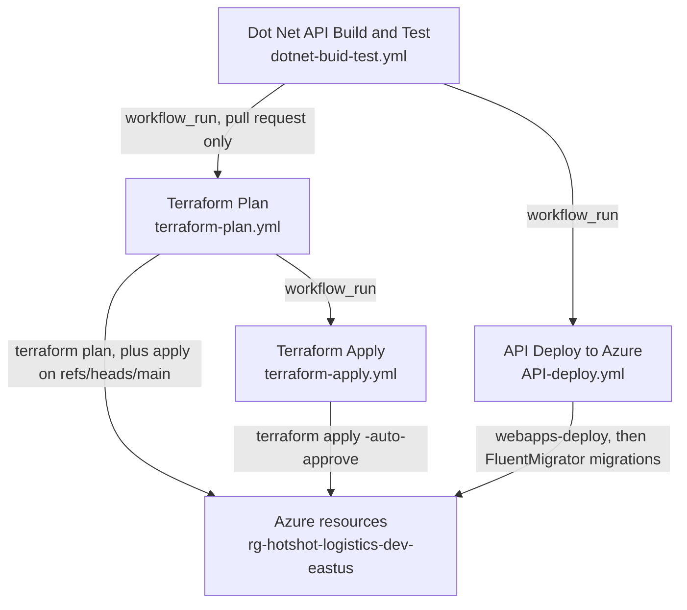

# Deployment architecture

How the Hotshot Logistics platform is deployed as this repository actually implements it:
the Terraform under `7-Deployment/Azure-deploy/`, the four GitHub Actions workflows under
`.github/workflows/`, the local Docker Compose file, and the DbSetup CLI.

This document also hosts the **canonical drift register** for this repository — the
[Canonical drift register](#canonical-drift-register) section below. Other documents link
to that section instead of restating its items.

Every statement below was read from the source files named in the same subsection. Where the
code and the documentation disagree, both are reported and the disagreement is recorded in the
register rather than resolved here.

## Sources

| Area | Files read |
| --- | --- |
| CI/CD | `.github/workflows/dotnet-buid-test.yml`, `.github/workflows/terraform-plan.yml`, `.github/workflows/terraform-apply.yml`, `.github/workflows/API-deploy.yml`, `.github/dependabot.yml` |
| Infrastructure as code | `7-Deployment/Azure-deploy/solution/launchpad/{main,variables,outputs}.tf`, `7-Deployment/Azure-deploy/solution/HotshotLogistics/{main,variables,outputs}.tf`, `7-Deployment/Azure-deploy/environments/dev/hotshot.tfvars` |
| Local dependencies | `7-Deployment/docker-compose.yml` |
| Provisioning tool | `7-Deployment/DbSetup/HotshotLogistics.DbSetup/Program.cs`, `7-Deployment/DbSetup/HotshotLogistics.DbSetup/MigrationInvoker.cs` |
| Application | `1-Presentation/HotshotLogistics.Api/HotshotLogistics.Api.csproj`, `1-Presentation/HotshotLogistics.Api/Program.cs` |

## Environments

| Environment | Where the code defines it | Provisioning inputs |
| --- | --- | --- |
| `dev` | Terraform variable default (`environment = "dev"` in `variables.tf`); the `workflow_dispatch` default in `API-deploy.yml` and `terraform-apply.yml` | `7-Deployment/Azure-deploy/environments/dev/hotshot.tfvars` |
| `staging` | `workflow_dispatch` choice option in `API-deploy.yml` and `terraform-apply.yml` only | none |
| `prod` | `workflow_dispatch` choice option in `API-deploy.yml` and `terraform-apply.yml` only | none |

The Terraform `environment` variable is a plain string whose only effect in the
`HotshotLogistics` solution is to prefix the six resource names built from it. Resource tags
come from the separate `tags` variable, a `map(string)` that the tfvars file sets independently
of `environment`, so `environment` never reaches a tag. There is no per-environment module, no
separate state key, and no environment-specific parameterization beyond that prefix and the
tfvars file. `staging` and `prod` exist as workflow input options, but no infrastructure
definition for either exists in the tree — see DR5 in the register.

## Hosting model

**The hosting model is unresolved.** The documentation and the infrastructure disagree, and
this document does not pick a winner. The conflict is recorded as DR2 in the register.

| Source | What it says |
| --- | --- |
| [technology-stack.md](../technology-stack.md) | "**Framework**: .NET 8 ASP.NET Core Web API (Azure App Service / Function App — see 'Hosting model')"; "**Cloud**: Azure (App Service / Function App, SQL Server, App Configuration, Key Vault)". Its "Hosting model" section states that the hosting model is "**unresolved**", names the actual deployment path, and points back at DR2. |
| [api/architecture.md](../api/architecture.md) | "`HotshotLogistics.Api` is an ASP.NET Core Web API. Its hosting model is unresolved — see the canonical drift register (DR2) in deployment architecture; the actual deployment path is an Azure App Service plan / Function App provisioned by Terraform, deployed by `API-deploy.yml`." It was corrected on 2026-10-20 within this delivery; it previously read "`HotshotLogistics.Api` is an ASP.NET Core Web API hosted on Azure Container Apps". |
| [project-overview.md](../project-overview.md) | "ASP.NET Core Web API (hosting model unresolved — see DR2), SQL Server via native ADO.NET, Clean Architecture." It was corrected on 2026-10-20 within this delivery; it previously read "ASP.NET Core Web API on Azure Container Apps". |
| [rules/file-organization.md](../rules/file-organization.md) | "API controllers and endpoints" — the hosting parenthetical was dropped. It was corrected on 2026-10-20 within this delivery; it previously read "API controllers and endpoints (ASP.NET Core Web API on Azure Container Apps)". |
| `7-Deployment/Azure-deploy/solution/HotshotLogistics/main.tf` | `module "function_app"` — AVM `Azure/avm-res-web-site/azurerm` v0.17.2, `kind = "functionapp"` |
| `.github/workflows/API-deploy.yml` | `azure/webapps-deploy@v4`, in a step named "Deploy to Azure App Service", with `startup-command: 'dotnet HotshotLogistics.Api.dll'` |

Text quoted from another document is reproduced without that document's internal link markup.

[technology-stack.md](../technology-stack.md) no longer asserts Azure Container Apps. It was
corrected on 2026-10-19, within this delivery: it now names the actual deployment path — an
App Service plan and a Function App provisioned by Terraform, deployed by `API-deploy.yml` —
and it states that the hosting model is unresolved.

The documents that carried Azure Container Apps as the hosting model were
[api/architecture.md](../api/architecture.md), [project-overview.md](../project-overview.md),
[rules/file-organization.md](../rules/file-organization.md), the root `README.md`, and
`1-Presentation/HotshotLogistics.Api/README.md`. All five were corrected on 2026-10-20, within
this delivery: each no longer asserts Azure Container Apps.
[api/architecture.md](../api/architecture.md), [project-overview.md](../project-overview.md),
the root `README.md`, and `1-Presentation/HotshotLogistics.Api/README.md` now state that the
hosting model is unresolved and point at DR2, while
[rules/file-organization.md](../rules/file-organization.md) dropped the hosting parenthetical
without naming a hosting model. See the
[register reconciliation note](#register-reconciliation-note) below.

No Container Apps resource is declared in any Terraform file, and no workflow step builds a
container image or deploys to Container Apps. The API project is `Microsoft.NET.Sdk.Web`
targeting `net8.0`; it carries no `host.json` and no Azure Functions worker package. It is
published with `dotnet publish` and started as a plain ASP.NET Core process, which is what the
`dotnet HotshotLogistics.Api.dll` startup command implies.

## Resource topology

### launchpad — remote state bootstrap

`7-Deployment/Azure-deploy/solution/launchpad/` provisions the Terraform remote state:

| Resource | Name | Settings |
| --- | --- | --- |
| Resource group | `rg-launchpad-dev-eastus` | `location = "East US"`; tags `Environment`, `Project`, `ManagedBy` |
| Storage account | `hotshotlogisticsstate` | `Standard`, `LRS` |

`variables.tf` declares `location` and `environment`, but `main.tf` hardcodes `East US` and
`rg-launchpad-dev-eastus` rather than referencing them.

No workflow invokes the launchpad solution. `terraform-plan.yml` and `terraform-apply.yml` both
set `working-directory: 7-Deployment/Azure-deploy/solution/HotshotLogistics`, so the state
backend has to be bootstrapped out of band before either workflow can run.

### HotshotLogistics — workload solution

`7-Deployment/Azure-deploy/solution/HotshotLogistics/`

- **Backend:** `azurerm` — resource group `rg-launchpad-dev-eastus`, storage account
  `hotshotlogisticsstate`, container `tfstate`, state key `hotshotlogistics.tfstate`.
- **Providers:** `hashicorp/azurerm ~> 4.34.0`, `hashicorp/random ~> 3.0`.

| Terraform address | Resource | Name for `dev` | Module source | Notable settings |
| --- | --- | --- | --- | --- |
| `azurerm_resource_group.rg` | Resource group | `rg-hotshot-logistics-dev-eastus` (from `environments/dev/hotshot.tfvars`; see DR3) | — | `location` from the tfvars file |
| `module.app_service_plan` | App Service plan | `dev-hotshot-logistics-plan` | `Azure/avm-res-web-serverfarm/azurerm` v0.7.0 | `sku_name = "B1"`, `os_type = "Linux"`, zone balancing disabled |
| `azurerm_storage_account.storage` | Storage account | `devhotshotstorage` | — | `Standard`, `LRS`; backs the Function App |
| `module.function_app` | Function App | `dev-hotshot-logistics-function` | `Azure/avm-res-web-site/azurerm` v0.17.2 | `kind = "functionapp"`, Linux, on the B1 plan above |
| `module.app_configuration` | App Configuration store | `dev-hotshot-logistics-config` | `Azure/avm-res-appconfiguration-configurationstore/azure` v0.1.0 | — |
| `module.sql_server` | SQL Server | `dev-hotshot-logistics-sql` | `Azure/avm-res-sql-server/azurerm` v0.1.5 | `server_version = "12.0"`, `administrator_login` default `sqladmin`, public network access enabled |
| `module.sql_database` | SQL database | `hotshot-logistics-db` | `Azure/avm-res-sql-server/azurerm//modules/database` v0.1.5 | `sku_name = "GP_S_Gen5_1"`, `min_capacity = 0.5`, auto-pause delay 60 minutes |
| `module.key_vault` | Key Vault | `dev-hotshot-log-kv-01` | `Azure/avm-res-keyvault-vault/azurerm` v0.10.0 | `sku_name = "standard"`; two secrets, listed below |
| `random_password.sql_password` | Generated password | — | — | length 16, special characters enabled |

Two details of the SQL database module are worth stating because they are easy to misread from
the variable names. The `compute_model = "Serverless"` line in the module block is commented
out, so the database is created with the General Purpose `GP_S_Gen5_1` SKU. The `min_capacity`
and `auto_pause_delay_in_minutes` settings that would apply to a serverless tier are present
in the module block, and the `max_capacity` variable is declared and set in the tfvars file but
is never passed to the module.

The `administrator_login_password` variable is declared `sensitive` with no default. The
tfvars file deliberately omits it and points at the `TF_VAR_administrator_login_password`
environment variable instead, but no workflow exports that variable — the workflows export
`TF_VAR_subscription_id`, `TF_VAR_azure_ad_client_id`, and `TF_VAR_azure_ad_client_secret`
only.

### Key Vault secret names

| Secret name | Content type | Source |
| --- | --- | --- |
| `sql-connection-string` | `text/plain` | Assembled in Terraform from the SQL Server fully qualified domain name, the database name, the `sqladmin` login, and the generated password |
| `sql-admin-password` | `text/plain` | The generated password |

No secret value is recorded in this document, in the tfvars files, or anywhere else in the
repository. The `sql-connection-string` value is written into the vault by Terraform, and
`API-deploy.yml` reads it back out at deploy time to run the migrations. See the
[security guidelines](../security.md) for the repository-wide rules on secret handling.

### Workflow-to-Terraform name reconciliation

`API-deploy.yml` derives its targets from the workflow input rather than from Terraform
outputs, so the two have to agree by convention:

| Target | Name used by `API-deploy.yml` | Name provisioned by Terraform for `dev` | Match |
| --- | --- | --- | --- |
| App | `<environment>-hotshot-logistics-function` | `dev-hotshot-logistics-function` | yes |
| Key Vault | `<environment>-hotshot-logistics-kv` | `dev-hotshot-log-kv-01` | no |

This table records observed naming facts about the current code. It does not add or change an
entry in the canonical drift register below.

## Workflow chain

All four workflows also accept `workflow_dispatch`.

### Dot Net API Build and Test

`.github/workflows/dotnet-buid-test.yml` is the entry point of the chain. It triggers on
`pull_request` (path-filtered to `**/*.cs`, `**/*.csproj`, `**/Directory.Build.props`,
`**/Directory.Build.targets`, `**/.editorconfig`, `stylecop.json`, `.github/workflows/**`),
on `push` to `main` and `develop`, and on `workflow_dispatch`. Workflow permissions are
`actions: read`, `contents: read`, `security-events: write`. It installs the .NET `9.0.x` SDK.

| Job | What it does |
| --- | --- |
| `build` | Restores every `*.csproj`, runs `dotnet format` (analyzers, style, whitespace) in verify mode over every project, builds each project in Release with `-warnaserror:IDE0005`, then runs `dotnet test` over every project under `5-Test` |
| `codeql` | Initializes CodeQL for `csharp`, autoloads, and analyzes |
| `secret-scanning` | Runs TruffleHog over the repository, scoped to verified results, against the PR base/head for pull requests and against the whole tree otherwise |
| `dependabot` | Reports outdated NuGet packages, and runs only when the actor is `dependabot[bot]` |

### Terraform Plan

`.github/workflows/terraform-plan.yml` triggers on `workflow_run` for "Dot Net API Build and
Test" completed (branch filter `development`, `main`) with the additional condition
`github.event.workflow_run.event == 'pull_request'`, and on `workflow_dispatch`. It runs in
`7-Deployment/Azure-deploy/solution/HotshotLogistics` and performs checkout, Terraform setup,
Azure login, `terraform init`, writes a `hotshot.tfvars` file, `terraform plan`, and a
`terraform apply -auto-approve` step gated on `github.ref == 'refs/heads/main'`.

The generated tfvars file sets `location = "East US 2"` and
`resource_group_name = "rg-hotshot-logistics-dev-eastus2"`. See DR3 and DR4 in the register.

### Terraform Apply

`.github/workflows/terraform-apply.yml` triggers on `workflow_run` for "Terraform Plan"
completed (branch filter `development`) and on `workflow_dispatch` with an `environment` choice
offering `dev`, `staging`, and `prod` and defaulting to `dev`. It runs in the same working
directory and performs checkout, Terraform setup, Azure login, `terraform init`, writes a
`hotshot.tfvars` file, and `terraform apply -auto-approve`.

The generated tfvars file sets `location = "East US"` and
`resource_group_name = "rg-hotshot-logistics-dev-eastus"`. See DR3 in the register.

### API Deploy to Azure

`.github/workflows/API-deploy.yml` triggers on `workflow_run` for "Dot Net API Build and Test"
completed (branch filter `development`, `main`) and on `workflow_dispatch` with an
`environment` choice offering `dev`, `staging`, and `prod` and defaulting to `dev`. It runs in
`1-Presentation/HotshotLogistics.Api` and performs checkout, .NET setup, Azure login,
`dotnet restore`, `dotnet build -c Release`, `dotnet publish -c Release -o ./publish`, the
App Service deploy, the Key Vault lookup, the migration run, and a verification summary.

| Step | Detail |
| --- | --- |
| Deploy | `azure/webapps-deploy@v4` to `<environment>-hotshot-logistics-function` with `package: ./publish` and `startup-command: 'dotnet HotshotLogistics.Api.dll'` |
| Key Vault lookup | Reads the `sql-connection-string` secret from `<environment>-hotshot-logistics-kv` |
| Migrations | Installs `FluentMigrator.DotNet.Cli` 3.4.0, builds `4-Persistence/HotshotLogistics.Data`, then runs `dotnet fm migrate` against that assembly with the SQL Server provider and the retrieved connection string |
| Verify | Prints a summary of the environment, the app name, and the migration result |

### How the API deploy relates to the Terraform workflows

`API-deploy.yml` is independent of both Terraform workflows. It does not run `terraform`, does
not read Terraform outputs, and does not wait for either Terraform workflow to complete. Both
sides reconstruct resource names from the same `<environment>` string, but they do so
separately, and neither validates the other's result. A deployment therefore needs the
infrastructure workflow and the API workflow to have targeted the same subscription, region,
and environment for the app to find its own configuration and its own database.

Two further facts about how the chain is wired:

- The build workflow pushes on `main` and `develop`, while the deploy workflows filter
  `workflow_run` on `development` and `main`. `develop` and `development` are different branch
  names.
- The Terraform `tfstate` blob container named in the `azurerm` backend is not created by the
  launchpad solution, which declares only the resource group and the storage account.

### Dependency updates

`.github/dependabot.yml` covers two ecosystems, both on a weekly Monday 09:00 schedule: NuGet
across the repository root, and GitHub Actions. Major version updates to `actions/setup-dotnet`
are ignored.

## Local SQL Server with Docker Compose

`7-Deployment/docker-compose.yml` defines one service:

| Setting | Value |
| --- | --- |
| Image | `mcr.microsoft.com/mssql/server:2022-latest` |
| Container name | `hotshot_sqlserver` |
| Ports | `1433:1433` |
| Volume | `hotshot_sqlserver_data` mounted at `/var/opt/mssql` |
| Environment | `ACCEPT_EULA=Y`, `MSSQL_SA_PASSWORD` taken from `SQL_SA_PASSWORD`, `MSSQL_PID=Developer` |
| Restart policy | `unless-stopped` |

Its role is to provide a local SQL Server 2022 instance for development and integration
testing. The `SQL_SA_PASSWORD` value is supplied by the caller from the environment; no value
is stored in the repository. The file provisions the database engine only. It does not create
the application database, the application login, or the schema — creating those is the job of
the DbSetup CLI and the FluentMigrator migrations.

The file also declares `version: '3.8'`, which the Compose specification marks obsolete.

## DbSetup CLI role

DbSetup (`7-Deployment/DbSetup/`) is a .NET 8 console tool that provisions SQL Server: it
creates the database, the application login and user. Its migration half is inert — the CLI
never invokes `MigrationInvoker`, so it applies no FluentMigrator migrations of its own (see
DR1). It is a **provisioning tool, not a runtime service**. It is not deployed, has no host, and
is not started by any pipeline.

Its source-root README, [`7-Deployment/DbSetup/README.md`](../../7-Deployment/DbSetup/README.md),
states that boundary only in part. Its `**Boundary:**` line reads "provisioning only. Not a
runtime service. Do not embed connection strings or passwords in this repository." and matches
the boundary above. Its opening sentence used to describe the tool as one that "creates the
SQL Server database and application login, then applies FluentMigrator migrations" — the DR1
claim, which the code does not support. That sentence was corrected on 2026-10-20, within this
delivery; DR1 in the register names that file as a location where the claim was recorded, and
the [register reconciliation note](#register-reconciliation-note) below records the correction.
The authoritative statements of the migration-inertness fact are
[dbsetup/architecture.md](../dbsetup/architecture.md) and
[dbsetup/onboarding.md](../dbsetup/onboarding.md).

Two facts about how it is actually used today:

1. **No workflow executes DbSetup.** `API-deploy.yml` applies the schema by installing
   the `FluentMigrator.DotNet.Cli` tool and running `dotnet fm migrate` against
   `4-Persistence/HotshotLogistics.Data`. The build workflow does compile the DbSetup
   project and its test project, because it restores and builds every `*.csproj` it finds
   from the repository root, but nothing in any pipeline runs the CLI. The `dotnet test`
   step scans only `5-Test`, so the DbSetup test project is compiled but never executed.
2. **The tool's own migration path is currently unreachable.** `Program.cs` composes
   `ArgumentParser`, `EnvironmentManager`, `PasswordManager`, and `SqlServerProvisioner`. The
   `MigrationInvoker` step is a `// TODO` comment, and `MigrationInvoker.RunMigrationsAsync` is
   never called. The class is implemented but dead. See DR1 in the register.

The live half of DbSetup is therefore database and login provisioning; its migration half is
inert. See [dbsetup/architecture.md](../dbsetup/architecture.md) for the intended composition
and [dbsetup/onboarding.md](../dbsetup/onboarding.md) for how to run the tool.

## Canonical drift register

This section is the single source of truth for deployment drift for this repository. Other
documents link here rather than restating the items.

- **DR1 — DbSetup composition claim (residual locations).** `Program.cs` carries `// TODO: Implement ... MigrationInvoker` and never calls `MigrationInvoker.RunMigrationsAsync`; `MigrationInvoker` is implemented but dead code. The claim that DbSetup "applies migrations" was recorded in `6-Docs/catalog.md`, `6-Docs/api/onboarding.md`, `7-Deployment/DbSetup/README.md`, `6-Docs/rules/scripts.md`, and `6-Docs/project-overview.md`; all five were corrected on 2026-10-20 within this delivery (see the [register reconciliation note](#register-reconciliation-note)).
- **DR2 — Hosting model conflict (residual locations).** Terraform `main.tf` provisions a Function App (`kind = "functionapp"`, AVM `web-site`); `API-deploy.yml` uses `azure/webapps-deploy@v4` (App Service) with startup `dotnet HotshotLogistics.Api.dll`. The hosting model is unresolved at the code/infra level. The claim that the API is "hosted on Azure Container Apps" was recorded in `6-Docs/api/architecture.md`, `6-Docs/project-overview.md`, `6-Docs/rules/file-organization.md`, `1-Presentation/HotshotLogistics.Api/README.md`, and the root `README.md`; all five were corrected on 2026-10-20 within this delivery (see the [register reconciliation note](#register-reconciliation-note)).
- **DR3 — Divergent region/resource-group.** `terraform-plan.yml` hardcodes "East US 2" / `rg-hotshot-logistics-dev-eastus2`; `terraform-apply.yml` hardcodes "East US" / `rg-hotshot-logistics-dev-eastus`.
- **DR4 — Plan/apply overlap.** `terraform-plan.yml` embeds a `terraform apply -auto-approve` step gated to `refs/heads/main`, overlapping `terraform-apply.yml`.
- **DR5 — Missing staging/prod environments.** `staging` and `prod` appear in `workflow_dispatch` inputs and the Terraform `environment` variable, but `7-Deployment/Azure-deploy/environments/` contains only `dev/hotshot.tfvars`.
- **DR6 — Action pinning vs standard.** Nine distinct action references in the corpus are on mutable tags or branches: seven third-party — `azure/login@v2`, `hashicorp/setup-terraform@v3`, `azure/webapps-deploy@v4`, `trufflesecurity/trufflehog@main`, `github/codeql-action/init@v3`, `github/codeql-action/autobuild@v3`, `github/codeql-action/analyze@v3` — and two first-party, `actions/checkout@v5` and `actions/setup-dotnet@v4`. The `github-actions` coding standard requires SHA-pinning and least-privilege `permissions:` (that standard is itself `status: draft`). Its carve-out for first-party `actions/*` is conditional — "First-party `actions/*` may be pinned to a major tag if the repository says so here" — and the standard does not say so, so `actions/checkout@v5` and `actions/setup-dotnet@v4` are not exempted and remain part of the same gap.
- **DR7 — Key Vault name divergence.** `API-deploy.yml` reads the `sql-connection-string` secret from a vault named `<environment>-hotshot-logistics-kv`; Terraform `main.tf` provisions the Key Vault as `<environment>-hotshot-log-kv-01`. The two names are reconciled only by convention and do not match.
- **DR8 — `tfstate` container not provisioned.** The `azurerm` backend in both solutions names blob container `tfstate`; the launchpad solution creates only the resource group and the storage account, so the container must be created out of band before `terraform init` can succeed.
- **DR9 — Serverless knobs on a provisioned tier.** `compute_model = "Serverless"` is commented out and the `modules/database` submodule of `avm-res-sql-server` 0.1.5 declares no `compute_model` input; the database is created `GP_S_Gen5_1`, while `min_capacity` and `auto_pause_delay_in_minutes` are set as literals that do not take effect on that tier.
- **DR10 — SQL administrator password never supplied.** `administrator_login_password` is `sensitive` with no default; the committed `dev/hotshot.tfvars` omits it and points at `TF_VAR_administrator_login_password`, but no workflow exports that variable, so an unattended `terraform plan`/`apply` has no value for it.
- **DR11 — SQL admin password and Key Vault password diverge.** The `sql_server` module receives `var.administrator_login_password`, while the Key Vault `sql-admin-password` secret and the embedded `sql-connection-string` use `random_password.sql_password.result` — two different values — and the connection-string template hardcodes the login name rather than `var.administrator_login`.
- **DR12 — Inert Terraform variables.** `min_capacity`, `max_capacity`, `auto_pause_delay_in_minutes`, `azure_ad_client_id`, and `azure_ad_client_secret` are declared (the last two supplied by the workflows) but referenced by nothing; the launchpad solution's `location` and `environment` variables are hardcoded away in `main.tf`.
- **DR13 — Branch-name mismatch in the workflow chain.** `dotnet-buid-test.yml` triggers on push to `main` and `develop`, while `API-deploy.yml` and `terraform-plan.yml` filter their `workflow_run` on `development` and `main`, and `terraform-apply.yml` filters on `development` alone. `develop` is not `development`, so a push to `develop` triggers the build but never the deploy chain.
- **DR14 — Secret values written to a generated tfvars file.** `terraform-plan.yml` and `terraform-apply.yml` interpolate `DAVIDS_AZURE_SUB`, `AZURE_AD_CLIENT_ID`, and `AZURE_AD_CLIENT_SECRET` into a generated `hotshot.tfvars`, diverging from the `github-actions` coding standard's "passed by `env:`" rule (the same values are already passed as `TF_VAR_*` environment variables). The file is created only on the CI runner and is covered by the repository's `*.tfvars` gitignore, so it is **not** a violation of the root `AGENTS.md` absolute secrets ban, which governs the repository working tree; it is a standard-conformance drift whose fix is a workflow change outside this plan.
- **DR15 — Key Vault secret value written to a step output and echoed into the job log.** `API-deploy.yml` writes the value of the Key Vault secret `sql-connection-string` to `$GITHUB_OUTPUT` and interpolates it into the migration step's script, where the runner prints it, with no `::add-mask::` call to redact it.

### Register versioning

These are the entries as originally recorded on 2026-10-19, retained verbatim for audit. DR1 and
DR2 above were corrected in place on 2026-10-20 to name the locations that carried the claims,
so the entries below are the superseded originals.

- **DR1 — DbSetup composition claim.** `6-Docs/dbsetup/architecture.md` states `Program` composes `MigrationInvoker`; `Program.cs` carries `// TODO: Implement ... MigrationInvoker` and never calls `MigrationInvoker.RunMigrationsAsync`. `MigrationInvoker` is implemented but dead code.
- **DR2 — Hosting model conflict.** `6-Docs/technology-stack.md` and `6-Docs/api/architecture.md` say Azure Container Apps; Terraform `main.tf` provisions a Function App (`kind = functionapp`, AVM `web-site`); `API-deploy.yml` uses `azure/webapps-deploy@v4` (App Service) with startup `dotnet HotshotLogistics.Api.dll`. The hosting model is unresolved at the code/infra level.
- **DR3 — Divergent region/resource-group.** `terraform-plan.yml` hardcodes "East US 2" / `rg-hotshot-logistics-dev-eastus2`; `terraform-apply.yml` hardcodes "East US" / `rg-hotshot-logistics-dev-eastus`.
- **DR4 — Plan/apply overlap.** `terraform-plan.yml` embeds a `terraform apply -auto-approve` step gated to `refs/heads/main`, overlapping `terraform-apply.yml`.
- **DR5 — Missing staging/prod environments.** `staging` and `prod` appear in `workflow_dispatch` inputs and the Terraform `environment` variable, but `7-Deployment/Azure-deploy/environments/` contains only `dev/hotshot.tfvars`.
- **DR6 — Action pinning vs standard.** Third-party actions use mutable tags (`azure/login@v2`, `hashicorp/setup-terraform@v3`, `azure/webapps-deploy@v4`, `trufflesecurity/trufflehog@main`); the `github-actions` coding standard requires SHA-pinning and least-privilege `permissions:` (that standard is itself `status: draft`).

### Register reconciliation note

**Dated 2026-10-19; amended 2026-10-20.** This note is not a register entry. It records the
corrections made to the documents behind DR1 and DR2, the amendment made to the register itself
on 2026-10-20, and the locations in which each of the two claims was recorded.

- On 2026-10-19, within this delivery, `6-Docs/technology-stack.md` was corrected. It no
  longer asserts Azure Container Apps; it now states the actual deployment path — an App
  Service plan and a Function App (`kind = "functionapp"`) provisioned by Terraform, deployed
  by `API-deploy.yml` with `azure/webapps-deploy@v4` and the startup command
  `dotnet HotshotLogistics.Api.dll` — and it states that the hosting model is unresolved.
- On 2026-10-19, within this delivery, `6-Docs/dbsetup/architecture.md` was also corrected. Its
  "`Program` composes …" sentence no longer names `MigrationInvoker` — it now states that
  `Program` composes `ArgumentParser`, `EnvironmentManager`, `PasswordManager`, and
  `SqlServerProvisioner` — and its components table now marks `MigrationInvoker` as not wired
  by `Program`. The original DR1 wording, which described the claim before that correction, is
  retained in the [Register versioning](#register-versioning) subsection above.
- The DR1 claim — that DbSetup "applies migrations" — was also carried by
  `7-Deployment/DbSetup/README.md`, whose opening sentence read "Cross-platform .NET 8 console
  tool that creates the SQL Server database and application login, then applies FluentMigrator
  migrations"; by `6-Docs/catalog.md`, whose entry described DbSetup as a "Console tool that
  provisions SQL Server and applies migrations"; by `6-Docs/api/onboarding.md`, which said "use
  DbSetup to apply them" for schema changes; by `6-Docs/rules/scripts.md`, which said the
  supported DbSetup CLI "applies FluentMigrator migrations in-process when possible and
  otherwise invokes MigrationRunner"; and by `6-Docs/project-overview.md`, which listed
  DbSetup as a "Console tool that provisions SQL Server and applies FluentMigrator migrations".
  All five files were corrected on 2026-10-20, within this delivery, and the corrected DR1
  above names them. The corrected `6-Docs/dbsetup/architecture.md` and
  `6-Docs/dbsetup/onboarding.md` are the authoritative
  statements of the DbSetup composition and of the tool's migration-inertness; the schema is
  applied by the deploy pipeline with `dotnet fm migrate`, as
  [ci-cd-pipelines.md](ci-cd-pipelines.md) records.
- The Azure Container Apps claim was also carried by `6-Docs/api/architecture.md`,
  `6-Docs/project-overview.md`, `6-Docs/rules/file-organization.md`, the root `README.md`,
  and `1-Presentation/HotshotLogistics.Api/README.md`, in addition to
  `6-Docs/technology-stack.md`, which was corrected on 2026-10-19. All five files were
  corrected on 2026-10-20, within this delivery, and the corrected DR2 above names them. The
  hosting model remains unresolved, and the corrected DR2 does not pick a winner.
- On 2026-10-20 the register was amended in two steps. First, the register was amended to name
  the locations that carried each claim, and DR7–DR15 were added. Then, after the ten
  claim-correction edits landed the same day, DR1 and DR2 were re-worded to state where the
  claims were recorded and that all five locations per claim were corrected. The six original
  entries are retained verbatim in the [Register versioning](#register-versioning) subsection
  above. This register remains the single source of truth for deployment drift for this
  repository.
- On 2026-10-20, after the end-of-run review of this delivery, DR6 was amended in place. Its
  enumeration of mutable action references was completed with the three
  `github/codeql-action/*@v3` references, so it now names every distinct mutable reference in
  the corpus, and it now records that the `github-actions` coding standard's carve-out for
  first-party `actions/*` is conditional on the standard granting it — which it does not — so
  `actions/checkout@v5` and `actions/setup-dotnet@v4` are not exempted from the SHA-pinning
  requirement. The 2026-10-19 wording of DR6 is retained verbatim in the
  [Register versioning](#register-versioning) subsection above.

## Out-of-scope pre-existing documentation defects

Recorded for the conductor's awareness. Neither defect is caused by this delivery, and neither
is fixed by it.

- **P1 —** `6-Docs/admin-dashboard/AZURE_AD_SETUP.md` has no YAML frontmatter (`KW-DOC-SPEC-001`).
- **P2 —** `6-Docs/todo/README.md` links `../todos/admin-dashboard-job-status-unresolved.md` while the file is `6-Docs/todo/admin-dashboard-job-status-unresolved.md` (`KW-DOC-LIFECYCLE-002`).

## Related documentation

- [Documentation index](../README.md)
- [Deployment and build documentation](README.md)
- [CI/CD pipelines](ci-cd-pipelines.md)
- [Terraform modules and infrastructure](terraform-modules.md)
- [Documentation standard](../documentation-standard.md)
- [Documentation ontology](../documentation-ontology.md)
- [Component and owner catalog](../catalog.md)
- [Technology stack](../technology-stack.md)
- [API architecture](../api/architecture.md) and [API onboarding](../api/onboarding.md)
- [DbSetup architecture](../dbsetup/architecture.md) and [DbSetup onboarding](../dbsetup/onboarding.md)
- [Admin dashboard architecture](../admin-dashboard/architecture.md)
- [github-actions coding standard](../standards/github-actions/README.md)
- [Security guidelines](../security.md)
- Source roots: [7-Deployment/README.md](../../7-Deployment/README.md) and [7-Deployment/DbSetup/README.md](../../7-Deployment/DbSetup/README.md)
