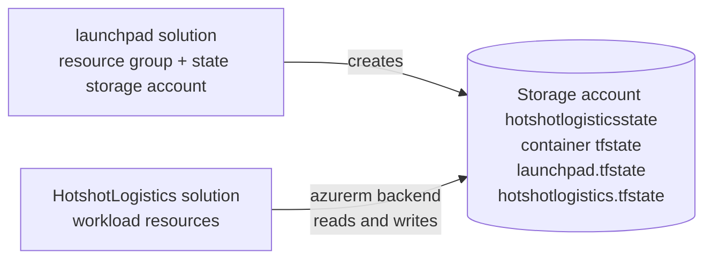
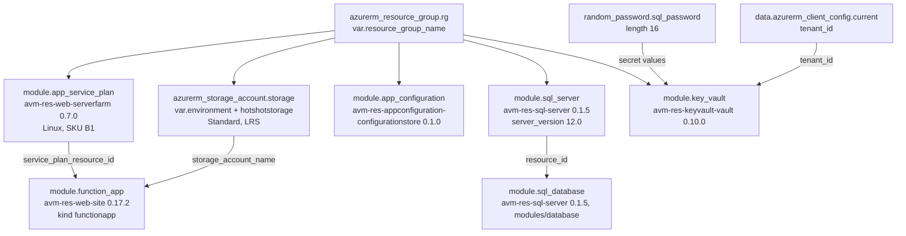

# Terraform modules and infrastructure

A reference inventory of the Terraform infrastructure-as-code under
`7-Deployment/Azure-deploy/`: the two solutions, the remote-state backend, the providers,
the module and resource inventory, every variable and output, and the environment files
that feed them.

The `.tf` files are the source of truth. This document describes them as they are written
today. The deployment narrative, the workflow chain, and the canonical drift register live
in [the deployment architecture document](deployment-architecture.md) and [the CI/CD
pipelines document](ci-cd-pipelines.md); those documents link here for the module,
variable, and output detail.

Terraform under `7-Deployment/` is this repository's infrastructure-as-code. The
[architecture guidelines](../architecture.md) record the decision — "Infrastructure is
Terraform, not Pulumi" — and the Azure deployment assets under that path are the only
infrastructure definition in the tree. Nothing else in the repository provisions Azure
resources.

## Source layout

```text
7-Deployment/Azure-deploy/
├── README.md                       # blank placeholder
├── environments/
│   └── dev/
│       └── hotshot.tfvars
└── solution/
    ├── HotshotLogistics/
    │   ├── main.tf
    │   ├── outputs.tf
    │   └── variables.tf
    └── launchpad/
        ├── main.tf
        ├── outputs.tf
        └── variables.tf
```

There is no shared module directory, no `.tfvars` for any environment other than `dev`, and
no Terraform file outside these two solutions.

## The two solutions

| Solution | Directory | What it declares | State key |
|---|---|---|---|
| `launchpad` | `solution/launchpad/` | The Azure resources that hold Terraform state: one resource group and one storage account. No application resources. | `launchpad.tfstate` |
| `HotshotLogistics` | `solution/HotshotLogistics/` | The platform's Azure workload: resource group, App Service plan, storage account, Function App, App Configuration store, SQL Server, SQL database, Key Vault, and a generated password. | `hotshotlogistics.tfstate` |

The two are related by the backend. The `HotshotLogistics` solution's `azurerm` backend
points at the same storage account and container that the `launchpad` solution creates,
under a different state key. The launchpad solution must therefore be applied first, and
out of band: no workflow runs it. Both Terraform workflows set their working directory to
the `HotshotLogistics` solution, so the state backend has to exist before either of them
can run. See [the deployment architecture document](deployment-architecture.md) for the
workflow chain.



## Remote state

Both solutions declare an `azurerm` backend with the same storage account and container
and different keys.

| Solution | Resource group | Storage account | Container | Key |
|---|---|---|---|---|
| `launchpad` | `rg-launchpad-dev-eastus` | `hotshotlogisticsstate` | `tfstate` | `launchpad.tfstate` |
| `HotshotLogistics` | `rg-launchpad-dev-eastus` | `hotshotlogisticsstate` | `tfstate` | `hotshotlogistics.tfstate` |

The backend configuration is static — no backend value is a variable in either solution,
so the state location is fixed in source. The `tfstate` container is not declared by
either solution; the launchpad solution creates the resource group and the storage
account only, and the container has to exist in the account before the backend can be
initialised. Recorded as **DR8** in the
[canonical drift register](deployment-architecture.md#canonical-drift-register).

The state storage account is `Standard` tier with `LRS` replication and no
customer-managed key, so state blobs are encrypted with the platform's service-managed
encryption. The `hotshotlogisticsstate` account is a state store, not an application
resource; the application storage account is a separate resource in the `HotshotLogistics`
solution.

## Providers

| Solution | Provider | Source | Version constraint | Provider block |
|---|---|---|---|---|
| `launchpad` | `azurerm` | not declared in a `required_providers` block; the default source `hashicorp/azurerm` applies | none — unconstrained | `features {}` only |
| `HotshotLogistics` | `azurerm` | `hashicorp/azurerm` | `~> 4.34.0` | `features {}` and `subscription_id = var.subscription_id` |
| `HotshotLogistics` | `random` | `hashicorp/random` | `~> 3.0` | none — the default provider configuration applies |

The `launchpad` solution declares no `required_providers` block, so the `azurerm` provider
version it resolves is whatever the registry offers; the pin that governs the platform's
providers lives in the `HotshotLogistics` solution only. The `random` provider is
required by the `HotshotLogistics` solution for `random_password.sql_password`, and is
also a dependency of the Key Vault module, which requires `random ~> 3.5` — compatible
with the root's `~> 3.0` constraint, which allows any `3.x` release at or above `3.0`.

## Modules

Six module blocks, all in the `HotshotLogistics` solution. The launchpad solution
declares no modules.

| Module block | Source | Version | What it provisions |
|---|---|---|---|
| `app_service_plan` | `Azure/avm-res-web-serverfarm/azurerm` | `0.7.0` | App Service plan, Linux, SKU `B1`, zone balancing disabled, named `${var.environment}-hotshot-logistics-plan` |
| `function_app` | `Azure/avm-res-web-site/azurerm` | `0.17.2` | Function App (`kind = "functionapp"`, `os_type = "Linux"`) on the plan above, named `${var.environment}-hotshot-logistics-function`, backed by the application storage account |
| `app_configuration` | `Azure/avm-res-appconfiguration-configurationstore/azure` | `0.1.0` | App Configuration store named `${var.environment}-hotshot-logistics-config` |
| `sql_server` | `Azure/avm-res-sql-server/azurerm` | `0.1.5` | SQL Server named `${var.environment}-hotshot-logistics-sql`, `server_version = "12.0"`, public network access enabled |
| `sql_database` | `Azure/avm-res-sql-server/azurerm//modules/database` | `0.1.5` | SQL database named `var.database_name`, SKU `var.sku_name`, `min_capacity = 0.5`, auto-pause delay of 60 minutes |
| `key_vault` | `Azure/avm-res-keyvault-vault/azurerm` | `0.10.0` | Key Vault named `${var.environment}-hotshot-log-kv-01`, SKU `standard`, with two secret entries |

Every module source and version above was checked against the Terraform Registry: all six
resolve to published releases, and every argument the solution passes is an input the
corresponding module version declares.

## Resources

### Direct resources

Five resource blocks and one data source across the two solutions.

| Address | Solution | What it declares |
|---|---|---|
| `azurerm_resource_group.launchpad` | `launchpad` | Name `rg-launchpad-dev-eastus`, location `East US`, tags `Environment = "dev"`, `Project = "launchpad"`, `ManagedBy = "terraform"` |
| `azurerm_storage_account.remote_state` | `launchpad` | Name `hotshotlogisticsstate`, `Standard` tier, `LRS` replication, no tags |
| `azurerm_resource_group.rg` | `HotshotLogistics` | Name `var.resource_group_name`, location `var.location`, tags `var.tags` |
| `azurerm_storage_account.storage` | `HotshotLogistics` | Name `${var.environment}hotshotstorage` — a concatenation with no separator, so `devhotshotstorage` for `dev`; `Standard` tier, `LRS` replication, tags `var.tags` |
| `random_password.sql_password` | `HotshotLogistics` | Generated password, 16 characters, special characters enabled, no `keepers` |
| `data.azurerm_client_config.current` | `HotshotLogistics` | Data source; supplies the `tenant_id` to the Key Vault module |

The two storage accounts are distinct: `hotshotlogisticsstate` holds Terraform state and
is created by the launchpad solution, while `${var.environment}hotshotstorage` backs the
Function App and is created by the workload solution.

### Provisioned topology



### Key Vault secret entries

The `key_vault` module block passes two `secrets` entries and a matching `secrets_value`
map. Both arguments are inputs the module version declares, and the two maps share their
keys, which is the contract the module requires.

| Secret name | Content type | Value source in the source |
|---|---|---|
| `sql-connection-string` | `text/plain` | Assembled in the module block from the SQL Server fully qualified domain name, the database name, the SQL administrator login, and the generated password |
| `sql-admin-password` | `text/plain` | The generated password from `random_password.sql_password` |

No secret value is recorded in this document, in the tfvars files, or anywhere else in the
repository. The connection string is composed by Terraform and written into the vault; its
value is not reproduced here. See the [security guidelines](../security.md) for the
repository-wide rules on secret handling.

## Variables

Sixteen variable blocks across the two solutions: two in `launchpad`, fourteen in
`HotshotLogistics`. Four are marked `sensitive = true` and none of the four has a
default value.

### launchpad

| Variable | Type | Default | Sensitive | Declared purpose | Referenced by |
|---|---|---|---|---|---|
| `location` | `string` | `"East US"` | no | The Azure region where resources will be created | Nothing — the resource group location is hardcoded in `main.tf` |
| `environment` | `string` | `"dev"` | no | The environment (e.g., dev, prod) | Nothing — the resource group tags are hardcoded in `main.tf` |

### HotshotLogistics

| Variable | Type | Default | Sensitive | Declared purpose | Referenced by |
|---|---|---|---|---|---|
| `location` | `string` | `"East US"` | no | The Azure region where resources will be created | `azurerm_resource_group.rg.location` |
| `resource_group_name` | `string` | `"hotshot-logistics-rg"` | no | The name of the resource group | `azurerm_resource_group.rg.name` |
| `subscription_id` | `string` | none | **yes** | The Azure subscription ID | The `azurerm` provider block |
| `azure_ad_client_id` | `string` | none | **yes** | The Azure AD application client ID for authentication | Nothing — declared and supplied, but not used by any resource or provider block |
| `azure_ad_client_secret` | `string` | none | **yes** | The Azure AD application client secret for authentication | Nothing — declared and supplied, but not used by any resource or provider block |
| `environment` | `string` | `"dev"` | no | The environment (dev, staging, prod) | The resource-name prefix in the plan, Function App, configuration store, SQL Server, and Key Vault names, and the storage account name |
| `tags` | `map(string)` | `{ Environment = "dev", Project = "hotshot-logistics", ManagedBy = "terraform" }` | no | Tags to apply to all resources | The resource group and every module block |
| `administrator_login` | `string` | `"sqladmin"` | no | The administrator login for the SQL Server | The `sql_server` module |
| `administrator_login_password` | `string` | none | **yes** | The administrator login password for the SQL Server | The `sql_server` module |
| `database_name` | `string` | `"hotshot-logistics-db"` | no | The name of the SQL database | The `sql_database` module |
| `sku_name` | `string` | `"GP_S_Gen5_1"` | no | The SKU name for the SQL database | The `sql_database` module |
| `min_capacity` | `number` | `0.5` | no | The minimum capacity for the serverless SQL database | Nothing — the module block sets `min_capacity = 0.5` literally |
| `max_capacity` | `number` | `4` | no | The maximum capacity for the serverless SQL database | Nothing — the module block sets no maximum capacity at all |
| `auto_pause_delay_in_minutes` | `number` | `60` | no | The auto pause delay in minutes for the serverless SQL database | Nothing — the module block sets `auto_pause_delay_in_minutes = 60` literally |

### Sensitive variables

| Variable | Purpose | How it is supplied |
|---|---|---|
| `subscription_id` | The Azure subscription the provider authenticates against | `TF_VAR_subscription_id` in both Terraform workflows, and written into the generated tfvars from a GitHub Actions secret |
| `azure_ad_client_id` | The Azure AD application client ID | `TF_VAR_azure_ad_client_id` in both Terraform workflows, and written into the generated tfvars from a GitHub Actions secret |
| `azure_ad_client_secret` | The Azure AD application client secret | `TF_VAR_azure_ad_client_secret` in both Terraform workflows, and written into the generated tfvars from a GitHub Actions secret |
| `administrator_login_password` | The SQL Server administrator password | The committed tfvars omits it and points at `TF_VAR_administrator_login_password`; no workflow exports that variable. Recorded as **DR10** in the [canonical drift register](deployment-architecture.md#canonical-drift-register) |

A `sensitive = true` variable's value is never recorded in this document or in any file
committed to the repository, and none of the four sensitive variables has a default value
in source. `sensitive = true` redacts a value from Terraform's console output; it does not
encrypt the value in state.

`administrator_login_password` has no default, so Terraform requires a value for it before
it can produce a plan — it prompts for one when a variable is left without a value, and an
unattended pipeline run has no one to answer the prompt. Recorded as **DR10** in the
[canonical drift register](deployment-architecture.md#canonical-drift-register).

## Outputs

Six output blocks: two in `launchpad`, four in `HotshotLogistics`. One is marked
`sensitive = true`.

| Output | Solution | Value | Sensitive | What it exposes |
|---|---|---|---|---|
| `resource_group_name` | `launchpad` | `azurerm_resource_group.launchpad.name` | no | The name of the launchpad resource group |
| `storage_account_name` | `launchpad` | `azurerm_storage_account.remote_state.name` | no | The name of the state storage account |
| `resource_group_name` | `HotshotLogistics` | `azurerm_resource_group.rg.name` | no | The name of the workload resource group |
| `sql_server_name` | `HotshotLogistics` | `module.sql_server.resource.name` | no | The name of the SQL Server |
| `sql_server_fqdn` | `HotshotLogistics` | `module.sql_server.resource.fully_qualified_domain_name` | **yes** | The fully qualified domain name of the SQL Server |
| `sql_database_name` | `HotshotLogistics` | `module.sql_database.resource.name` | no | The name of the SQL database |

No output exposes a password, a connection string, or a secret value. The `sql_server_fqdn`
output is marked sensitive even though its value is a host name.

## Environment separation

`7-Deployment/Azure-deploy/environments/` contains exactly one file:

| File | What it sets |
|---|---|
| `environments/dev/hotshot.tfvars` | `location = "East US"`, `resource_group_name = "rg-hotshot-logistics-dev-eastus"`, `environment = "dev"`, a `tags` map that adds `Owner = "hotshot-team"` to the variable default, `administrator_login = "sqladmin"`, `database_name = "hotshot-logistics-db"`, `sku_name = "GP_S_Gen5_1"`, `min_capacity = 0.5`, `max_capacity = 4`, `auto_pause_delay_in_minutes = 60` |

The file does not set `subscription_id`, `azure_ad_client_id`, `azure_ad_client_secret`, or
`administrator_login_password`. The first three are supplied as `TF_VAR_*` environment
variables by the workflows; the fourth is left unset, with a comment in the file pointing
at `TF_VAR_administrator_login_password`.

The `environment` variable is a plain string whose only effect is to prefix the six
resource names built from it — the App Service plan, the storage account, the Function App,
the configuration store, the SQL Server, and the Key Vault. Resource tags do not come from
it: every `tags` assignment in `main.tf` reads the separate `tags` variable, a
`map(string)` that the tfvars file sets independently of `environment`, so `environment`
never reaches a tag. There is no per-environment module, no per-environment state key, and
no per-environment backend.

`dev`, `staging`, and `prod` are not separated by configuration in the Terraform tree.
`staging` and `prod` exist as `workflow_dispatch` choices in the workflows and as
documented values of the `environment` variable, but no environment file exists for
either, and the `environment` input the apply workflow offers is not passed to Terraform
— the generated tfvars always sets `environment = "dev"`. The environment separation gap
is recorded as **DR5** in the canonical drift register; see
[the deployment architecture document](deployment-architecture.md).

Neither workflow reads `environments/dev/hotshot.tfvars`. Both write their own
`hotshot.tfvars` into the working directory at run time, from GitHub Actions secrets, and
pass it with `-var-file`. The committed file is therefore not the input either workflow
applies, and the two workflows generate different values for `location` and
`resource_group_name` — recorded as **DR3** in the same register.

## How Terraform is invoked

Both Terraform workflows set `working-directory` to
`7-Deployment/Azure-deploy/solution/HotshotLogistics` and run the same sequence:
checkout, `hashicorp/setup-terraform@v3`, `azure/login@v2` with OIDC, `terraform init`
with `ARM_USE_OIDC: true`, write `hotshot.tfvars`, then `terraform plan` or
`terraform apply -auto-approve` with `-var-file="hotshot.tfvars"`.

`terraform-plan.yml` runs on `workflow_run` of the .NET build workflow and on
`workflow_dispatch`, and additionally applies when `github.ref == 'refs/heads/main'`.
`terraform-apply.yml` runs on `workflow_run` of the plan workflow and on
`workflow_dispatch`. The full workflow inventory, including every secret and environment
variable each workflow declares, is in [the CI/CD pipelines document](ci-cd-pipelines.md).

The launchpad solution has no workflow. It must be applied by hand before either
workflow can initialise the backend.

## Declared-behaviour notes

These are facts about what the source declares, read from the `.tf` files. The canonical
drift register, owned by
[the deployment architecture document](deployment-architecture.md#canonical-drift-register),
owns the definition and the severity of every `DR` entry; the notes below record the
Terraform-side evidence for those entries, and each note names the id of the entry it
supports — where the register has one.

1. **The SQL administrator password and the Key Vault `sql-admin-password` secret are
   different values.** The `sql_server` module receives `var.administrator_login_password`;
   the `sql-admin-password` secret receives `random_password.sql_password.result`, and the
   `sql-connection-string` secret embeds the same generated value. Recorded as **DR11** in
   the canonical drift register.
2. **The connection string template hardcodes the SQL login name** rather than using
   `var.administrator_login`, so the two agree only while `administrator_login` keeps its
   default. Recorded as **DR11** in the same register.
3. **`compute_model` is not an input of the `database` submodule.** The
   `compute_model = "Serverless"` line in the `sql_database` module block is commented out,
   and the `modules/database` submodule of `avm-res-sql-server` 0.1.5 declares no
   `compute_model` argument, so the line could not be uncommented as written. The
   serverless-tier properties `min_capacity` and `auto_pause_delay_in_minutes` are set as
   literals while the database uses the General Purpose SKU `GP_S_Gen5_1`. Recorded as
   **DR9** in the canonical drift register.
4. **Five declared variables are inert.** `min_capacity`, `max_capacity`, and
   `auto_pause_delay_in_minutes` have defaults, are set in the committed tfvars, and are
   passed to no module, so changing them has no effect on the database. `azure_ad_client_id`
   and `azure_ad_client_secret` are supplied by the workflows and referenced by nothing.
   Recorded as **DR12** in the same register.
5. **The launchpad solution's two variables are inert.** `location` and `environment` are
   declared with defaults, and `main.tf` hardcodes `East US`, `rg-launchpad-dev-eastus`,
   and the resource group tags instead. Recorded as **DR12** in the same register.
6. **`random_password.sql_password` has no `keepers`.** The generated value is persisted
   in Terraform state, and it is written into the vault in plain text by the Key Vault
   module. No entry in the canonical drift register covers this fact; minting an id for it
   belongs to the register, not to this document.

## Related documentation

- [Deployment architecture](deployment-architecture.md) — deployment narrative, workflow
  chain, and the canonical drift register
- [CI/CD pipelines](ci-cd-pipelines.md) — the four GitHub Actions workflows
- [Architecture guidelines](../architecture.md) — the Clean Architecture folder layout
- [Security guidelines](../security.md) — repository-wide secret handling rules
- [Documentation standard](../documentation-standard.md) and
  [documentation ontology](../documentation-ontology.md)
- Source roots: [7-Deployment/README.md](../../7-Deployment/README.md)
