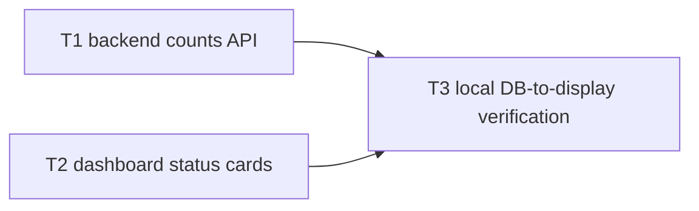

# Admin dashboard job status cards

**Status: Ready, 2026-11-16.**

- **Autonomy:** autonomous (the owner's standing approval for every decision recorded below).
- **Development mode:** test-first.
- **Run:** branch `copilot/feat/dashboard-job-status-cards`, base `main` at `ff869481800fcaa57dc4e8ba476b02549d4d4b10`.

## Problem and goal

The Admin Dashboard overview (`DashboardOverview`) shows four metric cubes (Total Jobs, Active Jobs,
Active Drivers, Overdue Invoices) and then Recent Activity. Dispatchers cannot see how many jobs sit in
each lifecycle status, and no API returns per-status counts: the only job read is the paged
`GET /api/job`, so any client-side count covers one page only.

Goal: add four job status cards (Pending, Assigned, EnRoute, Received) between the metric cubes and
Recent Activity, each showing the real aggregate count of jobs in that status, read from SQL Server by
one `GROUP BY` query in `JobRepository`, shaped by `JobService` into a `JobStatusSummaryDto`, and
served by `GET /api/job/status-summary`. The cards match the existing cubes' padding, shadow and
corners, use the requested colours and lucide icons, carry no mock data, and read through a TanStack
Query hook whose key a future SignalR handler can invalidate.

## Scale

`documentation-impact: extends-component` for `admin-dashboard` (new overview section, hook, theme
tokens) and `Api` (new endpoint, repository aggregate, shared DTO). No new component, dependency,
infrastructure, migration or deployment asset.

## Decisions

| ID | Question | Answer / decision | Mitigating and supporting information | Status / approval provenance |
|---|---|---|---|---|
| D1 | The request names Next.js 16 App Router, React and Tailwind; does the repo match? | Yes: build on the existing stack, no stack change. | `package.json`: `next` 16.4.6, `react` 19.3.1, `tailwindcss` ^4.3.5, `lucide-react` 1.70.0, `@tanstack/react-query` ^5.107.1. No conflict to record. | autonomous: covered by repository manifest |
| D2 | Which status values back the four cards? | The existing backend enum `HotshotLogistics.Core.Enums.JobStatus` (Pending=0, Assigned=1, EnRoute=2, Received=3), stored as `Jobs.Status INT`. No schema change. | The backend already has exactly the four requested statuses; `Jobs.Status` is `AsInt32().NotNullable()` with `IX_Jobs_Status` (`20250101000200_CreateJobsTable`). The frontend `JobStatus` TS enum is stale (InProgress/Completed/Cancelled) but is not used by the new code; replacing it stays in the existing todo (see Out-of-scope). | autonomous: covered by existing schema and enum |
| D3 | REST or SignalR for the counts? | REST `GET /api/job/status-summary` on `JobController`, policy `AuthorizationPolicies.ManagerOrAdmin` (same as `GET /api/job`), optional `customerId` query filter. No SignalR broadcast now. | A server push needs a broadcast on every status change across `JobService`, `JobAssignmentService` and the hub: a cross-cutting change the request says needs approval. Future-SignalR support is met by D10. `customerId` mirrors `GetJobs`' filter and lets HTTP tests scope to their own rows (test standard: never assert absolute table counts). | autonomous: low-confidence, no authoritative source; cost: endpoint shape is a public contract, cheap to extend |
| D4 | Response shape? | `public sealed record JobStatusSummaryDto(int Pending, int Assigned, int EnRoute, int Received)`; JSON (Newtonsoft, camelCase) `{"pending":n,"assigned":n,"enRoute":n,"received":n}`. A status with no rows is `0`. | C# standard: response bodies are `sealed record` DTOs; never return an entity. Named fields keep the payload stable for a future SignalR message of the same shape. | autonomous: covered by C# standard § Stack, § Types |
| D5 | Where does `JobStatusSummaryDto` live? | `3-Domain/HotshotLogistics.Contracts/Models/JobStatusSummaryDto.cs`, namespace `HotshotLogistics.Contracts.Models` (new folder in the existing Contracts project; no new project). | C# standard § Model classification: shared DTOs go to `HotshotLogistics.Contracts.Models` (target, `contracts-model-placement` todo). Existing DTOs sit in `HotshotLogistics.Domain/DTOs`, which the standard says not to copy. A separate `.Contracts.Models` project would be new infrastructure; the namespace meets the rule without it. `6-Docs/api/architecture.md` says DTOs live in Domain; docs-dev corrects it in closeout. | autonomous: low-confidence, no authoritative source; cost: moving one record later |
| D6 | Repository contract and query? | `IJobRepository.GetJobStatusCountsAsync(JobFilterDto? filter = null, CancellationToken cancellationToken = default)` returns `IReadOnlyDictionary<JobStatus, int>`. SQL: `SELECT Status, COUNT(*) AS JobCount FROM Jobs{where} GROUP BY Status`, where-clause and parameters from the existing private `BuildWhereClause(filter)`. Status ints outside the enum are skipped. | One round trip instead of four `GetJobCountAsync` calls. Explicit columns and parameters (DAL and SQL standards). Served by `IX_Jobs_Status` (and `IX_Jobs_CustomerId` when filtered), so no new index. | autonomous: covered by DAL and SQL standards |
| D7 | DAL standard forbids `new SqlConnection(...)` at a call site, but `ISqlConnectionFactory` does not exist yet. | Sanctioned exception: the new method opens its connection with `await using SqlConnection connection = new(ConnectionString);` exactly as the sibling `GetJobCountAsync` does. | The factory is tracked by `6-Docs/todo/sql-connection-factory.md`; introducing it here is a cross-cutting change. Worker adds an `Open item:` naming the DAL standard and this decision. | autonomous: covered by DAL standard (target tracked by todo) |
| D8 | Service responsibilities? | `IJobService.GetJobStatusSummaryAsync(string? customerId = null, CancellationToken cancellationToken = default)` in `JobService`: trims `customerId`; null, empty or whitespace means unfiltered (`filter` null); otherwise `new JobFilterDto { CustomerId = trimmed }`. Missing statuses become `0`. Exceptions propagate (no catch). | Request asks for repository → service → DTO → API. The controller does not catch: `ExceptionHandlingMiddleware` maps exceptions (C# standard: do not swallow). | autonomous: covered by C# standard § Safety, api architecture |
| D9 | Frontend structure? | Presentational `src/components/dashboard/JobStatusCards.tsx` (props `items: JobStatusCardItem[]`, interface `JobStatusCardItem { key; label; count; color; icon }`); container `src/components/dashboard/JobStatusSummarySection.tsx` (hook + loading/error/cards); pure mapper `src/components/dashboard/jobStatusCardItems.ts` (`buildJobStatusCardItems`); hook `src/hooks/useJobStatusSummary.ts` (new folder). | React standard: one responsibility per component; a fetching-and-rendering component is two; repeated logic is a custom hook; one component per file. `src/hooks/` is a new folder — approved by autonomy. The user's `label/count/color/icon` interface is kept, plus `key` for stable React keys and test ids. | autonomous: covered by React standard § Components |
| D10 | How is future SignalR supported? | The hook exports `jobStatusSummaryQueryKey = ['jobs', 'status-summary'] as const`; a future SignalR handler calls `queryClient.invalidateQueries({ queryKey: jobStatusSummaryQueryKey })` or `setQueryData` with a `JobStatusSummary` payload. The prefix `['jobs']` also refreshes the summary whenever existing job queries are invalidated. | No SignalR code now (D3). The DTO shape (D4) is the payload a future push would carry. | autonomous: low-confidence, no authoritative source; cheap to reverse |
| D11 | Exact hex colours in Tailwind v4? | Add a `@theme` block to `src/app/globals.css`: `--color-job-status-pending: #3B82F6; --color-job-status-assigned: #0EA5E9; --color-job-status-enroute: #0284C7; --color-job-status-received: #0369A1;` and use the literal classes `bg-job-status-pending`, `bg-job-status-assigned`, `bg-job-status-enroute`, `bg-job-status-received`. | Tailwind 4.3 (installed) defines its palette in OKLCH, so `bg-blue-500` is not exactly `#3B82F6`. React standard § Styling: theme tokens, not inline hex. Classes must be literal strings so Tailwind's scanner emits them. | autonomous: covered by React standard § Styling and the installed Tailwind major |
| D12 | Icons? | `lucide-react` 1.70.0 (already installed) `Hourglass`, `ClipboardList`, `Truck`, `Inbox`, rendered `aria-hidden="true"` with `className="h-5 w-5 text-white"`; each renders the class `lucide-hourglass`, `lucide-clipboard-list`, `lucide-truck`, `lucide-inbox`. | Verified in the installed package: all four exported from `dist/lucide-react.d.ts`; class built as `lucide-${icon.name}` in `buildLucideIconNode`. No new dependency. | autonomous: covered by installed package |
| D13 | Card layout and typography? | Grid `<dl data-testid="job-status-cards" className="grid grid-cols-1 gap-4 sm:grid-cols-2 lg:grid-cols-5">`. Card `
" className="bg-white p-6 rounded-lg shadow">`; `<dt className="flex items-center">` with badge `">` left of label ``; count `<dd data-testid="job-status-count-<key>" className="mt-4 text-center text-2xl font-bold text-gray-900">` below. Inter is inherited from `layout.tsx` (`Inter` via `next/font/google` on `<body>`). | Card shell classes equal the existing cubes' `bg-white p-6 rounded-lg shadow`. `grid-cols-5 gap-4` is the request's literal value, applied at `lg` so the layout stays responsive below it (see Risks). `<dl>` with `div > dt + dd` is valid HTML (React standard § Accessibility). Inter needs no new font load. | autonomous: covered by request text and existing layout |
| D14 | Loading, error and malformed-response behaviour? | Loading: `
` with four `bg-white p-6 rounded-lg shadow animate-pulse` placeholders. Error (HTTP error or malformed body): `
Unable to load job status counts.
` and no cards (never fake zeros). `apiService.getJobStatusSummary()` throws `Error('Invalid job status summary response')` unless all four fields are non-negative integers. The section loads independently and does not block the existing cubes. | Showing zero on failure would display mock-like data; the request forbids it. No `zod` (installed but unused in `src`); a small guard suffices. | autonomous: low-confidence, no authoritative source; cheap to reverse |
| D15 | "Production components must not use mock data": what about `DashboardOverview`'s existing test-mode fallback (`testJobs`, `testDrivers`, `testInvoices`, `isTestMode`)? | Remove the fallback and the `DASHBOARD DEBUG INFO` `console.log` block from `DashboardOverview` in T2; stats read the query data only. Also remove the `console.log` debug lines from `ApiService.request` in `api.ts` (keep `console.error`). | Same files T2 edits; small. React standard § Hygiene: no `console.log`. Playwright mocks every route the overview calls, so the fallback is not needed; if a spec relied on it the worker fixes that spec's route mock, not its assertions. The hard-coded Recent Jobs markup is out of scope (needs a recent-jobs API; tracked by `admin-dashboard-playwright-baseline` todo). | autonomous: covered by the request and React standard § Hygiene |
| D16 | `JobRepository.GetJobsAsync` writes `Console.WriteLine` debug lines (C# standard § Safety). | Remove those five `Console.WriteLine` calls in T1 (same file, no behaviour change). The pre-existing `SELECT *` in other `JobRepository` methods is filed as a todo, not fixed here. | Small and in a file T1 already edits. `SELECT *` spans six methods and their tests: separate change. | autonomous: covered by plan-authoring divergence rule |
| D17 | How is the DB-to-display flow proved without breaking "Playwright never hits a real API" (test standard)? | Three layers, all executed: (a) `JobRepositoryTests` and `JobControllerIntegrationTests` against the real `hotshot_logistics_test` SQL Server prove DB → JSON; (b) `job-status-cards.spec.ts` proves JSON contract → display with a mock of the exact D4 shape; (c) T3 runs the real stack locally (dev-env SQL Server, API in Development, `next dev`) and compares `sqlcmd` counts, the API JSON and a Playwright CLI screenshot. Nothing is committed for (c). | Test standard forbids a committed spec against a live API; T3 gives the requested real-flow evidence without breaking it. All data is the isolated local test database `hotshot_logistics_test`; nothing touches Azure or production. | autonomous: covered by test standard and the request |
| D18 | Test data isolation? | Repository and HTTP tests create jobs under a unique `test-{Guid:N}` customer id, register them with `TestRowCleanup` before insert, and assert only counts filtered to that customer; unfiltered assertions use `>=` against the scoped counts. Playwright mocks every API route. | Test standard § Test data hygiene and § Frontend. | autonomous: covered by test standard |
| D19 | Approval gate | Approve and execute. | Autonomous run; the conductor records `AUTONOMOUS_APPROVAL` at finalization. | autonomous: recommendation accepted, 2026-11-16 |
| AP1 | Approve and execute | Approved for execution as planned. | Recorded by the finalize step, which changed no task, file scope, test row or command. | ANSWERED: autonomous: recommendation accepted, AUTONOMOUS_APPROVAL: approve-and-execute, 2026-11-16 |

## Design harvest

| Target component | Target doc type | Section | Content to harvest |
|---|---|---|---|
| admin-dashboard | architecture | Components and interfaces | Overview row: `DashboardOverview` → `JobStatusSummarySection` (container) → `JobStatusCards` (presentational, `JobStatusCardItem { key, label, count, color, icon }`); hook `src/hooks/useJobStatusSummary.ts` with `jobStatusSummaryQueryKey`. |
| admin-dashboard | architecture | Data models | `JobStatusSummary` in `src/types` mirrors `JobStatusSummaryDto`; theme tokens `--color-job-status-*` in `globals.css`. |
| admin-dashboard | architecture | Error handling | Status cards show a `role="alert"` message on error or malformed payload, never zero placeholders; no test-mode fallback data in production components. |
| admin-dashboard | architecture | Testing strategy | `tests/job-status-cards.spec.ts` covers counts, states, visual consistency and responsive layout. |
| Api | architecture | Components and interfaces | `GET /api/job/status-summary?customerId=` (ManagerOrAdmin) → `IJobService.GetJobStatusSummaryAsync` → `IJobRepository.GetJobStatusCountsAsync` (`GROUP BY Status`). Future SignalR: same DTO as payload, client invalidates `['jobs','status-summary']`. |
| Api | architecture | Data models | Shared DTOs now start in `HotshotLogistics.Contracts.Models` (`JobStatusSummaryDto`); replace "Request and response DTOs live in Domain" with the current split. |

## Investigation findings

- Read at revision `ff86948` on `copilot/feat/dashboard-job-status-cards` (worktree index; provenance matched).
- `DashboardOverview` (`src/components/dashboard/DashboardOverview.tsx`) renders the cubes in `data-testid="stats-container"` (`grid grid-cols-1 sm:grid-cols-2 lg:grid-cols-4 gap-6`, cards `bg-white p-6 rounded-lg shadow`, `data-testid="stats-card"`), then the "Recent Jobs" card. The new section goes between them.
- `dashboard-overview.spec.ts` constraints the new UI must respect: `[data-testid="stats-card"]` count is 4 (new cards use `job-status-card`); responsive tests read `page.locator('.grid').first()` (the stats grid stays first); `page.locator('text=Pending').first()` in "should display job status badges with correct styling" will match the new "Pending" card label first, so the worker narrows that locator to the Recent Jobs section; the beforeEach mocks need a `**/api/job/status-summary` route; the "Key Metrics" test's `**/api/job**` route also matches the summary URL, so that test registers a summary route after it.
- `ApiService.request` sends `Authorization: Test test-token` in development and in Playwright bypass mode; `TestAuthHandler` defaults to role Admin and honours `X-Test-Role`.
- API serialises with Newtonsoft (`AddNewtonsoftJson`), camelCase property names.
- `JobRepository` is `internal` (ArchitectureTests rule: repositories not public); `HotshotLogistics.Tests` already constructs it directly. The only `IJobRepository` implementation is `JobRepository`; the only `IJobService` implementation is `JobService`. No `JobServiceTests` class exists.
- `layout.tsx` already applies `Inter` (`next/font/google`) to `<body>`.
- Dev stack for T3: API profile `HotshotLogistics.Api` on `https://localhost:5001`; CORS allows `http://localhost:3000`; dev auth bypass in `withAuth`/`auth-provider`; `dev-env-up.sh` writes the API user secret pointing at `hotshot_logistics_test` and keeps the SA password outside the tree.
- Divergences found: `new SqlConnection` at call sites in every repository (tracked: `sql-connection-factory` todo; D7); `Console.WriteLine` in `JobRepository.GetJobsAsync` (fixed in T1, D16); `SELECT *` in `JobRepository` read methods (reported as an open item by T1, filed at run end); `console.log` in `DashboardOverview` and `ApiService.request` (fixed in T2, D15); DTOs in `HotshotLogistics.Domain/DTOs` (tracked: `contracts-model-placement` todo; D5).
- Discovery: codegraph 4, docs 7 (6 standards, 1 glossary-free doc lookup via standards), direct reads 21. Direct reads and reasons: dashboard TSX/TS files (`DashboardOverview.tsx`, `api.ts`, `types/index.ts`, `signalr.ts`, `layout.tsx`, `page.tsx`, `providers.tsx`, `globals.css`) — codegraph returned names only, full markup needed; `package.json`, `playwright.config.ts`, `task-e2e.sh`, `.kyber-weave/kyber-weave.yml`, `launchSettings.json`, `appsettings.Development.json`, `dev-env-up.sh` — config/scripts not indexed; `lucide-react` dist — `node_modules` not indexed (version check); test class shapes (`JobRepositoryTests`, `JobControllerIntegrationTests`, `JobControllerTests`, `AuthenticationAndAuthorizationTests`, `TestAuthHandler`) — grep for structure only; `CreateJobsTable` migration grep — index check; todo docs and `admin-dashboard/architecture.md` — governed docs read for scope.

## Test contract (development-mode: test-first)

| Task | Test project or file | Runner command | Observable behavior | RED evidence required | GREEN acceptance |
|---|---|---|---|---|---|
| T1 | `5-Test/tests/HotshotLogistics.Tests/Jobs/JobRepositoryTests.cs` (extend `HotshotLogistics.Tests.Jobs.JobRepositoryTests`) | `bash 5-Test/run-task-tests.sh 'FullyQualifiedName~HotshotLogistics.Tests.Jobs.JobRepositoryTests\|FullyQualifiedName~HotshotLogistics.Tests.Jobs.JobServiceTests\|FullyQualifiedName~HotshotLogistics.Tests.Jobs.JobControllerTests\|FullyQualifiedName~HotshotLogistics.IntegrationTests.JobControllerIntegrationTests' .agent_scratchpad/T1/artifacts` | `GetJobStatusCountsAsync_WithCustomerFilter_ReturnsCountPerStatus`: 2 Pending, 1 Assigned, 3 EnRoute, 0 Received created for the class customer → `{Pending:2, Assigned:1, EnRoute:3}` and no `Received` key. `GetJobStatusCountsAsync_WithCustomerFilterAndNoJobs_ReturnsEmpty`: unknown `test-{Guid}` customer → empty dictionary. `GetJobStatusCountsAsync_WithoutFilter_IncludesCreatedJobs`: unfiltered counts for each status ≥ the filtered counts. | Compile error CS1061: `JobRepository` has no `GetJobStatusCountsAsync`. | All three pass against `hotshot_logistics_test`; created rows cleaned by `TestRowCleanup`. |
| T1 | `5-Test/tests/HotshotLogistics.Tests/Jobs/JobServiceTests.cs` (new `HotshotLogistics.Tests.Jobs.JobServiceTests`; copy `RealtimeServiceTests` Moq style) | same as above | `GetJobStatusSummaryAsync_WithAllStatusesPresent_MapsEachCount` (4 counts mapped to the DTO); `GetJobStatusSummaryAsync_WithMissingStatuses_ReturnsZeroForThem`; `GetJobStatusSummaryAsync_WithNoJobs_ReturnsAllZero`; `GetJobStatusSummaryAsync_WithCustomerId_PassesTrimmedCustomerFilter` (`"  cust-9  "` → filter `CustomerId == "cust-9"`); `GetJobStatusSummaryAsync_WithNullOrWhitespaceCustomerId_PassesNullFilter` (theory: `null`, `""`, `"   "`); `GetJobStatusSummaryAsync_WhenRepositoryThrows_PropagatesException`. | Compile error CS1061/CS0117: `JobService`/`IJobService` lack `GetJobStatusSummaryAsync`; `JobStatusSummaryDto` missing. | All pass. |
| T1 | `5-Test/tests/HotshotLogistics.Tests/Jobs/JobControllerTests.cs` (extend `HotshotLogistics.Tests.Jobs.JobControllerTests`) | same as above | `GetJobStatusSummary_ReturnsOkWithSummary` (service DTO returned in `OkObjectResult`); `GetJobStatusSummary_WithCustomerId_PassesItToService`. | Compile error: `JobController` lacks `GetJobStatusSummary`. | Both pass. |
| T1 | `5-Test/tests/HotshotLogistics.IntegrationTests/JobControllerIntegrationTests.cs` (extend `HotshotLogistics.IntegrationTests.JobControllerIntegrationTests`) | same as above | `GetJobStatusSummary_WithCustomerFilter_ReturnsCountsFromDatabase`: creates jobs for a unique customer directly in the DB (tracked by `Cleanup.TrackJob`), GET `/api/Job/status-summary?customerId=<id>` → 200 and raw JSON with exactly `pending`, `assigned`, `enRoute`, `received` matching the inserted counts (`received` 0). `GetJobStatusSummary_WithoutFilter_ReturnsAllFourCounts`: 200, four non-negative fields. `GetJobStatusSummary_WithDriverRole_Returns403` (`X-Test-Role: Driver`). `GetJobStatusSummary_WithAdminRole_Returns200`. `GetJobStatusSummary_WithoutAuthorizationHeader_Returns401` (fresh `Factory.CreateClient()`). | 404 for `/api/Job/status-summary` (route absent) or compile error on `JobStatusSummaryDto`. | All pass against `hotshot_logistics_test`. |
| T2 | `1-Presentation/admin-dashboard/tests/job-status-cards.spec.ts` (new; copy `billing-management.spec.ts` / `dashboard-overview.spec.ts` beforeEach mocks) | `bash 1-Presentation/admin-dashboard/scripts/task-e2e.sh 1-Presentation/admin-dashboard/tests/job-status-cards.spec.ts 1-Presentation/admin-dashboard/tests/dashboard-overview.spec.ts` | `should display four status cards with counts from the API` (mock `{pending:7,assigned:3,enRoute:5,received:12}` → labels Pending, Assigned, EnRoute, Received in that order with counts 7, 3, 5, 12); `should place status cards between metric cards and recent activity` (DOM/box order: stats-container < job-status-cards < "Recent Jobs"); `should display zero counts` (all 0 → "0" ×4); `should show an error and no cards when the API fails` (500 → alert "Unable to load job status counts.", 0 `job-status-card`); `should show an error when the response is malformed` (`{pending:1}` → same alert); `should show a loading state before counts arrive` (delayed route → `job-status-cards-loading` visible, then counts); `should match the metric cards' padding, shadow and corners` (computed `padding`, `box-shadow`, `border-radius`, `background-color` of first `job-status-card` equal first `stats-card`); `should render the specified badge colours and icons` (badge computed `background-color` rgb(59, 130, 246) / rgb(14, 165, 233) / rgb(2, 132, 199) / rgb(3, 105, 161); svg classes `lucide-hourglass`, `lucide-clipboard-list`, `lucide-truck`, `lucide-inbox`; badge left of label); `should use Inter with semibold labels and bold centred counts` (font-family contains "Inter"; label weight 600; count weight 700, text-align center); `should lay out cards responsively` (grid class contains `grid-cols-1`, `sm:grid-cols-2`, `lg:grid-cols-5`, `gap-4`; at 375px all cards share one x; at 768px two per row; at 1200px all four share one y). | Spec fails: `[data-testid="job-status-cards"]` not found (component absent). | All pass in chromium; the existing `dashboard-overview.spec.ts` tests keep their assertions and pass. |
| T3 | No test file: executed local verification | Commands in T3 | Real stack: `sqlcmd` per-status counts in `hotshot_logistics_test` = API JSON from `GET /api/job/status-summary` = counts shown in the screenshot of `http://localhost:3000`. | Not applicable: verification-only task, no code. | Evidence (three outputs and screenshot path) reported; all three agree. |

## Tasks

### T1: Job status counts from the database to the API

- **Objective:** Serve real per-status job counts from SQL Server through `JobRepository`, `JobService` and `GET /api/job/status-summary`.
- **Capabilities:** C# ASP.NET Core API, ADO.NET repository code, xUnit tests against SQL Server
- **Session:** `backend`
- **Depends on:** none
- **Files:**
  - `3-Domain/HotshotLogistics.Contracts/Models/JobStatusSummaryDto.cs`: new `public sealed record JobStatusSummaryDto(int Pending, int Assigned, int EnRoute, int Received)`, namespace `HotshotLogistics.Contracts.Models`, XML docs.
  - `3-Domain/HotshotLogistics.Contracts/Repositories/IJobRepository.cs`: `IJobRepository.GetJobStatusCountsAsync(JobFilterDto? filter = null, CancellationToken cancellationToken = default)` → `Task<IReadOnlyDictionary<JobStatus, int>>`.
  - `4-Persistence/HotshotLogistics.Data/Repositories/JobRepository.cs`: `JobRepository.GetJobStatusCountsAsync`: `SELECT Status, COUNT(*) AS JobCount FROM {GetTableName()}{whereClause} GROUP BY Status` via `BuildWhereClause` and `AddParametersToCommand`; connection opened like `GetJobCountAsync` (`new SqlConnection(ConnectionString)`, sanctioned until the connection factory exists); async reader with cancellation; skip status ints not defined in `JobStatus`. Delete the `Console.WriteLine` lines in `JobRepository.GetJobsAsync`.
  - `3-Domain/HotshotLogistics.Contracts/Services/IJobService.cs`: `IJobService.GetJobStatusSummaryAsync(string? customerId = null, CancellationToken cancellationToken = default)` → `Task<JobStatusSummaryDto>`.
  - `2-Application/HotshotLogistics.Application/Services/JobService.cs`: `JobService.GetJobStatusSummaryAsync`: trim `customerId`; null, empty or whitespace → `null` filter, else `new JobFilterDto { CustomerId = trimmed }`; absent statuses → `0`; no catch.
  - `1-Presentation/HotshotLogistics.Api/Controllers/JobController.cs`: `JobController.GetJobStatusSummary([FromQuery] string? customerId = null, CancellationToken cancellationToken = default)`, `[HttpGet("status-summary")]`, `[Authorize(Policy = AuthorizationPolicies.ManagerOrAdmin)]`, `[ProducesResponseType(typeof(JobStatusSummaryDto), StatusCodes.Status200OK)]`, returns `Ok(dto)`, no try/catch (middleware handles errors).
  - `5-Test/tests/HotshotLogistics.Tests/Jobs/JobRepositoryTests.cs`: three tests per the Test contract.
  - `5-Test/tests/HotshotLogistics.Tests/Jobs/JobServiceTests.cs`: new class `HotshotLogistics.Tests.Jobs.JobServiceTests` (Moq mocks for `IJobRepository`, `ICustomerRepository`, `IDriverRepository`, `INotificationService`, `IMappingService`, `ILogger<JobService>`).
  - `5-Test/tests/HotshotLogistics.Tests/Jobs/JobControllerTests.cs`: two tests per the Test contract.
  - `5-Test/tests/HotshotLogistics.IntegrationTests/JobControllerIntegrationTests.cs`: five tests per the Test contract.
- **Commands:**
  - `kyber-weave review gates . --agent <your agent name> --task T1 --red`
  - `kyber-weave review gates . --agent <your agent name> --task T1`
- **Acceptance:**
  - Every T1 row of the Test contract fails first (missing symbols or 404) and then passes without weakening an assertion.
  - `GET /api/Job/status-summary` returns `{"pending":n,"assigned":n,"enRoute":n,"received":n}` from the database; Driver role gets 403, no auth header gets 401.
  - The query lists columns explicitly, is parameterized, and propagates cancellation; no new index or migration.
  - No `Console.WriteLine` remains in `JobRepository.GetJobsAsync`; existing `JobRepositoryTests`, `JobControllerTests` and `JobControllerIntegrationTests` keep their assertions and pass.
  - Report `Open item:` lines for the DTO's namespace inside the Contracts project (C# standard) and `new SqlConnection` (DAL standard).

### T2: Job status cards on the admin dashboard

- **Objective:** Render the four status cards between the metric cubes and Recent Activity from `GET /api/job/status-summary`, with no mock data in production components.
- **Capabilities:** React and TypeScript UI with Tailwind v4 and TanStack Query, Playwright tests
- **Session:** `dashboard`
- **Depends on:** none (consumes only the JSON contract `{pending, assigned, enRoute, received}`)
- **Files:**
  - `1-Presentation/admin-dashboard/src/types/index.ts`: add `export interface JobStatusSummary { pending: number; assigned: number; enRoute: number; received: number; }`.
  - `1-Presentation/admin-dashboard/src/services/api.ts`: `ApiService.getJobStatusSummary()` calls `this.request<unknown>('/job/status-summary')` and throws `Error('Invalid job status summary response')` unless all four fields are non-negative integers (no zod). Remove the `console.log` lines in `ApiService.request`; keep `console.error`.
  - `1-Presentation/admin-dashboard/src/hooks/useJobStatusSummary.ts`: new; exports `jobStatusSummaryQueryKey = ['jobs', 'status-summary'] as const` (future SignalR handlers invalidate it) and `useJobStatusSummary()` (`useQuery`).
  - `1-Presentation/admin-dashboard/src/components/dashboard/jobStatusCardItems.ts`: new; `buildJobStatusCardItems(summary)` → items in order Pending, Assigned, EnRoute, Received (labels exact; keys `pending`, `assigned`, `enroute`, `received`; literal `color` classes `bg-job-status-<key>`; icons lucide `Hourglass`, `ClipboardList`, `Truck`, `Inbox`).
  - `1-Presentation/admin-dashboard/src/components/dashboard/JobStatusCards.tsx`: new; exports `JobStatusCardItem { key: string; label: string; count: number; color: string; icon: LucideIcon }` and `JobStatusCards({ items })`: `<dl data-testid="job-status-cards" className="grid grid-cols-1 gap-4 sm:grid-cols-2 lg:grid-cols-5">`; each card `
`; `<dt className="flex items-center">` with badge `` holding the icon (`h-5 w-5 text-white`, `aria-hidden`) then label `ml-3 text-sm font-semibold text-gray-700`; `<dd data-testid="job-status-count-{key}" className="mt-4 text-center text-2xl font-bold text-gray-900">`.
  - `1-Presentation/admin-dashboard/src/components/dashboard/JobStatusSummarySection.tsx`: new; `JobStatusSummarySection()`: loading → `
` with four pulsing card-shell placeholders; error → `
Unable to load job status counts.
` and no cards; success → `JobStatusCards`.
  - `1-Presentation/admin-dashboard/src/components/dashboard/DashboardOverview.tsx`: `DashboardOverview` renders `<JobStatusSummarySection />` after the `stats-container` grid, before Recent Activity; remove `isTestMode`, `testJobs`, `testDrivers`, `testInvoices`, the `final*` fallbacks and the debug `console.log` block.
  - `1-Presentation/admin-dashboard/src/app/globals.css`: `@theme { --color-job-status-pending: #3B82F6; --color-job-status-assigned: #0EA5E9; --color-job-status-enroute: #0284C7; --color-job-status-received: #0369A1; }`.
  - `1-Presentation/admin-dashboard/tests/job-status-cards.spec.ts`: new spec per the Test contract; mocks inline (no new fixture file, so the task gate does not run the whole suite).
  - `1-Presentation/admin-dashboard/tests/dashboard-overview.spec.ts`: add a `**/api/job/status-summary` mock to `beforeEach`; in "Key Metrics Non-Zero Validation" register the summary route after its `**/api/job**` route; narrow the Pending badge locator in "should display job status badges with correct styling" to the Recent Jobs section. No assertion changes.
- **Commands:**
  - `kyber-weave review gates . --agent <your agent name> --task T2 --red`
  - `kyber-weave review gates . --agent <your agent name> --task T2`
- **Acceptance:**
  - Every T2 row of the Test contract fails first and then passes in chromium; lint, typecheck and `npm run build` pass.
  - No production component under `src/` contains mock or fallback data or `console.log`.
  - Cards show API counts only; on error or malformed data an alert shows instead of numbers.
  - `dashboard-overview.spec.ts` keeps every assertion; each locator or mock edit is named in the report.

### T3: Local DB-to-display verification

- **Objective:** Prove on the real local stack that the counts in `hotshot_logistics_test` reach the dashboard cards unchanged.
- **Capabilities:** local full-stack run: Docker SQL Server, .NET API, Next.js dev server, Playwright CLI
- **Session:** `verify`
- **Depends on:** T1 (endpoint), T2 (cards)
- **Files:**
  - none: verification only; nothing is committed. The screenshot goes to the git-ignored scratch folder for T3.
- **Commands:**
  - `7-Deployment/dev-env/dev-env-up.sh`
  - `docker exec -e SQLCMDPASSWORD="${SQL_SA_PASSWORD:-$(cat "${XDG_CONFIG_HOME:-$HOME/.config}/hotshot-logistics/sa-password")}" hotshot_sqlserver /opt/mssql-tools18/bin/sqlcmd -C -S localhost -U sa -d hotshot_logistics_test -h -1 -Q "SET NOCOUNT ON; SELECT Status, COUNT(*) FROM dbo.Jobs GROUP BY Status ORDER BY Status"`
  - `dotnet run --project 1-Presentation/HotshotLogistics.Api --launch-profile HotshotLogistics.Api` (background; Development environment, user-secret connection to `hotshot_logistics_test`)
  - `curl -sk -H "Authorization: Test" https://localhost:5001/api/job/status-summary`
  - `cd 1-Presentation/admin-dashboard && NEXT_PUBLIC_API_BASE_URL=https://localhost:5001/api NEXT_PUBLIC_AZURE_CLIENT_ID=11111111-1111-4111-8111-111111111111 NEXT_PUBLIC_AZURE_TENANT_ID=22222222-2222-4222-8222-222222222222 npx --no-install next dev --port 3000` (background)
  - `cd 1-Presentation/admin-dashboard && npx --no-install playwright screenshot --browser chromium --ignore-https-errors --viewport-size "1280,900" --wait-for-selector '[data-testid="job-status-count-received"]' --full-page http://localhost:3000 ../../.agent_scratchpad/T3/dashboard-status-cards.png`
  - Stop both background processes by PID.
- **Acceptance:**
  - Status 0/1/2/3 counts from `sqlcmd` equal `pending`/`assigned`/`enRoute`/`received` from `curl`, and equal the four card counts in the screenshot (read with the image viewer).
  - The report quotes the three outputs and the screenshot path; no secret is printed or written to the tree.

## Dependency graph

T1 and T2 run in parallel (disjoint files; T2 depends only on the D4 JSON contract).

## Risks

- The request's literal `grid-cols-5` holds four cards, so one track stays empty at `lg`; kept as written (D13) — mitigation: applied at `lg` only, cards stack/pair below it.
- The label `EnRoute` is kept exactly as requested (no space) — mitigation: change only the label string in `jobStatusCardItems.ts` if the owner prefers "En Route".
- `dev-env` dev certificate may be untrusted, so the browser cannot fetch `https://localhost:5001` in T3 — mitigation: `--ignore-https-errors` on the Playwright CLI; `curl -k` for the JSON.
- Shared test database under parallel workers — mitigation: unique customer ids, scoped assertions, `>=` for unfiltered checks (D18).
- Removing the overview's test-mode fallback could expose a spec that relied on it — mitigation: fix the spec's route mock only; assertions unchanged (D15).
- `dashboard-overview.spec.ts` "Pending" locator ambiguity from the new label — mitigation: narrowed in T2.

## Out-of-scope boundaries

- SignalR server broadcast of status counts (D3, D10); the client's `JobStatusUpdate` vs server `JobStatusUpdated` event-name mismatch, the first-page Active Jobs count and the stale frontend `JobStatus` enum stay in [Resolve unresolved DashboardOverview issues](../todo/admin-dashboard-job-status-unresolved.md).
- Hard-coded Recent Jobs markup and Quick Actions: [Admin dashboard Playwright tests marked fixme](../todo/admin-dashboard-playwright-baseline.md).
- `ISqlConnectionFactory`: [Introduce a SQL connection factory](../todo/sql-connection-factory.md). A separate `Contracts.Models` project and moving existing DTOs: [Align C# contract model placement](../todo/contracts-model-placement.md).
- `SELECT *` in other `JobRepository` read methods: the T1 worker reports it as an `Open item:` and it is filed as a todo at run end.
- No infrastructure, deployment asset, migration, new dependency, Azure read or write.

## Verification gates

- Per task: the two task-gate runs listed in each task (failing run, then passing run).
- T3 executed evidence before review.
- End of run: the council's full-suite gates from `.kyber-weave/kyber-weave.yml` (`dotnet-build`, `unit-tests`, `integration-tests`, `api-tests`, `dbsetup-tests`, `dashboard-lint`, `dashboard-typecheck`, `dashboard-build`, `dashboard-e2e`), including `ArchitectureTests`.
- Docs: `kyber-weave docs validate . --merge-ready` and `kyber-weave docs drift .` pass after closeout.

## Review

`code-reviewer` reviews the whole accumulated change at the end of the run under the `code-review` skill, which derives the gate command; no per-task review.

## docs-dev closeout

docs-dev harvests the Design harvest rows into `6-Docs/admin-dashboard/architecture.md` and `6-Docs/api/architecture.md` (including the D5 correction of "Request and response DTOs live in Domain"), adds `code-refs` for `JobStatusCards`, `JobStatusSummarySection`, `GetJobStatusSummary` and `JobStatusSummaryDto` where the docs cite them, updates catalog review dates for `admin-dashboard` and `Api`, and maps each decision to its canonical destination in a Closeout mapping before archive.

## Completion summary

- Backend evidence: `.agent_scratchpad/t1/logs/tests.log` reports 12 integration
  and 43 unit/repository tests passed, including the scoped SQL-backed suite.
- Dashboard evidence: `.agent_scratchpad/t2/logs/dashboard-e2e.log` reports
  24 passed, 6 skipped, 2 failed on ambiguous alert locators. The current spec
  narrows those locators, but no subsequent passing run evidence was available
  to this review. A passing T2 gate remains required.
- NOT VERIFIED: T3 live SQL-to-API-to-browser comparison — independent live
  verification was not supplied to this documentation review.
- Documentation impact: update the API and dashboard architecture and catalog;
  no new component or ADR. The plan stays active pending the T2 evidence.

## Closeout mapping

All migrated rows have documentation-impact `extends-component`, impact-components
`admin-dashboard, Api`, last-reviewed `2026-11-16`, and status `archived` for
the eventual archive record. No ADR — ADR waiver: these decisions extend existing
component behavior or apply existing standards rather than establish new architecture.

| ID | Destination |
|---|---|
| D1 | [Dashboard architecture](../../admin-dashboard/architecture.md#overview) |
| D2, D3, D4, D5, D6, D7, D8 | [API architecture](../../api/architecture.md#components-and-interfaces) and [data models](../../api/architecture.md#data-models) |
| D9, D10, D11, D12, D13, D14, D15 | [Dashboard architecture](../../admin-dashboard/architecture.md#components-and-interfaces) and [error handling](../../admin-dashboard/architecture.md#error-handling) |
| D16 | Documentation waiver — historical removal of debugging output, with no surviving behavior. |
| D17, D18 | [Dashboard testing strategy](../../admin-dashboard/architecture.md#testing-strategy) and [API testing strategy](../../api/architecture.md#testing-strategy) |
| D19, AP1 | Documentation waiver — historical execution approval, with no surviving behavioral invariant. |
| admin-dashboard | [Dashboard architecture](../../admin-dashboard/architecture.md) — components, models, errors and testing. |
| Api | [API architecture](../../api/architecture.md) — interface and data model. |
| Dashboard components and interfaces, data models, error handling, testing strategy | [Dashboard architecture](../../admin-dashboard/architecture.md) |
| API components and interfaces, data models | [API architecture](../../api/architecture.md) |
