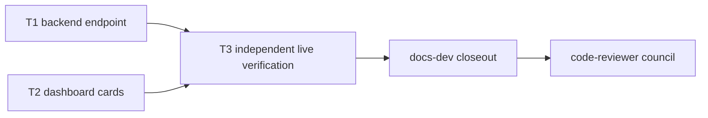

# Admin dashboard job status cards

**Status: Ready, 2026-11-16.**

## Problem and goal

The admin dashboard overview (`DashboardOverview`) shows four metric cards and a Recent Jobs
section but no per-status job breakdown. Its only job figures are computed client-side from the
first page of `GET /api/job`, and the dashboard's TypeScript `JobStatus` enum does not match the
server's four states.

Goal: render four job status cards (Pending, Assigned, EnRoute, Received) between the existing
metric cards and the Recent Jobs section, each showing the real number of jobs in that status,
aggregated in SQL Server and served by a new read-only API endpoint. The cards are a reusable
component (label, count, colour, icon), carry no fallback or mock data in production code, and read
their data through a TanStack Query key that a later SignalR handler can invalidate.

## Scale

`documentation-impact: extends-component` for `admin-dashboard` (new overview section and
components) and `Api` (new `GET /api/job/status-summary` contract). No new runnable component,
no schema change, no new dependency, no infrastructure.

## Decisions

| ID | Question | Answer / decision | Mitigating and supporting information | Status / approval provenance |
|---|---|---|---|---|
| D1 | Development mode and autonomy | `test-first`, `autonomous`. | Supplied by the conductor packet. | ANSWERED — conductor packet 2026-11-16 |
| D2 | Which statuses and what does each count mean? | The four values of `HotshotLogistics.Core.Enums.JobStatus` (Pending=0, Assigned=1, EnRoute=2, Received=3); each card counts every row in `Jobs` with that `Status`, with no date window. A status with no rows reports 0; any stored value outside the enum is not counted. | Migration `UpdateJobStatusesToNewEnum` (20251009060000) folded the old eight states into these four, so these are the only values the database holds. The dashboard's TS `JobStatus` enum (`InProgress`, `Completed`, `Cancelled`) is stale and is not used by the cards (see D10). | autonomous: decided from code (enum + migration) |
| D3 | Where does the response DTO live? | New `sealed record JobStatusSummaryDto` in `3-Domain/HotshotLogistics.Contracts/Models/JobStatusSummaryDto.cs`, namespace `HotshotLogistics.Contracts.Models`. | C# standard names `HotshotLogistics.Contracts.Models` as the approved target for shared DTOs and requires `sealed record` response DTOs; existing DTOs in `HotshotLogistics.Domain/DTOs` are the divergence tracked by `todo/contracts-model-placement.md`. The DTO crosses Data → Application → Api, so it is shared. First type in that folder, so it starts a new project layout convention. Cost of wrong: one file move. | APPROVED — owner 2026-11-16 (Q1: shared DTO in `HotshotLogistics.Contracts.Models` approved) |
| D4 | What API contract serves the counts? | `GET /api/job/status-summary` on `JobController`, policy `AuthorizationPolicies.ManagerOrAdmin` (same as `GetJobs`), optional `[FromQuery] string? customerId`, returns `200` with `JobStatusSummaryDto` serialized camelCase: `{ "pending": n, "assigned": n, "enRoute": n, "received": n }`. | One explicit field per status keeps the TS type exact and sidesteps enum serialization (Newtonsoft is configured without a `StringEnumConverter`). `customerId` reuses `JobFilterDto` / `BuildWhereClause` and is what lets tests scope counts to rows they created (test standard forbids absolute table counts). Alternative rejected: list of `{status,count}` (looser typing for four fixed states). | APPROVED — owner 2026-11-16 (Q1: ManagerOrAdmin endpoint with optional `customerId` filter approved) |
| D5 | Grid layout: the request says `grid grid-cols-5 gap-4` and also "responsive". | `grid grid-cols-1 sm:grid-cols-2 lg:grid-cols-4 gap-4`. | `grid-cols-5` is not responsive and leaves an empty fifth column for four cards; the existing metric grid uses `grid-cols-1 sm:grid-cols-2 lg:grid-cols-4`, so matching its breakpoints keeps the two rows aligned. Keeps the requested `gap-4`. Deviates from the literal class string. Cost of wrong: one class string and one spec assertion. | APPROVED — owner 2026-11-16 (recommended responsive grid approved) |
| D6 | How are the four colours expressed? | Tailwind palette classes that equal the requested hex values: Pending `bg-blue-500` (#3B82F6), Assigned `bg-sky-500` (#0EA5E9), EnRoute `bg-sky-600` (#0284C7), Received `bg-sky-700` (#0369A1). | React standard: "Do not hardcode a colour that the theme already names"; all four hex values are Tailwind v4 default palette entries. | autonomous: covered by `6-Docs/standards/react/README.md` § Styling |
| D7 | Icon source | `lucide-react` `Hourglass`, `ClipboardList`, `Truck`, `Inbox`, rendered white inside the coloured rounded-square badge, `aria-hidden`. | `lucide-react` is already a dashboard dependency; no new package. | autonomous: decided from `package.json` |
| D8 | Connection creation for the new repository query | Follow the existing `JobRepository` pattern (`new SqlConnection(ConnectionString)` from `BaseRepository<Job>`), parameterized, explicit columns, `await using`, cancellation passed. | The DAL standard's target `ISqlConnectionFactory` does not exist yet (`todo/sql-connection-factory.md`); introducing it is a cross-cutting change the repository rules reserve for the owner. Sanctioned exception for T1 only — worker records an `Open item:` naming the standard. | APPROVED — owner 2026-11-16 (existing connection pattern approved for T1) |
| D9 | Layering of the read path | `JobController.GetJobStatusSummary` → `IJobService.GetJobStatusSummaryAsync` → `IJobRepository.GetJobStatusCountsAsync(JobFilterDto?, CancellationToken)`. The action has no `catch (Exception)`; unexpected failures reach the host's 500 handling. | C# standard: application/API code consumes a persistence abstraction and "catch what you can name". Existing actions' bare catches are not copied. `IRepository<T>` migration stays in `todo/generic-repository-migration.md`. | autonomous: covered by `6-Docs/standards/csharp/README.md` § Stack, § Errors |
| D10 | Fix the stale dashboard `JobStatus` enum, the overview's test-mode fallback data and debug logging in this run? | No. The cards use a new `JobStatusSummary` type and add no fallback; the stale enum stays with `todo/admin-dashboard-job-status-unresolved.md`; the pre-existing fallback/debug logging is filed as `todo/admin-dashboard-overview-test-fallback.md`. | Replacing the enum changes `JobsManagement`, the Active Jobs metric and several specs — out of this feature's scope (AGENTS.md: no scope expansion without approval). | autonomous: scope rule in AGENTS.md |
| D11 | Frontend test tooling | Playwright in `tests/dashboard-overview.spec.ts`, API mocked with `page.route`. No Vitest/RTL. | Test standard: Playwright is the only frontend runner; adding Vitest is a new dependency (`todo/frontend-unit-test-tooling.md`) needing approval. | autonomous: covered by `6-Docs/standards/test/README.md` |
| D12 | What do the automated (committed) tests prove, and what do they not? | T1 tests prove SQL → repository → HTTP against the isolated `hotshot_logistics_test` database with uniquely-id'd rows scoped by a test-owned customer. T2 Playwright tests prove only that the UI renders, styles and lays out whatever the endpoint returns; their responses are mocked, so they are **not** evidence that database values reach the screen. That end-to-end claim is proved only by T3 (D14). | Test standard: Playwright specs mock every API call and never hit a real API; DB tests never assert absolute table counts. Mocked UI evidence is not substituted for the live path. | autonomous: covered by `6-Docs/standards/test/README.md` |
| D13 | Live updates | Out of scope. The cards read query key `['jobs', 'status-summary']` so a later SignalR handler can call `invalidateQueries` on it. | `RealtimeHub.JobStatusUpdated` sends only to group `job-{jobId}`; a dashboard-wide broadcast is a hub contract change. | autonomous: scope rule in AGENTS.md |
| D14 | How is the actual path isolated database → running API → rendered UI verified, and by whom? | **Option A (recommended):** task T3, run in its own `verification` session by an agent that implemented neither T1 nor T2, executes the scripted procedure in T3 against the local SQL Server 2022 container database `hotshot_logistics_test`, the API running in `Development` (Test auth handler, connection string from user secrets) and the dashboard dev server, with a browser driven by a verifier-owned, uncommitted Playwright script under the git-ignored agent scratchpad that installs **no** `page.route` mock. Pass = at baseline and after each seeded change, SQL `GROUP BY Status` = API JSON = the four rendered counts, and the observed deltas equal the jobs the verifier created and moved; evidence (SQL output, API bodies, captured network response, screenshots at 375/768/1200 px) is attached to the run. **Option B:** commit a live Playwright spec (own config, outside the default suite, opt-in by an environment flag). B gives a repeatable regression test but contradicts the test standard ("never hit a real API"), so it needs an owner-approved amendment of `6-Docs/standards/test/README.md` and a CI decision on the database; it would be a follow-up plan, not this run. | Feasibility checked in code: `Program.cs` uses `TestAuthHandler` in Development (default role Admin); `dev-env-up.sh` provisions the container, the least-privilege login and migrations and writes `ConnectionStrings:DefaultConnection` (database `hotshot_logistics_test`) to user secrets; the dashboard honours `__BYPASS_AUTH__` and `NEXT_PUBLIC_API_BASE_URL`; the CORS allow-list (`appsettings.Development.json`) lists only port 3000, so T3 appends port 3100 by environment variable at run time (no repo change); `UseHttpsRedirection` is on, so the verifier targets `https://localhost:5001` and accepts the local dev certificate in its browser context and `curl -k`. A must not be weakened to mocked evidence; if any precondition fails, T3 stops and reports BLOCKED rather than passing. Option A changes no governed document and adds no dependency, but it is a process/architecture choice about how acceptance is proved, so it was put to the owner and approved (Option A). The verifier never writes a secret into the repository or its evidence: connection strings and passwords are read from user secrets or the local secret file at run time and redacted from captured output; no Azure resource is used. | APPROVED — owner 2026-11-16 (Q2: Option A independent live check approved, including starting the local SQL Server test container; Option B not approved) |
| D15 | May `docs-dev` edit the canonical governed architecture docs at closeout? | Yes, limited to the Design harvest rows: `6-Docs/admin-dashboard/architecture.md` and `6-Docs/api/architecture.md` (sections and `code-refs` named in the harvest), plus the decision mapping. No other governed document, standard or ADR is edited. | AGENTS.md reserves edits to governed documentation outside plans/specs/todos for user approval. Without approval, closeout cannot harvest and the plan cannot archive. | APPROVED — owner 2026-11-16 (Q3: closeout edits limited to the dashboard and API architecture docs) |
| AP1 | Approve and execute | Approved for execution as planned. | Recorded by the finalize step, which changed no task, file scope, test row or command. | ANSWERED: autonomous: recommendation accepted, AUTONOMOUS_APPROVAL: approve-and-execute, 2026-11-16 |

## Design harvest

| Target component | Target doc type | Section | Content to harvest |
|---|---|---|---|
| admin-dashboard | architecture | Components and interfaces | `src/components/dashboard/JobStatusCards.tsx`, `JobStatusCard.tsx`, `src/hooks/useJobStatusSummary.ts`; position between metrics and Recent Jobs; colour/icon mapping (D6, D7); responsive grid (D5). |
| admin-dashboard | architecture | Data models | `JobStatusSummary` type mirrors `JobStatusSummaryDto`; query key `['jobs','status-summary']` reserved for SignalR invalidation (D13). |
| admin-dashboard | architecture | Error handling | Cards show an inline `role="alert"` error and no fallback data. |
| Api | architecture | Components and interfaces | `GET /api/job/status-summary` contract, policy and optional `customerId` (D4); controller → service → repository path (D9). |
| Api | architecture | Data models | `HotshotLogistics.Contracts.Models.JobStatusSummaryDto` as the first type in the approved shared-DTO location (D3). |

## Investigation findings

- Read revision: worktree `copilot/feat/dashboard-job-status-cards` at `ff86948` (codegraph and kw-docs provenance matched `RUN_BASE`/`RUN_BRANCH`).
- Dashboard stack is Next.js 16.4 App Router, React 19.3, Tailwind 4, TanStack Query 5, `lucide-react`, `@microsoft/signalr`; Inter is applied in `src/app/layout.tsx`. The request's stack description is accurate; no dependency is missing.
- `DashboardOverview.tsx` renders the metric grid (`data-testid="stats-container"`, cards `bg-white p-6 rounded-lg shadow`, `w-8 h-8 rounded-md` badge left of label) then `{/* Recent Activity */}` ("Recent Jobs"). New cards go between them.
- `tests/dashboard-overview.spec.ts` asserts `[data-testid="stats-card"]` count 4 and that the **first** `.grid` carries the metric classes, so the new grid must come after the metric grid and use a different test id. `beforeEach` routes only `/api/job`, `/api/drivers`, `/api/billing/invoices/overdue`; the new route must be added there.
- `DashboardOverview` contains test-mode fallback data and `console.log` debug output in production code (pre-existing; D10).
- Backend: `JobRepository` (internal, `BaseRepository<Job>`) already has `GetJobCountAsync(JobFilterDto?)` and `BuildWhereClause` (handles `CustomerId`); index `IX_Jobs_Status` exists (migration 20250101000200), so `GROUP BY Status` needs no new index.
- `JobController` is `[Route("api/[controller]")]` and injects `IJobService` and `IJobRepository`; `review.test-map` maps it to `HotshotLogistics.IntegrationTests.JobControllerIntegrationTests`; `JobRepository` maps by stem to `HotshotLogistics.Tests.Jobs.JobRepositoryTests` (scoped to a unique customer id per class).
- A previous implementation of this feature exists only on an unmerged branch (commit `8417300`); it is not in `origin/main`, and `todo/admin-dashboard-job-status-unresolved.md` cites its plan, which is not in this tree's archive. This plan does not depend on it.
- Divergences from documented rules seen (not fixed here): `JobRepository` `SELECT *` and `new SqlConnection` (DAL standard; todos `sql-connection-factory`, `generic-repository-migration`); DTOs in `HotshotLogistics.Domain/DTOs` (todo `contracts-model-placement`); `HotshotLogistics.Data` references `HotshotLogistics.Application` (todo `persistence-application-dependency`); controller bare `catch (Exception)` (todo `problem-details`).
- Discovery: codegraph 3, docs 11, direct reads 19 — `AGENTS.md` (host rules), plan/todo indexes and the cited todo (write boundary), catalog and `admin-dashboard/architecture.md` (harvest targets), `DashboardOverview.tsx` and `dashboard-overview.spec.ts` in full (codegraph trimmed them), `JobControllerIntegrationTests.cs` two ranges (fixture pattern), five shell surveys (dashboard tree, `package.json`, `task-e2e.sh`, `kyber-weave.yml` test-map, csproj references, migrations index) not answered by the index, and for the D14 revision five targeted reads of runtime configuration the index does not model (`Program.cs` auth/CORS/HTTPS lines, `appsettings.Development.json` CORS list, `dev-env-up.sh` secrets and migrations, `playwright.config.ts` webServer env, `.gitignore` scratchpad entry plus controller route attributes).

## Test contract (development-mode: test-first)

| Task | Test project or file | Runner command | Observable behavior | RED evidence required | GREEN acceptance |
|---|---|---|---|---|---|
| T1 | `5-Test/tests/HotshotLogistics.Tests/Jobs/JobRepositoryTests.cs` (extend `HotshotLogistics.Tests.Jobs.JobRepositoryTests`) | `bash 5-Test/run-task-tests.sh 'FullyQualifiedName~HotshotLogistics.Tests.Jobs.JobRepositoryTests\|FullyQualifiedName~HotshotLogistics.IntegrationTests.JobControllerIntegrationTests' .agent_scratchpad/T1/artifacts` | `GetJobStatusCountsAsync_WithCustomerFilter_ReturnsCountPerStatus`: rows created under the class's unique customer (e.g. 2 Pending, 1 Assigned, 3 EnRoute, 0 Received) produce exactly those four counts. `GetJobStatusCountsAsync_WithCustomerHavingNoJobs_ReturnsAllZero`. | Compile errors: `GetJobStatusCountsAsync` and `JobStatusSummaryDto` missing. | Both tests pass against `hotshot_logistics_test` (not skipped); rows cleaned by `TestRowCleanup`. |
| T1 | `5-Test/tests/HotshotLogistics.IntegrationTests/JobControllerIntegrationTests.cs` (extend `HotshotLogistics.IntegrationTests.JobControllerIntegrationTests`) | same command | `GetJobStatusSummary_WithCustomerId_ReturnsCountsOfThatCustomersJobs`: a test-owned customer with jobs moved through the API to known statuses yields `200` and the exact camelCase body counts. `GetJobStatusSummary_WithoutCustomerId_ReturnsOkWithNonNegativeCounts`. `GetJobStatusSummary_AsDriver_ReturnsForbidden` (`X-Test-Role: Driver`). | 404 from the missing route (or compile error on the DTO). | All three pass; created customer and jobs registered with `Cleanup` before creation. |
| T2 | `1-Presentation/admin-dashboard/tests/dashboard-overview.spec.ts` (copy the `beforeEach` route pattern already in the file) | `bash 1-Presentation/admin-dashboard/scripts/task-e2e.sh 1-Presentation/admin-dashboard/tests/dashboard-overview.spec.ts` | New `test.describe('Job Status Cards')`: `should render four job status cards in order with counts from the API` (mock `{pending:4,assigned:3,enRoute:2,received:7}` → labels Pending, Assigned, EnRoute, Received with those counts); `should place job status cards between metrics and recent jobs`; `should style job status cards like the metric cards` (`bg-white`, `rounded-lg`, `shadow`, `p-6`; badge classes `bg-blue-500`/`bg-sky-500`/`bg-sky-600`/`bg-sky-700`, `rounded-md`); `should show an error message when the status summary request fails` (500 → `role="alert"`, no counts); `should lay out job status cards responsively` (375 px → 1 column, 768 px → 2, 1200 px → 4, measured by card bounding boxes). Existing specs stay green with the new route mocked in `beforeEach`. | `tsc`/Playwright failures: `getJobStatusSummary` missing, `data-testid="job-status-card"` not found. | All new and existing non-fixme tests in the file pass in chromium; no assertion in existing tests weakened. |
| T3 | No committed test file (D14 Option A). Verifier-owned procedure and uncommitted Playwright script under the agent scratchpad for T3; evidence in the T3 artifacts folder of the scratchpad. | The T3 procedure (Tasks § T3), run by an agent that did not implement T1 or T2 | Live path, no mocks: with the API on the isolated `hotshot_logistics_test` database, (a) baseline SQL `SELECT Status, COUNT(*) FROM dbo.Jobs GROUP BY Status` equals the unfiltered status-summary JSON equals the four rendered card counts; (b) after creating 5 uniquely-named jobs under a verifier-owned customer (all start Pending) and then moving one to Assigned, two to EnRoute and one to Received through the job status endpoint, each of the three sources moves from baseline by exactly `{pending:+1, assigned:+1, enRoute:+2, received:+1}` and the `customerId`-scoped JSON is exactly `{1,1,2,1}`; (c) the browser's captured `/api/job/status-summary` response is a real 200 from `localhost:5001`, not a route mock; (d) cards render between metrics and Recent Jobs with badge colours #3B82F6/#0EA5E9/#0284C7/#0369A1 (computed style), labels weight 600 and counts weight 700 in Inter, and 1/2/4 columns at 375/768/1200 px; (e) after cleanup the counts return to baseline. | T3 runs only after T1 and T2 are GREEN, so it has no RED phase of its own; the RED evidence for the path is T1's 404 and T2's missing cards. T3 first runs the precondition checks in its procedure; any failing precondition returns BLOCKED naming the step. | Every check (a)–(e) passes with evidence files attached; any mismatch, a mocked or failed network response, or a precondition failure is a T3 failure, never a pass. |

## Tasks

### T1: Job status counts endpoint (repository, service, API)

- **Objective:** Serve real per-status job counts from SQL Server at `GET /api/job/status-summary`.
- **Capabilities:** C# ASP.NET Core API and service code, ADO.NET data access, xUnit repository and HTTP integration tests against SQL Server.
- **Session:** `backend`
- **Depends on:** none
- **Files:**
  - `3-Domain/HotshotLogistics.Contracts/Models/JobStatusSummaryDto.cs`: new `public sealed record JobStatusSummaryDto(int Pending, int Assigned, int EnRoute, int Received)` with XML docs, in namespace HotshotLogistics.Contracts.Models (D3).
  - `3-Domain/HotshotLogistics.Contracts/Repositories/IJobRepository.cs`: add `Task<JobStatusSummaryDto> GetJobStatusCountsAsync(JobFilterDto? filter = null, CancellationToken cancellationToken = default)`.
  - `4-Persistence/HotshotLogistics.Data/Repositories/JobRepository.cs`: implement it with `SELECT Status, COUNT(*) AS JobCount FROM Jobs{where} GROUP BY Status`, `BuildWhereClause`/`AddParametersToCommand`, `await using`, cancellation; zero-fill absent statuses, ignore values outside `JobStatus`; structured log on `SqlException` then rethrow (D2, D8).
  - `3-Domain/HotshotLogistics.Contracts/Services/IJobService.cs`: add `Task<JobStatusSummaryDto> GetJobStatusSummaryAsync(string? customerId = null, CancellationToken cancellationToken = default)`.
  - `2-Application/HotshotLogistics.Application/Services/JobService.cs`: `JobService.GetJobStatusSummaryAsync` builds `JobFilterDto { CustomerId = customerId }` (null filter when absent) and calls the repository.
  - `1-Presentation/HotshotLogistics.Api/Controllers/JobController.cs`: new action `GetJobStatusSummary` `[HttpGet("status-summary")]`, `[Authorize(Policy = AuthorizationPolicies.ManagerOrAdmin)]`, `[ProducesResponseType(typeof(JobStatusSummaryDto), 200)]`, optional `[FromQuery] string? customerId`, calls `_jobService`, no bare catch (D4, D9). The integration test proves `status-summary` resolves to this action, not the `{id}` route.
  - `5-Test/tests/HotshotLogistics.Tests/Jobs/JobRepositoryTests.cs`: tests per Test contract, using the class's unique customer id and `_cleanup`.
  - `5-Test/tests/HotshotLogistics.IntegrationTests/JobControllerIntegrationTests.cs`: tests per Test contract; create an own customer (track it with the Cleanup TrackCustomer method) and own jobs (TrackJob), set statuses through PUT on the job status route.
- **Commands:**
  - `kyber-weave review gates . --agent <your agent name> --task T1 --red`
  - `kyber-weave review gates . --agent <your agent name> --task T1`
- **Acceptance:**
  - Test-contract rows for T1 are RED then GREEN with DB tests executed, not skipped.
  - Response body is exactly `{ "pending", "assigned", "enRoute", "received" }` integers; driver role gets 403.
  - No `SELECT *`, no string-concatenated values, no new package or project reference.
  - `Open item:` lines for D8 (connection factory) and any other standard divergence touched.

### T2: Job status cards on the dashboard overview

- **Objective:** Render four reusable, API-backed job status cards between the metric cards and Recent Jobs.
- **Capabilities:** React and TypeScript UI with Tailwind styling and Playwright tests.
- **Session:** `frontend`
- **Depends on:** none (consumes the D4 JSON contract, fixed in this plan)
- **Files:**
  - `1-Presentation/admin-dashboard/src/types/index.ts`: add `export interface JobStatusSummary { pending: number; assigned: number; enRoute: number; received: number; }`; leave the existing `JobStatus` enum unchanged (D10).
  - `1-Presentation/admin-dashboard/src/services/api.ts`: `ApiService.getJobStatusSummary(): Promise<JobStatusSummary>` requesting the job status-summary path (D4).
  - `1-Presentation/admin-dashboard/src/hooks/useJobStatusSummary.ts`: new hook `useJobStatusSummary` wrapping `useQuery({ queryKey: ['jobs', 'status-summary'], queryFn: () => apiService.getJobStatusSummary() })` (D13).
  - `1-Presentation/admin-dashboard/src/components/dashboard/JobStatusCard.tsx`: new presentational `JobStatusCard({ label, count, colorClass, icon })` — `bg-white p-6 rounded-lg shadow`, `data-testid="job-status-card"`, left `w-8 h-8 rounded-md` badge with the icon (`aria-hidden`), label `text-sm font-semibold text-gray-500`, count `text-2xl font-bold text-gray-900 text-center`.
  - `1-Presentation/admin-dashboard/src/components/dashboard/JobStatusCards.tsx`: new `JobStatusCards` — calls the hook, maps a constant config (label, field, colour per D6, icon per D7) to `JobStatusCard` in a `<section aria-label="Job status">` grid `grid grid-cols-1 sm:grid-cols-2 lg:grid-cols-4 gap-4` (`data-testid="job-status-cards"`, D5); loading skeleton; error `role="alert"` text "Unable to load job status counts"; no fallback data, no console logging.
  - `1-Presentation/admin-dashboard/src/components/dashboard/DashboardOverview.tsx`: render `<JobStatusCards />` after the metric grid and before the Recent Activity block; change nothing else.
  - `1-Presentation/admin-dashboard/tests/dashboard-overview.spec.ts`: add a mocked route for the status-summary endpoint to `beforeEach` and the `Job Status Cards` describe per Test contract.
- **Commands:**
  - `kyber-weave review gates . --agent <your agent name> --task T2 --red`
  - `kyber-weave review gates . --agent <your agent name> --task T2`
- **Acceptance:**
  - T2 Test-contract tests RED then GREEN; existing dashboard-overview tests unchanged and passing.
  - Lint, typecheck and `npm run build` gates pass; no new npm dependency.
  - Counts shown are exactly the mocked API values; production code contains no mock or fallback counts.

### T3: Independent live verification (database → API → rendered UI)

- **Objective:** Prove, without mocks, that the counts in the isolated test database are what the running API returns and what the dashboard renders, responsively and in the specified style (D14 Option A).
- **Capabilities:** Running the local SQL Server container, the ASP.NET Core API and the Next.js dev server; SQL queries with sqlcmd; HTTP checks with curl; browser verification with Playwright. Read-only on the repository.
- **Session:** `verification` (a fresh agent that implemented neither T1 nor T2)
- **Depends on:** T1, T2
- **Files:**
  - `.agent_scratchpad/T3/live-status-cards.spec.ts`: verifier-owned, git-ignored, never committed; Playwright script with no route mocks.
  - `.agent_scratchpad/T3/artifacts/`: evidence (SQL outputs, API bodies, network metadata, screenshots, created and deleted ids).
  - No tracked file is changed; `git status` is clean of T3's work at the end.
- **Procedure:**
  1. Preconditions (each failure returns BLOCKED naming the step): Docker running; `bash 7-Deployment/dev-env/dev-env-up.sh` exits 0; `dotnet user-secrets list --project 1-Presentation/HotshotLogistics.Api` shows a DefaultConnection whose server is `localhost`/`127.0.0.1` and whose database is `hotshot_logistics_test`; no Azure App Configuration endpoint or connection string is set in the environment; no other DB-backed test suite is running.
  2. Start the API: `ASPNETCORE_ENVIRONMENT=Development Cors__AllowedOrigins__2=http://localhost:3100 dotnet run --project 1-Presentation/HotshotLogistics.Api --urls "https://localhost:5001;http://localhost:5000"`; wait until `curl -k -H "Authorization: Test test-token" https://localhost:5001/api/job/status-summary` returns 200.
  3. Start the dashboard: in the admin-dashboard folder, `NEXT_PUBLIC_API_BASE_URL=https://localhost:5001/api npx next dev --port 3100`, with the same placeholder Azure B2C variables the Playwright config webServer block sets.
  4. Baseline: record sqlcmd output (application login from user secrets) of `SELECT Status, COUNT(*) AS JobCount FROM dbo.Jobs GROUP BY Status`, the unfiltered status-summary JSON, and the rendered counts read by the verifier's Playwright script (init script sets the bypass-auth flag, `ignoreHTTPSErrors: true`, no `page.route`, waits for the real status-summary response and records its URL and status). Check (a).
  5. Seed: `POST /api/customer` a customer named with a `t3-verify-` prefix and a UTC timestamp; `POST /api/job` five jobs for it; `PUT /api/job/{id}/status` to Assigned (1), EnRoute (2), Received (1). Record every created id.
  6. Re-read all three sources and the `customerId`-scoped JSON; check (b), (c) and (d) (computed `background-color` of each badge, `font-weight` and `font-family` of label and count, card order and position, column count by bounding boxes at 375, 768 and 1200 px with a screenshot at each).
  7. Cleanup: `DELETE /api/job/{id}` for each recorded job, then `DELETE /api/customer/{id}`; if an API delete fails, delete by recorded id with parameterized sqlcmd. Re-read and check (e). Stop the API and dashboard processes.
  8. If a SQL-vs-API mismatch appears and another writer is suspected, repeat step 4 or 6 once; a second mismatch is a failure.
- **Commands:**
  - `bash 7-Deployment/dev-env/dev-env-up.sh`
- **Acceptance:**
  - T3 Test-contract checks (a)–(e) all pass, with evidence attached: SQL outputs, API bodies, captured network response metadata, screenshots at three widths, and the created and deleted ids.
  - No mocked response, no production or Azure-hosted database, no tracked-file change.
  - No secret (connection string, password, token other than the fixed local test token) appears in any committed file, and secrets are redacted from the evidence files.
  - Mismatches are reported as findings against T1 or T2, not fixed by the verifier.

## Dependency graph

T1 and T2 run in parallel; they share no files and T2 consumes only the D4 contract. T3 starts when both are GREEN and is run by a different agent. `docs-dev` closeout then runs (its canonical-doc edits are approved by D15, limited to the two architecture docs), and the `code-reviewer` council reviews the whole change, code and documentation, last.

## Risks

- `status-summary` captured by an existing `{id}` route → T1 integration test hits the literal path; attribute route literal segments outrank parameters in ASP.NET Core.
- Shared test database counts drift under parallel runs → every assertion is scoped to a test-owned customer (D4, D12).
- Contract drift between T1 and T2 → shape fixed in D4; reviewer checks the TS type against the DTO.
- Existing Playwright specs break from an unmocked request → route added in `beforeEach`.
- Unbounded table scan cost → `GROUP BY` on indexed `Status`; single aggregate query.
- T3 environment: CORS allow-list lacks port 3100 and HTTPS redirection needs the dev certificate → appended origin by environment variable and certificate errors accepted only in the verifier's local browser context and curl; no repo change.
- T3 against the wrong database → step 1 asserts the server is local and the database is `hotshot_logistics_test` before anything starts; otherwise BLOCKED.
- T3 unscoped counts race with other writers on the shared test DB → run with no other DB suite active, one retry, and the scoped `customerId` check that is immune to other writers.
- Overview's pre-existing test-mode fallback data could mask a failed API call → T3 requires the captured status-summary response to be a real 200, and the cards have no fallback (D10).

## Out-of-scope boundaries

- SignalR live push of status counts (D13).
- Replacing the stale dashboard `JobStatus` enum and Active Jobs computation — [`todo/admin-dashboard-job-status-unresolved.md`](../todo/admin-dashboard-job-status-unresolved.md).
- Removing `DashboardOverview` test-mode fallback data and debug logging — [`todo/admin-dashboard-overview-test-fallback.md`](../todo/admin-dashboard-overview-test-fallback.md).
- `ISqlConnectionFactory`, `IRepository<T>`, ProblemDetails, moving existing DTOs — existing todos (`sql-connection-factory`, `generic-repository-migration`, `problem-details`, `contracts-model-placement`).
- Vitest/RTL tooling (`todo/frontend-unit-test-tooling.md`), infrastructure, deployment, migrations.

## Verification gates

- Per task: the worker's task gate (RED then GREEN) for T1 and T2.
- Independent live verification: T3 (D14) by an agent other than the implementers; its pass is required before closeout. Mocked Playwright results are never accepted in its place.
- Then `docs-dev` closeout (canonical doc edits approved by D15, limited to the two architecture docs).
- End of run, last: the `code-reviewer` council over the whole change including the closeout docs, under the `code-review` skill, run by agents other than the implementers; it re-runs the full-suite gates including DB-backed tests after `7-Deployment/dev-env/dev-env-up.sh` and checks T3's evidence.
- Docs: `kyber-weave docs validate . --merge-ready` and `kyber-weave docs drift .` pass.

## Review

After docs-dev closeout, `code-reviewer` reviews the accumulated branch diff, code and docs, with its lens council and the `code-review` skill; it confirms the D3/D4/D5/D8 choices are implemented as approved, that T3's evidence shows matching SQL, API and UI counts from an unmocked response, and that no fallback data or `console.log` was added.

## docs-dev closeout

Runs after T3 and before review. As approved by the owner in D15, `docs-dev` harvests the Design harvest rows into `6-Docs/admin-dashboard/architecture.md` and `6-Docs/api/architecture.md`, adds `JobStatusCards` / `JobStatusSummaryDto` to their `code-refs` where cited, and maps D3–D15 to their canonical destinations before archive. It edits no other governed document; any further governed-doc edit would need new owner approval.
