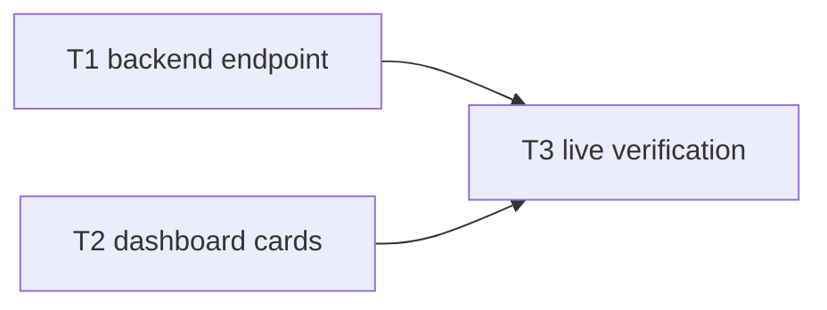

# Admin dashboard job status cards

**Status: Ready, 2026-11-16.**

## Problem and goal

The Admin Dashboard overview (`DashboardOverview`) shows four metric cards computed client-side from the
first page of `/api/job`, and nothing shows how many jobs sit in each lifecycle status. The goal is four
job status cards (Pending, Assigned, EnRoute, Received) placed between the existing metric cards and the
Recent Activity ("Recent Jobs") panel, fed end to end from the database: `Jobs` table → repository
`GROUP BY` aggregation → application service → shared DTO → REST endpoint → typed API client → React
Query hook → reusable `JobStatusCards` component. No production mock data; the data hook exposes a stable
query key so a later SignalR push can refresh it without changing the component. Proof runs on real
persisted rows: a database-backed HTTP integration test, a contract-matched Playwright spec, and an
independent live database-to-display verification task executed by a worker that did not write the code.

## Scale

`documentation-impact: extends-component` for `admin-dashboard` (new dashboard component, data hook and
API client call) and `Api` (new read endpoint `GET /api/job/status-counts` and its DTO). No new component,
project, package, infrastructure, deployment asset or cross-cutting concern.

## Decisions

| ID | Question | Answer / decision | Mitigating and supporting information | Status / approval provenance |
|---|---|---|---|---|
| D1 | Next.js 16 App Router migration? | None. The dashboard already is Next.js `16.4.6` with the App Router (`src/app/page.tsx`, `src/app/layout.tsx`), React `19.3.1`; the cards are added to the existing `DashboardOverview` client component. | Read from `1-Presentation/admin-dashboard/package.json`. The request asked to reconcile, not assume a migration. | autonomous: covered by repository evidence |
| D2 | Which status values back the four cards? | The backend `HotshotLogistics.Core.Enums.JobStatus` (`Pending`=0, `Assigned`=1, `EnRoute`=2, `Received`=3), stored as `int` in `Jobs.Status`. | The request's four labels match this enum exactly. The frontend `JobStatus` enum in `src/types/index.ts` is stale (`InProgress`/`Completed`/`Cancelled`) and is tracked by [todo](../todo/admin-dashboard-job-status-unresolved.md); this plan does not depend on or change it. | autonomous: covered by repository evidence |
| D3 | Transport: REST or SignalR? | REST `GET /api/job/status-counts` on `JobController`, policy `AuthorizationPolicies.ManagerOrAdmin` (same as `GetJobs`). No server-side SignalR broadcast in this change. | The request allows "REST or SignalR" and asks only to *support future* SignalR updates; the hook exports `jobStatusCountsQueryKey` so a future `JobStatusUpdated` handler can call `queryClient.invalidateQueries`. Adding a broadcast now would widen scope into `JobService` write paths and the known event-name mismatch. Literal route `status-counts` outranks `{id}` in ASP.NET Core routing. | autonomous: low-confidence, no authoritative source (cheap to reverse) |
| D4 | DTO shape and placement | `public sealed record JobStatusCountsDto(int Pending, int Assigned, int EnRoute, int Received)` in new folder `3-Domain/HotshotLogistics.Contracts/Models/`, namespace `HotshotLogistics.Contracts.Models`. Serialized camelCase by the existing Newtonsoft setup: `{"pending":n,"assigned":n,"enRoute":n,"received":n}`; every status always present, zero-filled. | C# standard: shared DTOs target `HotshotLogistics.Contracts.Models`, HTTP bodies target `sealed record`, never return an entity. A folder in the existing project adds no project or reference (the [contracts todo](../todo/contracts-model-placement.md) covers moving existing types). Cost if wrong: one type move. | autonomous: covered by C# standard (Model classification; Stack) |
| D5 | Repository connection pattern | New `JobRepository.GetJobStatusCountsAsync` opens `new SqlConnection(ConnectionString)` exactly as every sibling method does; explicit columns (`SELECT Status, COUNT(*) AS JobCount … GROUP BY Status`), parameterized optional `@CustomerId`, async with cancellation. | Data-access standard names `ISqlConnectionFactory` as the target; it does not exist yet ([todo](../todo/sql-connection-factory.md)). Sanctioned exception for this task: the worker reports it as an `Open item`. `SELECT *` is not copied. | autonomous: covered by data-access standard plus tracked todo |
| D6 | Test isolation for an aggregate over a shared database | Endpoint and repository accept optional `customerId`; null = all jobs (what the dashboard shows). Tests create a unique customer and their own jobs and query scoped counts, so they assert exact values. | Test standard: never assert absolute table counts; scope to rows the test created. A customer scope is also a real filter for a future per-customer view. | autonomous: covered by test standard (Test data hygiene) |
| D7 | Meaning of "independent persistent test data" | Real rows persisted in SQL Server through the API's own create/status endpoints, owned by the test (unique ids), independent of seed rows, registered with `TestRowCleanup` and removed after the run. No mocked database. | Test standard forbids leaving rows or changing seed rows; "persistent" is satisfied by real persisted rows, not by permanent data. | autonomous: low-confidence, no authoritative source (cheap to reverse) |
| D8 | Minimum tests that prove database-to-display | (a) one HTTP integration test (real DB → repository → service → controller → raw JSON names); (b) one Playwright spec fed the identical JSON contract (API → DOM, layout, colors, responsive, error state); (c) T3, an independent live run against the real API and database with no mocks. No unit tests for wiring, no repository-only test. | The user asked for only the tests needed for database-to-display integration and for independent verification. (a)+(b) share the literal JSON contract; (c) closes the gap with no mock. | autonomous: covered by request |
| D9 | Live verification vs. Playwright "never hit a real API" | T3 is a verification task, not a committed spec: a throwaway script under `.agent_scratchpad/T3/` (git-ignored; the only root folder `AGENTS.md` allows). The committed Playwright suite stays fully mocked. | Keeps the test standard intact while meeting the request's demand for executed proof. API runs `--no-launch-profile` on `http://localhost:5080` (no HTTPS port, so no redirect); dashboard on `http://localhost:3000`, already in the Development CORS allow-list; the API shares the tests' `UserSecretsId`, so no connection string is ever typed or printed. | autonomous: low-confidence, no authoritative source (no repo change) |
| D10 | Card colors with Tailwind 4 | Literal hex via inline `style={{ backgroundColor: color }}` on the icon badge: Pending `#3B82F6`, Assigned `#0EA5E9`, EnRoute `#0284C7`, Received `#0369A1`. | Installed `tailwindcss` is `4.3.5` (package-lock): v4 palette tokens are OKLCH, so `bg-blue-500` does not render exactly `#3B82F6`, and dynamic `bg-[${color}]` classes are not generated. | autonomous: covered by installed version |
| D11 | Icons | `lucide-react` (installed `1.70.0`, already a dependency): `Hourglass`, `ClipboardList`, `Truck`, `Inbox`, white, `aria-hidden`. | No new dependency. | autonomous: covered by installed version |
| D12 | Grid classes ("responsive grid grid-cols-5 gap-4") | Container `grid grid-cols-1 sm:grid-cols-2 lg:grid-cols-5 gap-4`: five columns at `lg` as requested, stacked below. | A bare `grid-cols-5` at every width would not be responsive. Four cards in five tracks leave one empty track at `lg` (Risk R1); kept as requested. | autonomous: low-confidence, no authoritative source (cheap to reverse) |
| D13 | Card styling | Each card matches the existing metric cards: `bg-white p-6 rounded-lg shadow`; header row `flex items-center` with icon badge `w-8 h-8 rounded-md` left of the label (`text-sm font-semibold text-gray-700`); count below, `text-2xl font-bold text-gray-900 text-center`. Font is inherited Inter (`layout.tsx` applies `inter.className` to `body`, which outranks the `body { font-family: Arial }` rule). | Matches `DashboardOverview` stats cards. | autonomous: covered by repository evidence |
| D14 | Loading, error and malformed payloads | Hook validates the payload with `zod` (already installed `^4.6.7`): four non-negative integers. Loading shows `…` with `aria-busy`; error or invalid payload shows `—` in every count and one `role="alert"` line "Job status counts unavailable". Never a fabricated number, no test-mode fallback. The cards do not join the page's combined loading skeleton. | "No production mock data"; the existing `isTestMode` fallback in `DashboardOverview` is not copied (Risk R3, existing code left as is). | autonomous: low-confidence, no authoritative source (cheap to reverse) |
| D15 | Component split | `JobStatusCard` (one card: label/count/color/icon props) and `JobStatusCards` (grid of `cards` prop) are presentational, one per file; status metadata in `jobStatusCardConfig.ts`; data in `useJobStatusCounts`; `DashboardOverview` joins them. | React standard: one responsibility and one component per file; fetching and rendering separated. New folder `src/hooks/`. | autonomous: covered by React standard |
| D16 | Task split | T1 backend chain (one worker), T2 dashboard (parallel, consumes only the D4 JSON contract), T3 independent live verification after both. | Plan-authoring rule: a chain in one technology is one task; different abilities run in parallel. | autonomous: covered by plan-authoring rules |
| AP1 | Approve and execute | Approved for execution as planned. | Recorded by the finalize step, which changed no task, file scope, test row or command. | ANSWERED: autonomous: recommendation accepted, AUTONOMOUS_APPROVAL: approve-and-execute, 2026-11-16 |

## Design harvest

| Target component | Target doc type | Section | Content to harvest |
|---|---|---|---|
| Api | architecture | Job endpoints | `GET /api/job/status-counts?customerId=` (ManagerOrAdmin) returns `JobStatusCountsDto` `{pending, assigned, enRoute, received}`, zero-filled, from a single `GROUP BY Status` over `Jobs`; flow controller → `IJobService.GetJobStatusCountsAsync` → `IJobRepository.GetJobStatusCountsAsync`. |
| Api | architecture | Model placement | First shared DTO in `HotshotLogistics.Contracts.Models` (folder in the Contracts project), per D4. |
| admin-dashboard | architecture | Dashboard overview | Job status cards between metric cards and Recent Jobs; `JobStatusCards`/`JobStatusCard` presentational components, `jobStatusCardConfig` colors/icons, `useJobStatusCounts` hook with exported `jobStatusCountsQueryKey` as the SignalR refresh seam; zod-validated payload; no mock fallback. |
| admin-dashboard | onboarding | Local live verification | How to run the API on `http://localhost:5080` and the dashboard on port 3000 against the dev database (T3 procedure), without handling the connection string. |

## Investigation findings

- Read at worktree revision `ff869481800fcaa57dc4e8ba476b02549d4d4b10`, branch `copilot/feat/job-status-dashboard`; CodeGraph and kw-docs provenance matched (`rev=ff86948`, root = worktree).
- `DashboardOverview.tsx` stats grid `data-testid="stats-container"` (`grid grid-cols-1 sm:grid-cols-2 lg:grid-cols-4 gap-6`) is followed by the "Recent Activity" panel whose heading is `Recent Jobs`; insertion point is between them.
- `Jobs.Status` is an `int` mapped by `JobRepository.MapReaderToEntity`; the enum has exactly the four requested values.
- `JobController` already uses `_jobService` and `_jobRepository`; `GetJobs` uses `ManagerOrAdmin`. JSON is Newtonsoft with the default camelCase resolver (`Program.cs` `AddNewtonsoftJson`).
- Development API uses the `Test` auth scheme (default role Admin); dashboard `apiService.getAuthToken` returns `test-token` when `NODE_ENV=development`, and `withAuth` bypasses MSAL in development.
- Divergences found (rule → existing code), none fixed here: `new SqlConnection` at call sites and `SELECT *` in `JobRepository` (data-access standard; [connection-factory todo](../todo/sql-connection-factory.md)); controllers return entities (`JobController`, C# standard; [sealed-record todo](../todo/api-platform-hardening.md)); `DashboardOverview` fetches and renders, carries a test-mode mock fallback and debug `console.log`s (React standard; covered by [dashboard todo](../todo/admin-dashboard-job-status-unresolved.md) area). New code follows the standards.
- Existing specs: `tests/dashboard-overview.spec.ts` targets `.grid` `.first()` (still the stats grid) and in "Key Metrics Non-Zero Validation" routes `**/api/job**`, which will also intercept `/api/job/status-counts` with a paged-jobs body; D14 makes that render the unavailable state without affecting its assertions.
- Discovery: codegraph 3, docs 4 (coding standards), direct reads 21 — dashboard/spec/config/script/test-helper files and `kyber-weave.yml` read directly because they are TS/JSON/YAML/shell or test fixtures needed verbatim for task text; `JobRepository.cs` 40–270 read directly because CodeGraph elided that range.

## Test contract (development-mode: test-first)

| Task | Test project or file | Runner command | Observable behavior | RED evidence required | GREEN acceptance |
|---|---|---|---|---|---|
| T1 | `5-Test/tests/HotshotLogistics.IntegrationTests/JobControllerIntegrationTests.cs` — extend `HotshotLogistics.IntegrationTests.JobControllerIntegrationTests` with `GetJobStatusCounts_ForOwnCustomer_ReturnsPersistedCountsPerStatus` | `bash 5-Test/run-task-tests.sh 'FullyQualifiedName~HotshotLogistics.IntegrationTests.JobControllerIntegrationTests' .agent_scratchpad/T1/artifacts` (run by the task gate) | Test creates a unique customer and 3 Pending, 2 Assigned, 1 EnRoute, 0 Received jobs through the API (registered with `Cleanup` first), calls `GET /api/Job/status-counts?customerId=<id>`: 200; raw JSON object has exactly the properties `pending`, `assigned`, `enRoute`, `received`; values 3, 2, 1, 0. | Compile failure naming the missing `JobStatusCountsDto` / endpoint, or 404 from the unmapped route. | Same test passes unchanged; `Cleanup` reports no remaining rows; existing tests in the class pass. |
| T2 | `1-Presentation/admin-dashboard/tests/job-status-cards.spec.ts` (new; copy setup from `tests/billing-management.spec.ts` / `tests/dashboard-overview.spec.ts` beforeEach) | `bash 1-Presentation/admin-dashboard/scripts/task-e2e.sh <changed files>` (run by the task gate; chromium) | With `**/api/job/status-counts` fulfilled by `{"pending":7,"assigned":5,"enRoute":3,"received":11}`: four cards in order Pending, Assigned, EnRoute, Received inside `data-testid="job-status-cards"`, located below `stats-container` and above `Recent Jobs`; counts 7/5/3/11; badge computed background `rgb(59, 130, 246)`, `rgb(14, 165, 233)`, `rgb(2, 132, 199)`, `rgb(3, 105, 161)`; card classes `bg-white`, `p-6`, `rounded-lg`, `shadow`; container classes `grid-cols-1`, `sm:grid-cols-2`, `lg:grid-cols-5`, `gap-4`; at 375 px wide the cards stack (distinct `y`), at 1280 px they share one row. With the route returning 500: every count shows `—`, alert "Job status counts unavailable" visible, no digits rendered in the counts. | `tsc` error for missing `@/components/dashboard/JobStatusCards` import or failing locator `job-status-cards`. | Same spec passes; `tests/dashboard-overview.spec.ts` passes with its assertions unchanged. |
| T3 | No committed test (verification task). Throwaway script `.agent_scratchpad/T3/read-cards.mjs` | Commands in T3 | Live: counts shown on the dashboard equal the API's unscoped counts read at the same moment; creating one Pending job through the API raises the displayed Pending count by exactly 1 after reload; scoped API counts for the verifier's own customer equal the jobs it created. | Not applicable (no implementation); a mismatch is a failure reported back to T1/T2's sessions. | Evidence block in the report: API JSON before/after, displayed counts before/after, screenshot path, cleanup confirmation (created jobs and customer deleted, scoped counts back to zero). |

## Tasks

### T1: Job status counts from database to REST endpoint

- **Objective:** Expose zero-filled per-status job counts aggregated in SQL through repository, service and `GET /api/job/status-counts`.
- **Capabilities:** ASP.NET Core C# service and controller code with parameterized ADO.NET repository code and xUnit HTTP integration tests against SQL Server.
- **Session:** `backend`
- **Depends on:** none
- **Files:**
  - `3-Domain/HotshotLogistics.Contracts/Models/JobStatusCountsDto.cs` (new): `public sealed record JobStatusCountsDto(int Pending, int Assigned, int EnRoute, int Received)`, namespace `HotshotLogistics.Contracts.Models`, XML docs (D4).
  - `3-Domain/HotshotLogistics.Contracts/Repositories/IJobRepository.cs`: `IJobRepository`, add `Task<JobStatusCountsDto> GetJobStatusCountsAsync(string? customerId = null, CancellationToken cancellationToken = default)`.
  - `4-Persistence/HotshotLogistics.Data/Repositories/JobRepository.cs`: `JobRepository.GetJobStatusCountsAsync` — `SELECT Status, COUNT(*) AS JobCount FROM Jobs WHERE (@CustomerId IS NULL OR CustomerId = @CustomerId) GROUP BY Status`, typed `SqlParameter` (`NVarChar`, `DBNull` when null), map each row by `(JobStatus)Status`, ignore values outside the enum, zero-fill missing statuses; connection pattern per D5; no `Console.WriteLine`.
  - `3-Domain/HotshotLogistics.Contracts/Services/IJobService.cs`: `IJobService`, add `Task<JobStatusCountsDto> GetJobStatusCountsAsync(string? customerId = null, CancellationToken cancellationToken = default)`.
  - `2-Application/HotshotLogistics.Application/Services/JobService.cs`: `JobService.GetJobStatusCountsAsync` delegates to the repository with structured logging (no customer id values beyond the id itself, no PII).
  - `1-Presentation/HotshotLogistics.Api/Controllers/JobController.cs`: `JobController.GetJobStatusCounts([FromQuery] string? customerId, CancellationToken)` with `[HttpGet("status-counts")]`, `[Authorize(Policy = AuthorizationPolicies.ManagerOrAdmin)]`, `[ProducesResponseType(typeof(JobStatusCountsDto), 200)]`, returns `Ok(dto)`; errors follow the class's existing try/catch → 500 pattern.
  - `5-Test/tests/HotshotLogistics.IntegrationTests/JobControllerIntegrationTests.cs`: `JobControllerIntegrationTests.GetJobStatusCounts_ForOwnCustomer_ReturnsPersistedCountsPerStatus` per the Test contract; add a private helper beside `CreateOwnJobAsync` that takes customer id and target status (create via `POST /api/Job`, then `PUT /api/Job/{id}/status` when not Pending); create the customer via `POST /api/Customer` with a `test-{Guid:N}` id; call `Cleanup.TrackCustomer` / `Cleanup.TrackJob` before each create.
  - Any other `IJobRepository` / `IJobService` implementation the build reports (fix compile only).
- **Commands:**
  - `kyber-weave review gates . --agent <your agent> --task T1 --red`
  - `kyber-weave review gates . --agent <your agent> --task T1`
- **Acceptance:**
  - Test-contract row T1 is RED first, then GREEN with the assertion unchanged.
  - The new endpoint returns all four properties even when a status has no rows.
  - `Open item:` lines for D5 (`ISqlConnectionFactory` target) and D4 (first type in `Contracts.Models`).
  - Existing tests keep their assertions; a narrowed locator or fixture query is named in the report.

### T2: JobStatusCards on the dashboard overview

- **Objective:** Render the four job status cards from the live endpoint between the metric cards and Recent Jobs, styled and responsive as specified.
- **Capabilities:** React and TypeScript UI (Next.js App Router, TanStack Query, Tailwind 4) with Playwright tests.
- **Session:** `dashboard`
- **Depends on:** none (consumes only the D4 JSON contract)
- **Files:**
  - `1-Presentation/admin-dashboard/src/types/index.ts`: add `export interface JobStatusCounts { pending: number; assigned: number; enRoute: number; received: number; }`; leave `JobStatus` enum unchanged.
  - `1-Presentation/admin-dashboard/src/services/api.ts`: `ApiService.getJobStatusCounts(customerId?: string): Promise<unknown>` → `GET /job/status-counts` (query `customerId` only when given) through the existing `request`.
  - `1-Presentation/admin-dashboard/src/hooks/useJobStatusCounts.ts` (new): `export const jobStatusCountsQueryKey = ['job-status-counts'] as const;` `useJobStatusCounts()` uses `useQuery` with `retry: false`, parses the response with a zod schema of four non-negative integers, returns `{ counts, isLoading, isError }`; doc comment names it as the SignalR refresh seam (D3).
  - `1-Presentation/admin-dashboard/src/components/dashboard/jobStatusCardConfig.ts` (new): ordered definitions `{ key, label, color, icon }` for Pending `#3B82F6` `Hourglass`, Assigned `#0EA5E9` `ClipboardList`, EnRoute `#0284C7` `Truck`, Received `#0369A1` `Inbox` (D10, D11).
  - `1-Presentation/admin-dashboard/src/components/dashboard/JobStatusCard.tsx` (new): `JobStatusCard({ label, count, color, icon })`, `data-testid="job-status-card"` plus `data-status`, badge `data-testid="job-status-badge"`, count `data-testid="job-status-count"`; markup per D13; `count` is `number | null`, null renders `—`.
  - `1-Presentation/admin-dashboard/src/components/dashboard/JobStatusCards.tsx` (new): `JobStatusCards({ cards, isLoading?, isError? })`, container `data-testid="job-status-cards"` with D12 classes, alert per D14.
  - `1-Presentation/admin-dashboard/src/components/dashboard/DashboardOverview.tsx`: `DashboardOverview` calls `useJobStatusCounts`, builds cards from the config, renders `<JobStatusCards … />` immediately after the `stats-container` grid and before the Recent Activity panel; no change to the existing cards, the skeleton or `isTestMode` code.
  - `1-Presentation/admin-dashboard/tests/job-status-cards.spec.ts` (new): the T2 Test-contract tests; auth bypass and MSAL init scripts as in `tests/dashboard-overview.spec.ts`; jobs/drivers/invoices routes mocked as there.
- **Commands:**
  - `kyber-weave review gates . --agent <your agent> --task T2 --red`
  - `kyber-weave review gates . --agent <your agent> --task T2`
- **Acceptance:**
  - Test-contract row T2 RED then GREEN; `dashboard-overview.spec.ts` keeps its assertions (a narrowed locator is named in the report).
  - lint, typecheck and `next build` gates pass; no new dependency in `package.json`.
  - No hard-coded counts anywhere in `src/`.

### T3: Independent live database-to-display verification

- **Objective:** Prove, with no mocks, that counts persisted in SQL Server reach the rendered dashboard, run by a worker other than T1's and T2's.
- **Capabilities:** Running a local ASP.NET Core API and Next.js dev server against the dev SQL Server, HTTP calls with curl, and browser automation with Playwright; no code changes.
- **Session:** `verify`
- **Depends on:** T1 (endpoint), T2 (cards)
- **Files:**
  - none (verification only; nothing is committed).
- **Scratch:** the throwaway `read-cards.mjs` script and screenshots go in the git-ignored scratch folder for this task; they are never committed.
- **Commands:**
  - `7-Deployment/dev-env/dev-env-up.sh`
  - `ASPNETCORE_ENVIRONMENT=Development ASPNETCORE_URLS=http://localhost:5080 dotnet run --project 1-Presentation/HotshotLogistics.Api --no-launch-profile` (background; wait for `Now listening`)
  - `cd 1-Presentation/admin-dashboard && (test -d node_modules || npm ci --no-audit --no-fund) && NEXT_PUBLIC_API_BASE_URL=http://localhost:5080/api NEXT_PUBLIC_AZURE_CLIENT_ID=11111111-1111-4111-8111-111111111111 NEXT_PUBLIC_AZURE_TENANT_ID=22222222-2222-4222-8222-222222222222 npx next dev --port 3000` (background)
  - `curl -s -H 'Authorization: Test' http://localhost:5080/api/Job/status-counts` (before)
  - Create a `verify-<guid>` customer and one Pending job with `curl -s -X POST -H 'Authorization: Test' -H 'Content-Type: application/json' …/api/Customer` and `…/api/Job` (bodies shaped like `CreateOwnJobAsync`); then `curl … /api/Job/status-counts?customerId=verify-<guid>`
  - `node .agent_scratchpad/T3/read-cards.mjs` (Playwright `chromium`: open `http://localhost:3000`, wait for `[data-testid=job-status-cards]`, print the four `data-status`/count pairs, save a 1280 px and a 375 px screenshot under `.agent_scratchpad/T3/`) — before and after the create
  - Cleanup: `curl -X DELETE …/api/Job/<id>` and `…/api/Customer/<id>`; confirm scoped counts are all zero; stop both servers.
- **Acceptance:**
  - Displayed counts equal the unscoped API counts read in the same step, before and after; Pending rises by exactly 1 after the create; scoped counts equal 1/0/0/0.
  - Report quotes the JSON and displayed values, screenshot paths, and cleanup proof; no connection string, token or PII appears in it.
  - A mismatch returns `FAIL` naming T1 or T2 as the owner; nothing is committed.

## Dependency graph

T1 and T2 run in parallel.

## Risks

- R1: Four cards in `lg:grid-cols-5` leave an empty fifth track; kept because the request names `grid-cols-5` (D12). Mitigation: owner may switch to `lg:grid-cols-4` at review, one class.
- R2: The integration test writes to the shared test database. Mitigation: unique ids, `TestRowCleanup` registration before create, scoped query (D6).
- R3: `DashboardOverview` keeps its pre-existing test-mode fallback data. Mitigation: new cards never use it; tracked by the [dashboard todo](../todo/admin-dashboard-job-status-unresolved.md) area, not widened here.
- R4: `dashboard-overview.spec.ts` route `**/api/job**` intercepts the new call with a non-matching body. Mitigation: zod validation shows the unavailable state (D14); its assertions do not read the new cards.
- R5: T3 needs ports 5080 and 3000 free and dev certificates are not used. Mitigation: plain http; if 3000 is taken, stop the local dev server or report BLOCKED with the port owner, never edit CORS config.
- R6: Status transitions in `JobService.UpdateJobStatusAsync` may reject a jump (e.g. Pending → EnRoute). Mitigation: the T1 helper walks Pending → Assigned → EnRoute through the API.

## Out-of-scope boundaries

- Server-side SignalR broadcast of counts and the `JobStatusUpdate`/`JobStatusUpdated` name mismatch, the stale frontend `JobStatus` enum, and the first-page Active Jobs count: [admin-dashboard-job-status-unresolved](../todo/admin-dashboard-job-status-unresolved.md).
- `ISqlConnectionFactory`, `IRepository<T>`, moving other DTOs into `Contracts.Models`, sealed-record migration of other endpoints: existing todos linked in the findings.
- Removing the `isTestMode` fallback and debug logging from `DashboardOverview` and the hard-coded Recent Jobs list: [Playwright baseline todo](../todo/admin-dashboard-playwright-baseline.md) area.
- Any infrastructure, deployment asset, CI workflow, package, migration or governed doc outside this plan; none is needed.

## Verification gates

- Per task: the task gates (T1 `tests`; T2 `dashboard-lint`, `dashboard-typecheck`, `dashboard-build`, `dashboard-e2e`).
- T3's executed live evidence (independent worker).
- End of run: the repository's blocking review gates in `.kyber-weave/kyber-weave.yml` (`dotnet-build`, `unit-tests`, `integration-tests`, `api-tests`, `dbsetup-tests`, dashboard gates) via the council.

## Review

`code-reviewer` reviews the whole accumulated change once T1–T3 finish, governed by the `code-review` skill; it derives its own gate command. Request-line walk: placement, four labels/colors/icons, padding/shadow/corners, Inter, semibold labels, bold centered counts, left badge, grid/gap, reusable props component, no mock data, SignalR seam, DB→repo→service→DTO→REST→UI, data integrity (T1, zod), API connectivity (T1, T3), responsive (T2, T3), real persisted test data (T1, T3).

## docs-dev closeout

`docs-dev` harvests the Design harvest rows into `6-Docs/api/architecture.md` and `6-Docs/admin-dashboard/architecture.md` / `onboarding.md`, then archives this plan.
